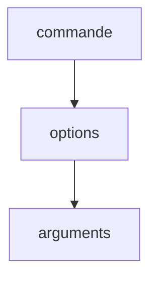

# Bash

> [!info] En une phrase
> Le shell standard de Linux : celui de WSL, des conteneurs, des serveurs et de la CI. Tout y est texte, et les petites commandes s'enchaînent.

```dataviewjs
await dv.view("10 — Templates/Scripts/learning", { view: "concept" })
```

## 1 · Comprendre
### Définition
**Bash** est le shell de presque toutes les distributions Linux. Ses commandes sont de **petits programmes** spécialisés (`ls`, `cp`, `grep`…) qui lisent et écrivent du **texte**, et qu'on combine avec des [[Redirection et pipe|pipes]].

Tu le rencontres dans : **WSL**, **Git Bash** (une version réduite pour Windows), les **conteneurs** (souvent `sh`, un shell plus simple, compatible), les **jobs de CI** et les serveurs.

### Pourquoi ça existe
Piloter Linux, et automatiser avec des [[Script shell|scripts shell]].

### Le problème résolu
Faire en une ligne ce qui demanderait un programme : « les 5 fichiers les plus gros contenant ERROR ».

## 2 · Explorer
### Comment ça fonctionne

Forme : `commande -options arguments`. Options courtes (`-l`, combinables : `-la`) ou longues (`--all`).

| Symbole | Sens |
| --- | --- |
| `~` | ton dossier personnel (`/home/oumar`) |
| `/` | la racine du système |
| `.` / `..` | dossier courant / parent |
| `*` | n'importe quels caractères (`*.png`) |
| `$NOM` | valeur d'une variable |
| `#` | commentaire |

Raccourcis : `Tab` complète, `↑` rappelle la commande précédente, `Ctrl+R` cherche dans l'historique, `Ctrl+C` interrompt, `Ctrl+L` efface l'écran.

### Exemple concret
```bash
pwd                         # où suis-je ?
ls -la                      # tout le contenu, même caché, en détail
cd ~/projets/essai-zip
cat requirements.txt        # afficher un fichier
grep -rn "zipfile" .        # chercher un texte dans le dossier
man ls                      # le manuel (q pour quitter) ; ou ls --help
```

### Cas d'utilisation
- Travailler dans WSL
- Lire et écrire les `script:` de GitLab CI et les `RUN` des Dockerfile
- Entrer dans un conteneur : `docker exec -it nom bash`

> [!warning] À ne pas confondre
> **Bash** (shell complet) et **sh** (shell minimal des petites images comme Alpine) : certaines syntaxes Bash n'existent pas dans `sh`. Et Linux est **sensible à la casse** : `Projets` ≠ `projets`.

## 3 · Pratiquer
- Fais l'[[Exercice - Lire une commande Bash avant de la lancer]], puis la mise en situation [[Exercice - Prendre en main WSL et Bash]].
- Utilise `Ctrl+R` pour retrouver une commande tapée plus tôt.

## 4 · Expliquer
> [!quote] Mon résumé, avec mes mots
> _À écrire sans regarder la fiche. Si je bloque, je ne l'ai pas encore compris._

## 5 · Relier
- **Notion parente** : [[Shell]]
- **Complémentaires** : [[PowerShell]] · [[Redirection et pipe]] · [[Processus]]
- **Utilisé par** : [[Script shell]] · [[Pipeline GitLab CI]] · [[Dockerfile]]
- **Commandes** : [[pwd]] · [[ls]] · [[cd]] · [[cp]] · [[mv]] · [[rm]] · [[cat]] · [[grep]]

## 6 · Réviser
> [!question] Me faire interroger
> Je demande à Claude de m'interroger sur cette notion pour vérifier que je l'ai comprise.

### Validation de la maîtrise
La notion est maîtrisée quand j'ai réussi **tous les exercices** qui l'utilisent (statut `reussi` dans l'exercice).

```dataviewjs
await dv.view("10 — Templates/Scripts/learning", { view: "maitrise" })
```
