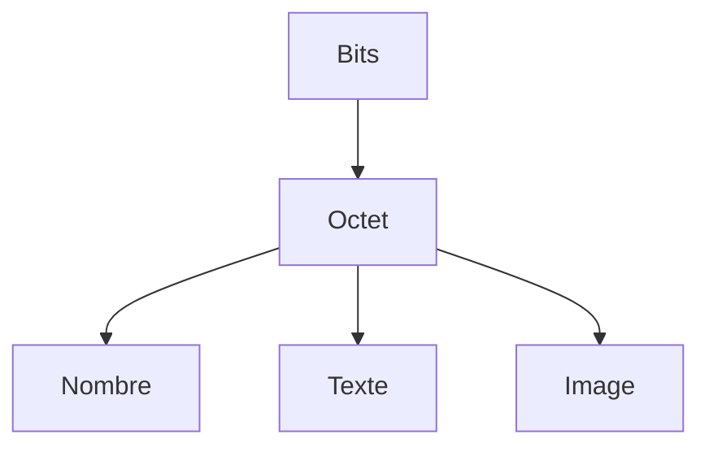

# Binaire et octet

> [!info] En une phrase
> L'ordinateur ne connaît que des 0 et des 1 (bits) ; 8 bits forment un octet, l'unité de base de toutes les tailles (Ko, Mo, Go).

```dataviewjs
await dv.view("10 — Templates/Scripts/learning", { view: "concept" })
```

## 1 · Comprendre
### Définition
Un **bit** vaut 0 ou 1 (courant ou pas). Un **octet** (*byte*) = 8 bits, soit 256 valeurs (0 à 255). Tout est stocké ainsi : nombres, textes, images, programmes. L'**hexadécimal** (base 16 : 0-9 puis a-f) écrit un octet en 2 caractères (`ff` = 255) : on le voit dans les hash Git, les couleurs CSS (`#ff6600`), les adresses mémoire.

| Unité | Taille |
| --- | --- |
| 1 Ko | 1 000 octets (1 Kio = 1 024) |
| 1 Mo | 1 000 Ko |
| 1 Go | 1 000 Mo |

### Pourquoi ça existe
Le matériel électronique sait représenter de façon fiable deux états : allumé / éteint.

### Le problème résolu
Représenter n'importe quelle information avec un seul mécanisme simple et fiable.

## 2 · Explorer
### Comment ça fonctionne

`1011` en binaire = 8 + 0 + 2 + 1 = **11** ; `11111111` = **255**. Le sens d'un octet dépend de **qui le lit** : le même octet peut être un nombre, une lettre ou un pixel.

### Exemple concret
```python
print(bin(11), hex(255), int("ff", 16))   # 0b1011 0xff 255
print(len("é".encode("utf-8")))           # 2 octets
```
```bash
xxd -l 16 image.png     # les 16 premiers octets d'un fichier, en hexadécimal
```

### Cas d'utilisation
- Comprendre les tailles de fichiers, de mémoire, de disque
- Lire un hash de commit, une couleur, des droits Linux (`755` en octal)

> [!warning] À ne pas confondre
> **bit** (b) et **octet** (o, ou B en anglais) : une connexion de 100 **Mb**/s transfère environ 12,5 **Mo**/s.

## 3 · Pratiquer

### Exercice visuel

Sur Excalidraw, **sans regarder la fiche**. Puis je compare avec la fiche, je corrige en rouge ce qui était faux, et j'explique mon dessin à voix haute ou à Claude dans le chat.

> [!example] 🧠 Dessine de mémoire
> Dessine un octet comme 8 cases. Écris dedans le nombre 5, puis le nombre 200, et note sous chaque case ce qu'elle vaut (1, 2, 4…).

> [!example] ⚖️ Avant / après
> Avant / après : à gauche, la lettre « A » telle que tu la vois à l'écran ; à droite, ce qui est vraiment rangé sur le disque. Dessine le passage de l'un à l'autre.

### Mon schéma

> [!tip] Mon dessin Excalidraw
> _Je crée le dessin « Schéma - Binaire et octet » et je l'intègre ici avec `![[Schéma - Binaire et octet.excalidraw]]`, puis je coche `schema`._

### Appliquer dans le fil rouge
- [[Dépenses 00 - Découvrir son poste]]

## 4 · Relier
- **Complémentaires** : [[Encodage des caractères]] · [[Processeur, mémoire et disque]]

## 5 · Réviser
> [!question] Me faire interroger
> Je demande à Claude de m'interroger sur cette notion pour vérifier que je l'ai comprise.

### Validation (compris, puis maîtrisé)
Trois cases à cocher dans les propriétés de la fiche :
- `schema` : mon dessin du concept est dans « Mon schéma » ;
- `exercice_visuel` : j'ai fait et corrigé les exercices visuels de la section 3 ;
- `fil_rouge` : je l'ai appliqué dans le fil rouge (coché tout seul quand une étape qui l'utilise est réussie).

Les trois cochées : la notion compte comme **comprise**. **Maîtrisé** : c'est moi qui le mets dans `status`, quand je le sens.

```dataviewjs
await dv.view("10 — Templates/Scripts/learning", { view: "maitrise" })
```
