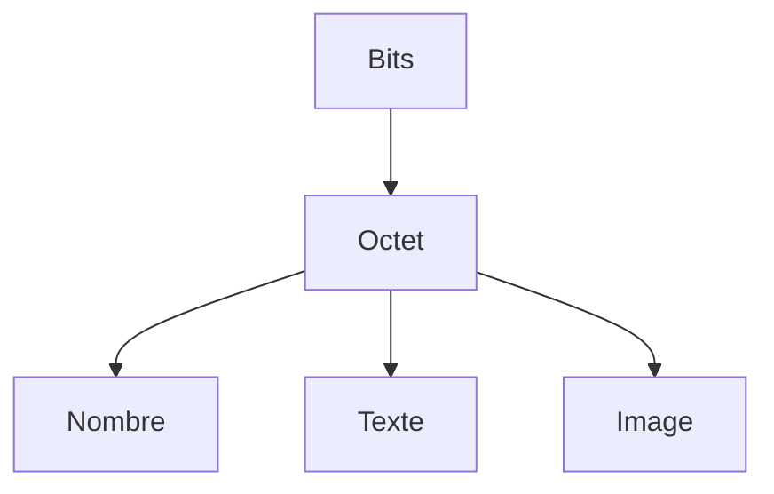

# Binaire et octet

> [!info] En une phrase
> L'ordinateur ne connaît que des 0 et des 1 (bits) ; 8 bits forment un octet, l'unité de base de toutes les tailles (Ko, Mo, Go).

```dataviewjs
await dv.view("10 — Templates/Scripts/learning", { view: "concept" })
```

## 1 · Comprendre
### Définition
Un **bit** vaut 0 ou 1 (courant ou pas). Un **octet** (*byte*) = 8 bits, soit 256 valeurs (0 à 255). Tout est stocké ainsi : nombres, textes, images, programmes. L'**hexadécimal** (base 16 : 0-9 puis a-f) écrit un octet en 2 caractères (`ff` = 255) : on le voit dans les hash Git, les couleurs CSS (`#ff6600`), les adresses mémoire.

| Unité | Taille |
| --- | --- |
| 1 Ko | 1 000 octets (1 Kio = 1 024) |
| 1 Mo | 1 000 Ko |
| 1 Go | 1 000 Mo |

### Pourquoi ça existe
Le matériel électronique sait représenter de façon fiable deux états : allumé / éteint.

### Le problème résolu
Représenter n'importe quelle information avec un seul mécanisme simple et fiable.

## 2 · Explorer
### Comment ça fonctionne

`1011` en binaire = 8 + 0 + 2 + 1 = **11** ; `11111111` = **255**. Le sens d'un octet dépend de **qui le lit** : le même octet peut être un nombre, une lettre ou un pixel.

### Exemple concret
```python
print(bin(11), hex(255), int("ff", 16))   # 0b1011 0xff 255
print(len("é".encode("utf-8")))           # 2 octets
```
```bash
xxd -l 16 image.png     # les 16 premiers octets d'un fichier, en hexadécimal
```

### Cas d'utilisation
- Comprendre les tailles de fichiers, de mémoire, de disque
- Lire un hash de commit, une couleur, des droits Linux (`755` en octal)

> [!warning] À ne pas confondre
> **bit** (b) et **octet** (o, ou B en anglais) : une connexion de 100 **Mb**/s transfère environ 12,5 **Mo**/s.

## 3 · Pratiquer
- Convertis à la main 13, 200 et 255 en binaire, puis vérifie en Python.

## 4 · Expliquer
> [!quote] Mon résumé, avec mes mots
> _À écrire sans regarder la fiche. Si je bloque, je ne l'ai pas encore compris._

## 5 · Relier
- **Complémentaires** : [[Encodage des caractères]] · [[Processeur, mémoire et disque]]

## 6 · Réviser
> [!question] Me faire interroger
> Je demande à Claude de m'interroger sur cette notion pour vérifier que je l'ai comprise.

### Validation de la maîtrise
La notion est maîtrisée quand j'ai réussi **tous les exercices** qui l'utilisent (statut `reussi` dans l'exercice).

```dataviewjs
await dv.view("10 — Templates/Scripts/learning", { view: "maitrise" })
```
