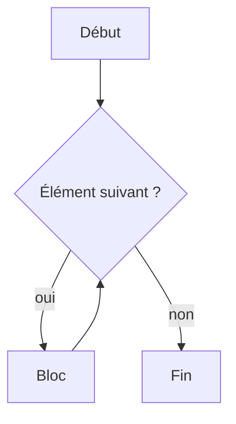

# Boucle (for, while)

> [!info] En une phrase
> Répéter un bloc de code : pour chaque élément d'une collection (for), ou tant qu'une condition est vraie (while).

```dataviewjs
await dv.view("10 — Templates/Scripts/learning", { view: "concept" })
```

## 1 · Comprendre
### Définition
- `for element in collection:` exécute le bloc **une fois par élément** (chaque fichier d'un dossier, chaque ligne d'un texte).
- `while condition:` répète **tant que** la condition est vraie.
- `break` sort de la boucle, `continue` passe directement au tour suivant.

### Pourquoi ça existe
Traiter 3 ou 3 000 fichiers avec le même code.

### Le problème résolu
Sans boucle, il faudrait écrire une ligne par fichier, et le code ne marcherait que pour un nombre fixe de fichiers.

## 2 · Explorer
### Comment ça fonctionne


### Exemple concret
```python
fichiers = ["a.png", "b.txt", "c.png"]

for nom in fichiers:
    if not nom.endswith(".png"):
        continue                 # on saute les non-images
    print("Traitement de", nom)

for i in range(3):               # 0, 1, 2
    print("Essai", i)

essais = 0
while essais < 3:
    essais += 1                  # sinon la boucle ne s'arrête jamais
```

### Cas d'utilisation
- Parcourir les fichiers d'un dossier (`for f in dossier.iterdir():`, voir [[Chemin de fichier en Python (pathlib)]])
- Réessayer une opération quelques fois

> [!warning] À ne pas confondre
> `for` (on connaît la collection) et `while` (on s'arrête sur une condition). Un `while` dont la condition ne devient jamais fausse tourne **à l'infini** : `Ctrl+C` pour l'arrêter.

## 3 · Pratiquer

### Exercice visuel

Sur Excalidraw, **sans regarder la fiche**. Puis je compare avec la fiche, je corrige en rouge ce qui était faux, et j'explique mon dessin avec mes mots (section 4).

> [!example] 🧠 Dessine de mémoire
> Dessine une boucle `for` sur une liste de 4 dépenses comme un tourniquet : la variable à chaque tour, ce qui se passe dedans.

> [!example] 🔍 Trouve l'erreur
> Ce schéma est faux. Corrige-le en rouge et explique l'erreur.
>
> ```mermaid
> flowchart TD
>   W[while i inf 3] --> P[print i]
>   P --> W
> ```

### Mon schéma

> [!tip] Mon dessin Excalidraw
> _Je crée le dessin « Schéma - Boucle (for, while) » et je l'intègre ici avec `![[Schéma - Boucle (for, while).excalidraw]]`._

### Appliquer dans le fil rouge
- [[Dépenses 02 - Classer les dépenses]]

## 4 · Expliquer
> [!quote] Mon résumé, avec mes mots
> _J'explique mon schéma avec mes mots, sans regarder la fiche. Si je bloque, je ne l'ai pas encore compris._

## 5 · Relier
- **Prérequis** : [[Condition (if)]]
- **Complémentaires** : [[Liste et dictionnaire]]
- **Utilisé par** : [[Chemin de fichier en Python (pathlib)]] · [[Archive zip (zipfile)]]

## 6 · Réviser
> [!question] Me faire interroger
> Je demande à Claude de m'interroger sur cette notion pour vérifier que je l'ai comprise.

### Validation de la maîtrise
La notion est maîtrisée quand je sais :
1. **l'expliquer** de façon fluide, à partir de mon schéma (section 4) ;
2. **l'adapter** à un autre contexte (consigne « Change de contexte », ou Claude m'interroge sur un autre cas) ;
3. **l'appliquer** pour de vrai dans le fil rouge (section 3).

Réussir un exercice ne suffit pas. C'est moi qui passe le statut en `maitrise`.

```dataviewjs
await dv.view("10 — Templates/Scripts/learning", { view: "maitrise" })
```
