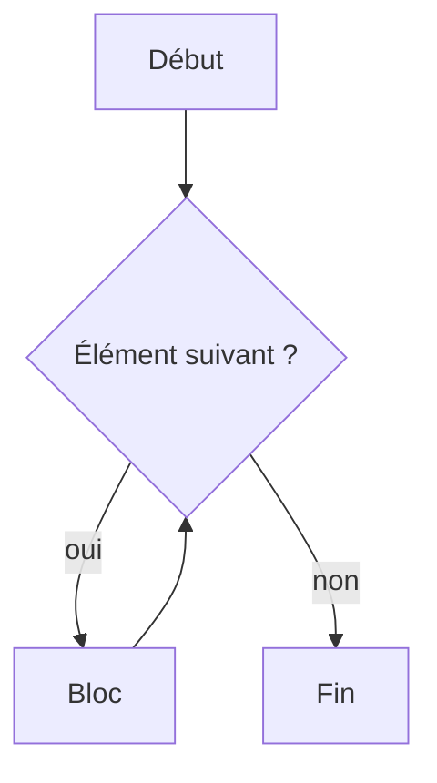

# Boucle (for, while)

> [!info] En une phrase
> Répéter un bloc de code : pour chaque élément d'une collection (for), ou tant qu'une condition est vraie (while).

```dataviewjs
await dv.view("10 — Templates/Scripts/learning", { view: "concept" })
```

## 1 · Comprendre
### Définition
- `for element in collection:` exécute le bloc **une fois par élément** (chaque fichier d'un dossier, chaque ligne d'un texte).
- `while condition:` répète **tant que** la condition est vraie.
- `break` sort de la boucle, `continue` passe directement au tour suivant.

### Pourquoi ça existe
Traiter 3 ou 3 000 fichiers avec le même code.

### Le problème résolu
Sans boucle, il faudrait écrire une ligne par fichier, et le code ne marcherait que pour un nombre fixe de fichiers.

## 2 · Explorer
### Comment ça fonctionne


### Exemple concret
```python
fichiers = ["a.png", "b.txt", "c.png"]

for nom in fichiers:
    if not nom.endswith(".png"):
        continue                 # on saute les non-images
    print("Traitement de", nom)

for i in range(3):               # 0, 1, 2
    print("Essai", i)

essais = 0
while essais < 3:
    essais += 1                  # sinon la boucle ne s'arrête jamais
```

### Cas d'utilisation
- Parcourir les fichiers d'un dossier (`for f in dossier.iterdir():`, voir [[Chemin de fichier en Python (pathlib)]])
- Réessayer une opération quelques fois

> [!warning] À ne pas confondre
> `for` (on connaît la collection) et `while` (on s'arrête sur une condition). Un `while` dont la condition ne devient jamais fausse tourne **à l'infini** : `Ctrl+C` pour l'arrêter.

## 3 · Pratiquer
- Parcours une liste de noms de fichiers et compte combien finissent par `.png`.
- Avec `range`, affiche les nombres de 1 à 10.

## 4 · Expliquer
> [!quote] Mon résumé, avec mes mots
> _À écrire sans regarder la fiche. Si je bloque, je ne l'ai pas encore compris._

## 5 · Relier
- **Prérequis** : [[Condition (if)]]
- **Complémentaires** : [[Liste et dictionnaire]]
- **Utilisé par** : [[Chemin de fichier en Python (pathlib)]] · [[Archive zip (zipfile)]]

## 6 · Réviser
> [!question] Me faire interroger
> Je demande à Claude de m'interroger sur cette notion pour vérifier que je l'ai comprise.

### Validation de la maîtrise
La notion est maîtrisée quand j'ai réussi **tous les exercices** qui l'utilisent (statut `reussi` dans l'exercice).

```dataviewjs
await dv.view("10 — Templates/Scripts/learning", { view: "maitrise" })
```
