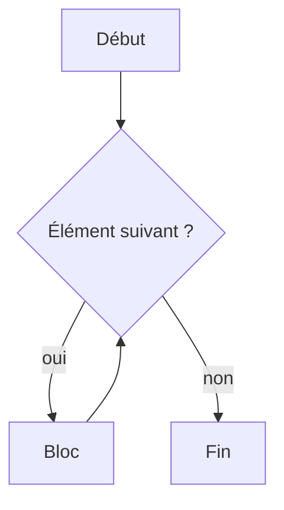

# Boucle (for, while)

> [!info] En une phrase
> Répéter un bloc de code : pour chaque élément d'une collection (for), ou tant qu'une condition est vraie (while).

## 1 · Comprendre
### Définition
- `for element in collection:` exécute le bloc **une fois par élément** (chaque fichier d'un dossier, chaque ligne d'un texte).
- `while condition:` répète **tant que** la condition est vraie.
- `break` sort de la boucle, `continue` passe directement au tour suivant.

### Pourquoi ça existe
Traiter 3 ou 3 000 fichiers avec le même code.

### Le problème résolu
Sans boucle, il faudrait écrire une ligne par fichier, et le code ne marcherait que pour un nombre fixe de fichiers.

## 2 · Explorer
### Comment ça fonctionne


### Exemple concret
```python
fichiers = ["a.png", "b.txt", "c.png"]

for nom in fichiers:
    if not nom.endswith(".png"):
        continue                 # on saute les non-images
    print("Traitement de", nom)

for i in range(3):               # 0, 1, 2
    print("Essai", i)

essais = 0
while essais < 3:
    essais += 1                  # sinon la boucle ne s'arrête jamais
```

> [!abstract]- Comment ça s'écrit (référence à chercher, pas à apprendre par cœur)
> L'idée est la même partout ; seule l'écriture change.
>
> **Python**
> ```python
> for d in depenses:
>     print(d["montant"])
> for i in range(3):
>     print(i)
> while essais < 3:
>     essais += 1
> ```
>
> **JavaScript / TypeScript**
> ```js
> for (const d of depenses) {
>   console.log(d.montant);
> }
> for (let i = 0; i < 3; i++) { console.log(i); }
> while (essais < 3) { essais++; }
> depenses.forEach((d) => console.log(d.montant));
> ```
> `for … of` parcourt les **valeurs** ; `for … in` parcourt les **clés** (piège classique).
>
> **Bash**
> ```bash
> for f in *.txt; do
>   echo "$f"
> done
> while read -r ligne; do
>   echo "$ligne"
> done < depenses.csv
> ```
>
> **C# (.NET)**
> ```csharp
> foreach (var d in depenses)
> {
>     Console.WriteLine(d.Libelle);
> }
> for (int i = 0; i < 10; i++) { }
> while (!fini) { }
> ```
> `foreach` est le plus courant, comme le `for … in` de Python. Pour filtrer ou transformer une liste, on utilise plutôt LINQ (voir [[Motifs de boucle]]).

### Cas d'utilisation
- Parcourir les fichiers d'un dossier (`for f in dossier.iterdir():`, voir [[Chemin de fichier]])
- Réessayer une opération quelques fois

> [!warning] À ne pas confondre
> `for` (on connaît la collection) et `while` (on s'arrête sur une condition). Un `while` dont la condition ne devient jamais fausse tourne **à l'infini** : `Ctrl+C` pour l'arrêter.

## 3 · Relier
- **Prérequis** : [[Condition (if)]]
- **Complémentaires** : [[Liste et dictionnaire]]
- **Utilisé par** : [[Chemin de fichier]] · [[Archive zip (zipfile)]]
