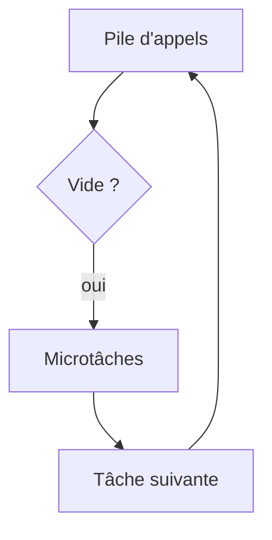

# Boucle d'événements

> [!info] En une phrase
> Le mécanisme qui permet à JavaScript, qui n'a qu'un seul fil d'exécution, de gérer beaucoup d'opérations en attente : il exécute une tâche, puis la suivante dans la file.

```dataviewjs
await dv.view("10 — Templates/Scripts/learning", { view: "concept" })
```

## 1 · Comprendre
### Définition
JavaScript a **une seule pile d'appels**. Les opérations lentes (réseau, minuterie, disque) sont confiées au navigateur ou à Node. Quand elles finissent, leur callback est mis dans une **file d'attente**. La **boucle d'événements** prend le callback suivant dès que la pile est vide.
- Les **microtâches** (Promesses) passent avant les **tâches** (`setTimeout`, événements).
- Une longue boucle de calcul **bloque tout** : plus de clics, plus d'affichage.

### Pourquoi ça existe
Avoir de la concurrence (beaucoup de choses en attente à la fois) sans la complexité des fils multiples.

### Le problème résolu
Comprendre pourquoi le code asynchrone s'exécute « plus tard » et pourquoi un calcul lourd fige la page ou le serveur Node.

## 2 · Explorer
### Comment ça fonctionne


### Exemple concret
```js
console.log("A");
setTimeout(() => console.log("tâche"), 0);
Promise.resolve().then(() => console.log("microtâche"));
console.log("B");
// A, B, microtâche, tâche
```
Un serveur [[Node.js]] gère des milliers de connexions avec ce seul fil, tant qu'aucune requête ne fait de gros calcul synchrone.

### Cas d'utilisation
- Comprendre l'ordre d'exécution
- Diagnostiquer une page qui gèle
- Comprendre les performances de Node.js

> [!warning] À ne pas confondre
> **Asynchrone** n'est pas **parallèle** : rien ne s'exécute en même temps dans ton code JS, les attentes se recouvrent seulement.

## 3 · Pratiquer
- Écris une boucle qui calcule pendant 3 secondes après un clic et observe que la page ne répond plus

## 4 · Expliquer
> [!quote] Mon résumé, avec mes mots
> _À écrire sans regarder la fiche. Si je bloque, je ne l'ai pas encore compris._

## 5 · Relier
- **Prérequis** : [[Asynchrone et Promesse]]
- **Complémentaires** : [[Node.js]] · [[Processus]]

## 6 · Réviser
> [!question] Me faire interroger
> Je demande à Claude de m'interroger sur cette notion pour vérifier que je l'ai comprise.

### Validation de la maîtrise
La notion est maîtrisée quand j'ai réussi **tous les exercices** qui l'utilisent (statut `reussi` dans l'exercice).

```dataviewjs
await dv.view("10 — Templates/Scripts/learning", { view: "maitrise" })
```
