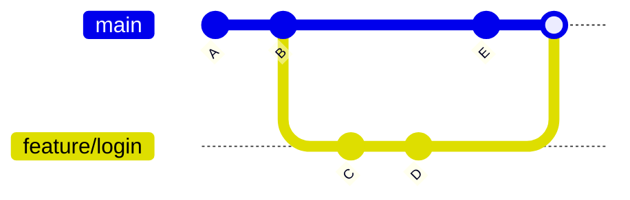

# Branche Git

> [!info] En une phrase
> Une ligne de développement parallèle : tu travailles sur une fonctionnalité sans toucher à la version principale.

```dataviewjs
await dv.view("10 — Templates/Scripts/learning", { view: "concept" })
```

## 1 · Comprendre
### Définition
Une **branche** est simplement un **pointeur mobile vers un commit**. La branche principale s'appelle souvent `main`. `HEAD` indique la branche sur laquelle tu te trouves.

### Pourquoi ça existe
Pour isoler un travail en cours (une fonctionnalité, une correction) et ne l'intégrer qu'une fois prêt.

### Le problème résolu
Sans branches, tout le monde modifie la même ligne d'historique : un travail à moitié fini casse le projet de tous.

## 2 · Explorer
### Comment ça fonctionne

- Créer une branche ne copie aucun fichier : c'est quasi instantané.
- Quand tu commits, seule la branche courante avance.

### Exemple concret
```bash
git switch -c feature/login   # créer et aller sur la branche
# ... modifications ...
git commit -am "Formulaire de login"
git switch main
git merge feature/login
```

### Cas d'utilisation
- Une branche par fonctionnalité (`feature/...`) ou correction (`fix/...`)
- Expérimenter sans risque
- Préparer une pull request / merge request

> [!warning] À ne pas confondre
> **Branche** et **copie du projet** : une branche ne duplique rien, elle pointe juste vers un commit.

## 3 · Pratiquer

### Exercice visuel

Sur Excalidraw, **sans regarder la fiche**. Puis je compare avec la fiche, je corrige en rouge ce qui était faux, et j'explique mon dessin avec mes mots (section 4).

> [!example] 🧠 Dessine de mémoire
> Dessine un historique avec `main` et une branche `feature/cors`. Place les commits et le pointeur HEAD.

> [!example] ⚖️ Avant / après
> Avant / après : l'historique avant de créer la branche, puis après deux commits dessus. Qu'est-ce qui a bougé ?

### Mon schéma

> [!tip] Mon dessin Excalidraw
> _Je crée le dessin « Schéma - Branche Git » et je l'intègre ici avec `![[Schéma - Branche Git.excalidraw]]`._

### Appliquer dans le fil rouge
- Pas encore d'étape du fil rouge pour cette notion : je l'applique dans mon travail (CVAT, Nuclio) ou je demande une étape à Claude.

## 4 · Expliquer
> [!quote] Mon résumé, avec mes mots
> _J'explique mon schéma avec mes mots, sans regarder la fiche. Si je bloque, je ne l'ai pas encore compris._

## 5 · Relier
- **Prérequis** : [[Commit]]
- **Notion parente** : [[Git]]
- **Mène à** : [[Merge]] → [[Conflit de merge]]
- **Commandes** : [[git branch]] · [[git switch]] · [[git merge]]
- **Cours** : [[Cours - Branches et fusion]]

## 6 · Réviser
> [!question] Me faire interroger
> Je demande à Claude de m'interroger sur cette notion pour vérifier que je l'ai comprise.

### Validation de la maîtrise
La notion est maîtrisée quand je sais :
1. **l'expliquer** de façon fluide, à partir de mon schéma (section 4) ;
2. **l'adapter** à un autre contexte (consigne « Change de contexte », ou Claude m'interroge sur un autre cas) ;
3. **l'appliquer** pour de vrai dans le fil rouge (section 3).

Réussir un exercice ne suffit pas. C'est moi qui passe le statut en `maitrise`.

```dataviewjs
await dv.view("10 — Templates/Scripts/learning", { view: "maitrise" })
```
