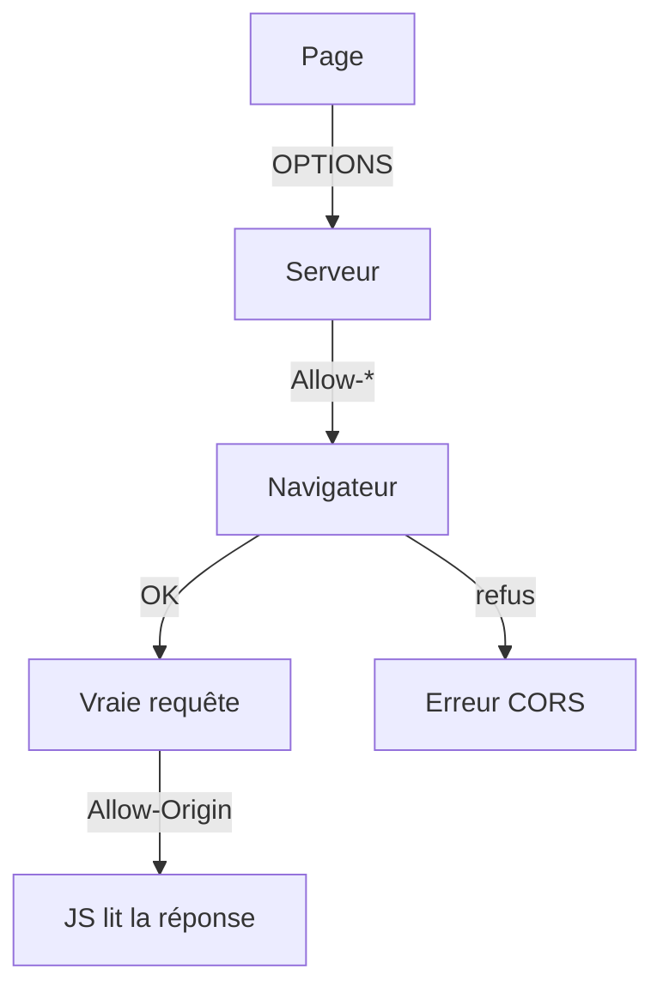

# CORS

> [!info] En une phrase
> CORS est la règle du navigateur qui bloque, par défaut, la lecture d'une réponse venant d'un autre site que la page ; le serveur peut l'autoriser avec des en-têtes Access-Control-Allow-*.

```dataviewjs
await dv.view("10 — Templates/Scripts/learning", { view: "concept" })
```

## 1 · Comprendre
### Définition
L'**origine** d'une page = protocole + domaine + port. `http://localhost:8080` et `http://localhost:32001` sont **deux origines différentes** : seul le port change, et ça suffit.

Par sécurité (*same-origin policy*), le JavaScript d'une page ne peut pas **lire** la réponse d'une autre origine… sauf si ce serveur l'autorise avec des en-têtes `Access-Control-Allow-*`.

### Requête simple ou non simple
Le navigateur trie les requêtes en deux familles :

| | Requête **simple** | Requête **non simple** |
|---|---|---|
| Méthode | `GET`, `HEAD`, `POST` | `PUT`, `PATCH`, `DELETE`… |
| `Content-Type` | `text/plain`, `multipart/form-data`, `application/x-www-form-urlencoded` | `application/json`, ou autre |
| En-têtes ajoutés | aucun en-tête « spécial » | `Authorization`, `X-CSRFToken`, `X-…` |
| Ce que fait le navigateur | envoie la requête **directement** | envoie d'abord un **preflight** `OPTIONS` |

Il suffit d'**un** critère « non simple » : un `POST` avec `Content-Type: application/json` déclenche un preflight.

### Le preflight (requête préliminaire)
Avant la vraie requête, le navigateur demande la permission :
```
OPTIONS /                                    ← envoyé par le navigateur, pas par ton code
Origin: http://localhost:8080
Access-Control-Request-Method: POST
Access-Control-Request-Headers: content-type
```
Le serveur doit répondre (souvent `204`, sans corps) :
```
Access-Control-Allow-Origin: http://localhost:8080
Access-Control-Allow-Methods: POST, OPTIONS
Access-Control-Allow-Headers: Content-Type
Access-Control-Max-Age: 600                  ← (facultatif) le navigateur s'en souvient 10 min
```
Si la réponse convient, la vraie requête part. Puis la **vraie réponse** doit, elle aussi, contenir `Access-Control-Allow-Origin`, sinon le navigateur cache son contenu au JavaScript.

### `*` ou l'origine exacte
- `Access-Control-Allow-Origin: *` : n'importe quelle page peut lire la réponse. Simple, mais **interdit avec les cookies** : si le `fetch` utilise `credentials: "include"`, le navigateur refuse `*`.
- `Access-Control-Allow-Origin: http://localhost:8080` : une seule origine. Une seule valeur par réponse : pour en autoriser plusieurs, le serveur compare l'en-tête `Origin` à sa liste et **renvoie celle-là** (avec `Vary: Origin`).
- Avec des cookies, il faut en plus `Access-Control-Allow-Credentials: true`.

### Pourquoi ça existe
Sans cette règle, un site malveillant ouvert dans ton navigateur pourrait appeler les API où tu es connecté et lire tes données.

### Le problème résolu
Protéger l'utilisateur tout en permettant à une page (`localhost:8080`) d'appeler un autre service (`localhost:32001`) de façon contrôlée.

## 2 · Explorer
### Comment ça fonctionne


### Cas d'utilisation
- Frontend et backend sur des ports différents en développement

> [!warning] À ne pas confondre
> - CORS est appliqué **par le navigateur** : curl, Python ou Postman ne sont pas concernés. Ce n'est donc pas une protection du serveur : la requête **arrive** au serveur, c'est la lecture de la réponse qui est bloquée.
> - **CORS et [[CSRF]]** : CORS décide si une page peut **lire** une réponse d'ailleurs ; CSRF est une attaque où une page **envoie** une requête avec tes cookies. CORS ne protège pas du CSRF.
> - **CORS et [[Reverse proxy]]** : si la page et le service passent par la même adresse (même origine), il n'y a plus de CORS du tout.

> [!note] CORS, API, API REST
> L'[[API]] (REST ou non) est ce qu'on appelle. CORS ne change rien à l'API : c'est le **navigateur** qui vérifie si la page a le droit de lire sa réponse. Une API REST parfaite peut quand même être bloquée par CORS si elle n'envoie pas `Access-Control-Allow-Origin`.

## 3 · Pratiquer

### Exercice visuel

Sur Excalidraw, **sans regarder la fiche**. Puis je compare avec la fiche, je corrige en rouge ce qui était faux, et j'explique mon dessin à voix haute ou à Claude dans le chat.

> [!example] 🛣️ Suis le trajet
> Ton front Vue (5173) appelle ton API (8000) et se fait bloquer. Dessine la requête, le preflight OPTIONS, la réponse, et l'endroit où le navigateur bloque.

> [!example] 🔄 Change de contexte
> Redessine le même trajet quand le front et l'API passent par un même nginx (même origine). Où est passé le problème ?

### Mon schéma

> [!tip] Mon dessin Excalidraw
> _Je crée le dessin « Schéma - CORS » et je l'intègre ici avec `![[Schéma - CORS.excalidraw]]`, puis je coche `schema`._

### Appliquer dans le fil rouge
- [[MesDépenses Front 02 - Régler CORS]]
- [[MesDépenses Front 03 - Vue, ajouter et supprimer]]
- [[MesDépenses Front 10 - Angular dans compose]]
- [[MesDépenses 12 - Derrière nginx, avec une petite page]]

## 4 · Relier
- **Au travail** : [CORS au travail](obsidian://open?vault=Travail&file=CORS%20au%20travail)
- **Prérequis** : [[En-tête HTTP]] · [[Appeler une API HTTP]]
- **Complémentaires** : [[Reverse proxy]] · [[Middleware]] · [[API]] · [[API REST]] · [[CSRF]] · [[Serverless et FaaS]]

## 5 · Réviser
> [!question] Me faire interroger
> Je demande à Claude de m'interroger sur cette notion pour vérifier que je l'ai comprise.

### Validation (compris, puis maîtrisé)
Trois cases à cocher dans les propriétés de la fiche :
- `schema` : mon dessin du concept est dans « Mon schéma » ;
- `exercice_visuel` : j'ai fait et corrigé les exercices visuels de la section 3 ;
- `fil_rouge` : je l'ai appliqué dans le fil rouge (coché tout seul quand une étape qui l'utilise est réussie).

Les trois cochées : la notion compte comme **comprise**. **Maîtrisé** : c'est moi qui le mets dans `status`, quand je le sens.

```dataviewjs
await dv.view("10 — Templates/Scripts/learning", { view: "maitrise" })
```
