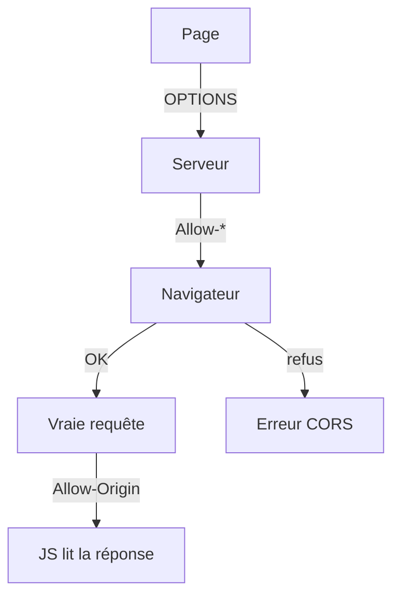

# CORS

> [!info] En une phrase
> CORS est la règle du navigateur qui bloque, par défaut, la lecture d'une réponse venant d'un autre site que la page ; le serveur peut l'autoriser avec des en-têtes Access-Control-Allow-*.

```dataviewjs
await dv.view("10 — Templates/Scripts/learning", { view: "concept" })
```

## 1 · Comprendre
### Définition
L'**origine** d'une page = protocole + domaine + port. `http://localhost:8080` et `http://localhost:32001` sont **deux origines différentes** : seul le port change, et ça suffit.

Par sécurité (*same-origin policy*), le JavaScript d'une page ne peut pas **lire** la réponse d'une autre origine… sauf si ce serveur l'autorise avec des en-têtes `Access-Control-Allow-*`.

### Requête simple ou non simple
Le navigateur trie les requêtes en deux familles :

| | Requête **simple** | Requête **non simple** |
|---|---|---|
| Méthode | `GET`, `HEAD`, `POST` | `PUT`, `PATCH`, `DELETE`… |
| `Content-Type` | `text/plain`, `multipart/form-data`, `application/x-www-form-urlencoded` | `application/json`, ou autre |
| En-têtes ajoutés | aucun en-tête « spécial » | `Authorization`, `X-CSRFToken`, `X-…` |
| Ce que fait le navigateur | envoie la requête **directement** | envoie d'abord un **preflight** `OPTIONS` |

Il suffit d'**un** critère « non simple » : un `POST` avec `Content-Type: application/json` déclenche un preflight.

### Le preflight (requête préliminaire)
Avant la vraie requête, le navigateur demande la permission :
```
OPTIONS /                                    ← envoyé par le navigateur, pas par ton code
Origin: http://localhost:8080
Access-Control-Request-Method: POST
Access-Control-Request-Headers: content-type
```
Le serveur doit répondre (souvent `204`, sans corps) :
```
Access-Control-Allow-Origin: http://localhost:8080
Access-Control-Allow-Methods: POST, OPTIONS
Access-Control-Allow-Headers: Content-Type
Access-Control-Max-Age: 600                  ← (facultatif) le navigateur s'en souvient 10 min
```
Si la réponse convient, la vraie requête part. Puis la **vraie réponse** doit, elle aussi, contenir `Access-Control-Allow-Origin`, sinon le navigateur cache son contenu au JavaScript.

### `*` ou l'origine exacte
- `Access-Control-Allow-Origin: *` : n'importe quelle page peut lire la réponse. Simple, mais **interdit avec les cookies** : si le `fetch` utilise `credentials: "include"`, le navigateur refuse `*`.
- `Access-Control-Allow-Origin: http://localhost:8080` : une seule origine. Une seule valeur par réponse : pour en autoriser plusieurs, le serveur compare l'en-tête `Origin` à sa liste et **renvoie celle-là** (avec `Vary: Origin`).
- Avec des cookies, il faut en plus `Access-Control-Allow-Credentials: true`.

### Pourquoi ça existe
Sans cette règle, un site malveillant ouvert dans ton navigateur pourrait appeler les API où tu es connecté et lire tes données.

### Le problème résolu
Protéger l'utilisateur tout en permettant à une page (`localhost:8080`) d'appeler un autre service (`localhost:32001`) de façon contrôlée.

## 2 · Explorer
### Comment ça fonctionne


### Exemple concret : une fonction Nuclio
Le bouton est dans la page CVAT (`localhost:8080`), la fonction écoute sur `localhost:32001` : autre origine. Le bouton envoie du JSON : preflight. Deux façons de répondre.

**1. À la main, dans le handler**, avec `context.Response(headers=…)` :
```python
CORS = {
    "Access-Control-Allow-Origin": "http://localhost:8080",
    "Access-Control-Allow-Methods": "POST, OPTIONS",
    "Access-Control-Allow-Headers": "Content-Type",
}

def handler(context, event):
    if event.method == "OPTIONS":                       # le preflight : on dit juste « oui »
        return context.Response(body="", headers=CORS, status_code=204)
    ...
    return context.Response(body=png, headers=CORS, content_type="image/png", status_code=200)
```
Les en-têtes doivent être sur **toutes** les réponses, y compris les erreurs (`400`, `500`). Sinon, le navigateur affiche une « erreur CORS » qui cache la vraie erreur.

**2. Par Nuclio, dans `function.yaml`** : le déclencheur HTTP sait gérer CORS tout seul.
```yaml
triggers:
  myHttpTrigger:
    kind: http
    attributes:
      cors:
        enabled: true
        allowOrigins: ["http://localhost:8080"]
```
Nuclio répond lui-même au preflight (ta fonction ne voit **plus jamais** de `OPTIONS`) et ajoute `Access-Control-Allow-Origin` aux réponses. Par défaut, il autorise toutes les origines et les en-têtes `Accept`, `Content-Length`, `Content-Type`, `Authorization`.

> [!warning] Piège de l'option 2
> Avec `cors.enabled`, Nuclio **refuse toute requête sans en-tête `Origin`** (vu dans son code). Le navigateur en envoie un pour tout appel venant d'une autre origine, mais curl et Python n'en envoient pas : pour tester à la main, ajoute `-H "Origin: http://localhost:8080"`. Choisis une seule des deux options : les mélanger rend difficile de savoir qui envoie quoi.

> [!tip] Lire une erreur CORS
> Dans les outils du navigateur, onglet **Réseau** : regarde d'abord s'il y a une ligne `OPTIONS` (preflight) et son statut, puis les en-têtes de réponse de la vraie requête. curl ne voit jamais d'erreur CORS : si curl marche et le navigateur non, c'est presque toujours un en-tête manquant.

### Cas d'utilisation
- Le bouton CVAT qui appelle ta fonction `convert-png`
- L'interface CVAT en mode dev (`localhost:3000`) qui parle au serveur (`localhost:8080`) : CVAT règle `CORS_ORIGIN_WHITELIST` avec `django-cors-headers`
- Frontend et backend sur des ports différents en développement

> [!warning] À ne pas confondre
> - CORS est appliqué **par le navigateur** : curl, Python ou Postman ne sont pas concernés. Ce n'est donc pas une protection du serveur : la requête **arrive** au serveur, c'est la lecture de la réponse qui est bloquée.
> - **CORS et [[CSRF]]** : CORS décide si une page peut **lire** une réponse d'ailleurs ; CSRF est une attaque où une page **envoie** une requête avec tes cookies. CORS ne protège pas du CSRF.
> - **CORS et [[Reverse proxy]]** : si la page et le service passent par la même adresse (même origine), il n'y a plus de CORS du tout.

> [!note] CORS, API, API REST
> L'[[API]] (REST ou non) est ce qu'on appelle. CORS ne change rien à l'API : c'est le **navigateur** qui vérifie si la page a le droit de lire sa réponse. Une API REST parfaite peut quand même être bloquée par CORS si elle n'envoie pas `Access-Control-Allow-Origin`.

## 3 · Pratiquer
- [[Exercice - Une page qui appelle un autre serveur]]
- [[Exercice - Distinguer API, API REST et CORS]]
- [[Exercice - Rendre une API robuste]]

## 4 · Expliquer
> [!quote] Mon résumé, avec mes mots
> _À écrire sans regarder la fiche. Si je bloque, je ne l'ai pas encore compris._

## 5 · Relier
- **Prérequis** : [[En-tête HTTP]] · [[Appeler une API avec fetch]]
- **Complémentaires** : [[Reverse proxy]] · [[Middleware]] · [[API]] · [[API REST]] · [[CSRF]] · [[Serverless et FaaS]]

## 6 · Réviser
> [!question] Me faire interroger
> Je demande à Claude de m'interroger sur cette notion pour vérifier que je l'ai comprise.

### Validation de la maîtrise
La notion est maîtrisée quand j'ai réussi **tous les exercices** qui l'utilisent (statut `reussi` dans l'exercice).

```dataviewjs
await dv.view("10 — Templates/Scripts/learning", { view: "maitrise" })
```
