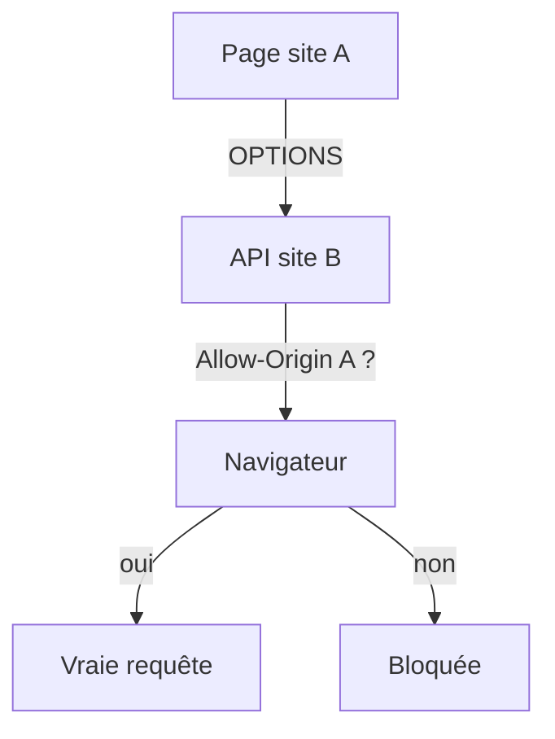

# CORS

> [!info] En une phrase
> CORS est la règle du navigateur qui bloque, par défaut, la lecture d'une réponse venant d'un autre site que la page ; le serveur peut l'autoriser avec des en-têtes Access-Control-Allow-*.

```dataviewjs
await dv.view("10 — Templates/Scripts/learning", { view: "concept" })
```

## 1 · Comprendre
### Définition
L'**origine** d'une page = protocole + domaine + port (`https://app.exemple.com:443`). Par sécurité (*same-origin policy*), le JavaScript d'une page ne peut pas lire les réponses d'une **autre origine**… sauf si ce serveur l'autorise :
```
Access-Control-Allow-Origin: https://app.exemple.com
Access-Control-Allow-Methods: GET, POST, PATCH
Access-Control-Allow-Headers: Content-Type, Authorization
Access-Control-Allow-Credentials: true
```
Pour une requête « non simple » (JSON, en-tête `Authorization`, PATCH…), le navigateur envoie d'abord une requête **préliminaire** `OPTIONS` (*preflight*) pour demander la permission.

### Pourquoi ça existe
Sans cette règle, un site malveillant ouvert dans ton navigateur pourrait appeler les API où tu es connecté et lire tes données.

### Le problème résolu
Protéger l'utilisateur tout en permettant à un frontend (`localhost:5173`) d'appeler son API (`localhost:3000`) de façon contrôlée.

## 2 · Explorer
### Comment ça fonctionne


### Exemple concret
Erreur typique dans la console :
```
Access to fetch at 'http://localhost:3000/api' from origin 'http://localhost:5173'
has been blocked by CORS policy: No 'Access-Control-Allow-Origin' header is present.
```
Correction **côté serveur** (Express) :
```js
import cors from "cors";
app.use(cors({ origin: "http://localhost:5173" }));
```
Ou faire passer les appels par le même domaine (proxy de Vite en développement, [[Reverse proxy]] en production).

### Cas d'utilisation
- Frontend et backend sur des ports différents en développement
- Appeler l'API de CVAT depuis une autre page
- Comprendre pourquoi curl marche alors que le navigateur bloque

> [!warning] À ne pas confondre
> CORS est appliqué **par le navigateur** : curl, Python ou Postman ne sont pas concernés. Ce n'est donc pas une protection du serveur. Et `Access-Control-Allow-Origin: *` ne fonctionne pas avec des cookies.

## 3 · Pratiquer
- Lance une petite API sur le port 3000 et appelle-la depuis une page sur le port 5173 : observe l'erreur, puis corrige-la

## 4 · Expliquer
> [!quote] Mon résumé, avec mes mots
> _À écrire sans regarder la fiche. Si je bloque, je ne l'ai pas encore compris._

## 5 · Relier
- **Prérequis** : [[En-tête HTTP]] · [[Appeler une API avec fetch]]
- **Complémentaires** : [[Reverse proxy]] · [[Middleware]]

## 6 · Réviser
> [!question] Me faire interroger
> Je demande à Claude de m'interroger sur cette notion pour vérifier que je l'ai comprise.

### Validation de la maîtrise
La notion est maîtrisée quand j'ai réussi **tous les exercices** qui l'utilisent (statut `reussi` dans l'exercice).

```dataviewjs
await dv.view("10 — Templates/Scripts/learning", { view: "maitrise" })
```
