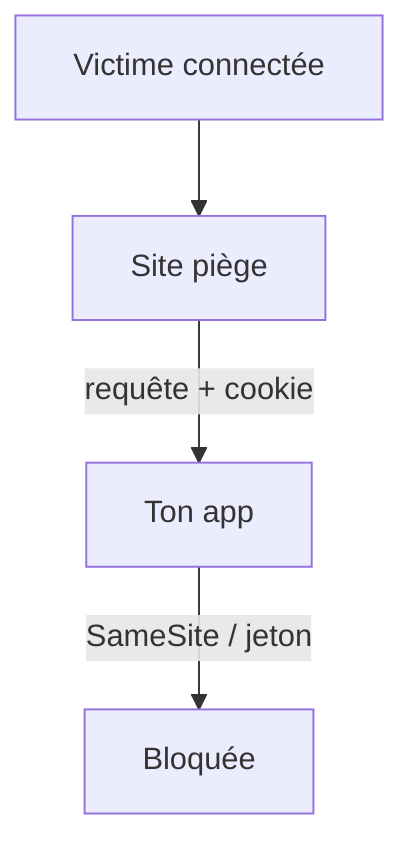
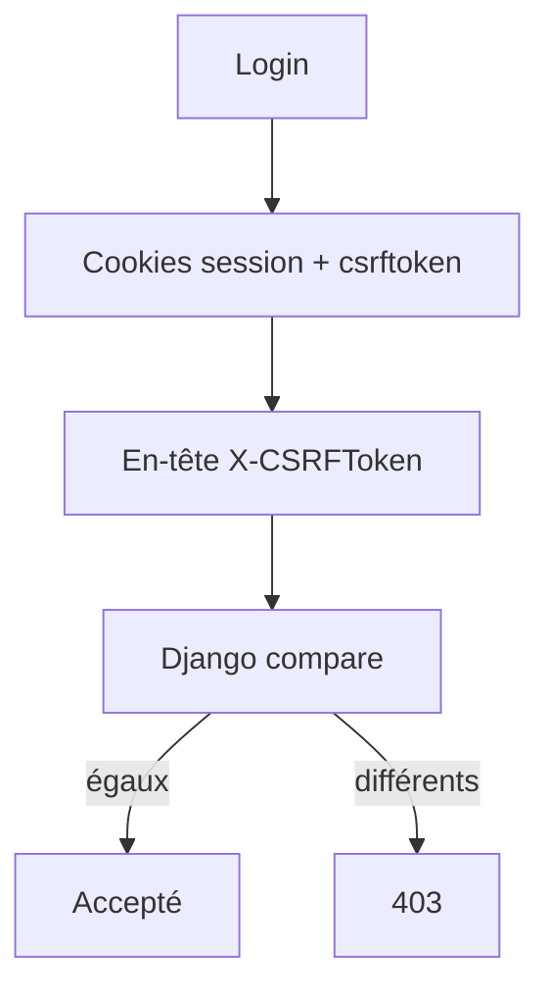

# CSRF

> [!info] En une phrase
> Le CSRF fait exécuter une action à un utilisateur connecté depuis un autre site : son navigateur envoie la requête avec ses cookies, sans qu'il le sache.

```dataviewjs
await dv.view("10 — Templates/Scripts/learning", { view: "concept" })
```

## 1 · Comprendre
### Définition
Tu es connecté à `app.ex` (cookie de session). Tu visites `piege.ex`, qui contient :
```html
<form action="https://app.ex/taches/12/supprimer" method="post" id="f"></form>
<script>document.getElementById("f").submit()</script>
```
Ton navigateur envoie la requête **avec ton cookie** : la tâche est supprimée.
Protections :
- Cookie **`SameSite=Lax`** ou `Strict` (le navigateur ne l'envoie plus depuis un autre site) : la protection de base aujourd'hui.
- **Jeton anti-CSRF** : une valeur aléatoire dans le formulaire, vérifiée par le serveur (Django, donc CVAT, le fait).
- Ne jamais modifier de données avec `GET`.
- Les API qui utilisent `Authorization: Bearer` (et pas de cookie) n'y sont pas exposées.

### Pourquoi ça existe
Les cookies sont envoyés automatiquement par le navigateur, quel que soit le site qui déclenche la requête.

### Le problème résolu
Empêcher un site tiers d'agir au nom de l'utilisateur.

## 2 · Explorer
### Comment ça fonctionne


### Exemple concret
```js
// Express : cookie de session protégé
cookie: { httpOnly: true, secure: true, sameSite: "lax" }
```
Dans Django : `` dans chaque formulaire, et l'en-tête `X-CSRFToken` pour les appels `fetch`.

### Dans CVAT (vérifié dans son code)
CVAT est fait avec **Django** et **Django REST Framework**. Il accepte quatre façons de prouver qui tu es :

| Façon | Ce qui est envoyé | Jeton CSRF demandé ? |
|---|---|---|
| **Session** (l'interface web) | cookie `sessionid` | **oui**, pour `POST`, `PUT`, `PATCH`, `DELETE` |
| Basic | `Authorization: Basic …` (`auth=(user, mdp)` avec requests) | non |
| Jeton | `Authorization: Token …` | non |
| Jeton d'accès personnel | `Authorization: Bearer …` | non |

Pourquoi seule la session : le cookie part **tout seul** avec chaque requête, même lancée par un autre site. Un en-tête `Authorization`, lui, n'est jamais ajouté par le navigateur sans ton code.

Ce qui se passe avec l'interface :
1. `POST /api/auth/login` : le serveur renvoie deux cookies, `sessionid` (qui tu es) et **`csrftoken`** (une valeur aléatoire).
2. À chaque requête qui modifie quelque chose, l'interface **recopie** la valeur du cookie `csrftoken` dans l'en-tête **`X-CSRFToken`**. C'est réglé une fois pour toutes dans `cvat-core` (axios : `xsrfCookieName = 'csrftoken'`, `xsrfHeaderName = 'X-CSRFTOKEN'`).
3. Django compare l'en-tête au cookie, et vérifie que l'en-tête `Origin` est bien CVAT lui-même ou une adresse de `CSRF_TRUSTED_ORIGINS`.

Le site piège ne peut pas réussir l'étape 2 : il ne peut pas **lire** le cookie `csrftoken` de CVAT, donc il ne connaît pas la valeur à mettre dans l'en-tête.



Les erreurs que tu peux croiser (toutes en `403` ; le texte exact peut varier selon la version de Django) :
- `CSRF Failed: CSRF token missing.` : cookie de session envoyé, mais pas d'en-tête `X-CSRFToken`.
- `CSRF Failed: CSRF token from the 'X-Csrftoken' HTTP header incorrect.` : l'en-tête ne correspond pas au cookie.
- `CSRF Failed: Origin checking failed - http://localhost:3000 does not match any trusted origins.` : la page vient d'une adresse que Django ne connaît pas. C'est ce que tu as réglé pour le mode dev avec `CSRF_TRUSTED_ORIGINS` (ta fiche « CVAT, mode dev de l'interface »).

Et pour toi :
- **Ta fonction Nuclio** appelle CVAT avec `auth=(user, mdp)` : c'est du Basic, donc **pas de CSRF**.
- **Le SDK CVAT** se connecte par session, et recopie lui-même `csrftoken` dans `X-CSRFToken`. Avec un jeton d'accès (`access_token=`), pas de cookie, donc pas de CSRF.
- **Le bouton** : s'il passe par `cvat-core`, c'est automatique. S'il appelle l'API de CVAT avec un `fetch` à toi (en `POST`), c'est à toi d'ajouter `X-CSRFToken`.

### CSRF ou CORS
| | [[CORS]] | CSRF |
|---|---|---|
| C'est… | une **règle du navigateur** | une **attaque** (et la protection qui va avec) |
| La question | « cette page a-t-elle le droit de **lire** la réponse ? » | « cette requête vient-elle vraiment de mon site ? » |
| Qui décide | le serveur, avec `Access-Control-Allow-*` ; le navigateur applique | le serveur, en vérifiant le jeton et l'origine |
| Dans ton POC | le bouton qui appelle `convert-png` | l'interface qui appelle l'API CVAT avec sa session |

### Cas d'utilisation
- Applications à cookie de session, comme l'interface CVAT
- Formulaires d'administration
- Comprendre un `403 CSRF Failed` en appelant l'API CVAT

> [!warning] À ne pas confondre
> **CSRF** (le navigateur de la victime envoie une requête qu'elle n'a pas voulue) et **[[XSS]]** (du code de l'attaquant tourne dans la page). Et [[CORS]] ne protège pas du CSRF : la requête part quand même, seule la lecture de la réponse est bloquée.

## 3 · Pratiquer
- [[Exercice - Le jeton CSRF de CVAT]]

## 4 · Expliquer
> [!quote] Mon résumé, avec mes mots
> _À écrire sans regarder la fiche. Si je bloque, je ne l'ai pas encore compris._

## 5 · Relier
- **Prérequis** : [[Session et cookie]] · [[Formulaire HTML]]
- **Complémentaires** : [[XSS]] · [[CORS]]

## 6 · Réviser
> [!question] Me faire interroger
> Je demande à Claude de m'interroger sur cette notion pour vérifier que je l'ai comprise.

### Validation de la maîtrise
La notion est maîtrisée quand j'ai réussi **tous les exercices** qui l'utilisent (statut `reussi` dans l'exercice).

```dataviewjs
await dv.view("10 — Templates/Scripts/learning", { view: "maitrise" })
```
