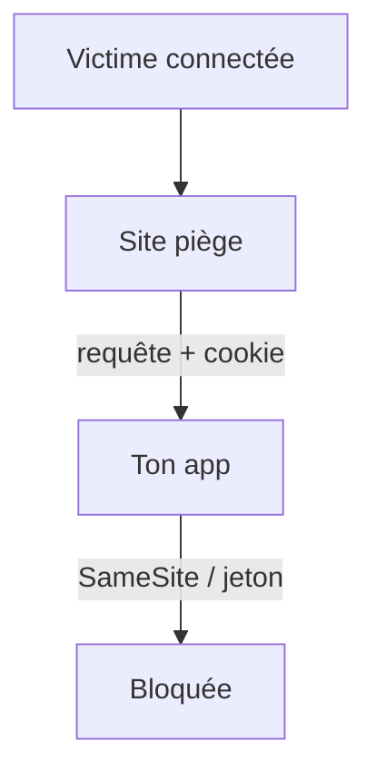

# CSRF

> [!info] En une phrase
> Le CSRF fait exécuter une action à un utilisateur connecté depuis un autre site : son navigateur envoie la requête avec ses cookies, sans qu'il le sache.

```dataviewjs
await dv.view("10 — Templates/Scripts/learning", { view: "concept" })
```

## 1 · Comprendre
### Définition
Tu es connecté à `app.ex` (cookie de session). Tu visites `piege.ex`, qui contient :
```html
<form action="https://app.ex/taches/12/supprimer" method="post" id="f"></form>
<script>document.getElementById("f").submit()</script>
```
Ton navigateur envoie la requête **avec ton cookie** : la tâche est supprimée.
Protections :
- Cookie **`SameSite=Lax`** ou `Strict` (le navigateur ne l'envoie plus depuis un autre site) : la protection de base aujourd'hui.
- **Jeton anti-CSRF** : une valeur aléatoire dans le formulaire, vérifiée par le serveur (Django, donc CVAT, le fait).
- Ne jamais modifier de données avec `GET`.
- Les API qui utilisent `Authorization: Bearer` (et pas de cookie) n'y sont pas exposées.

### Pourquoi ça existe
Les cookies sont envoyés automatiquement par le navigateur, quel que soit le site qui déclenche la requête.

### Le problème résolu
Empêcher un site tiers d'agir au nom de l'utilisateur.

## 2 · Explorer
### Comment ça fonctionne


### Exemple concret
```js
// Express : cookie de session protégé
cookie: { httpOnly: true, secure: true, sameSite: "lax" }
```
Dans Django : `` dans chaque formulaire, et l'en-tête `X-CSRFToken` pour les appels `fetch`.

### Cas d'utilisation
- Applications à cookie de session
- Formulaires d'administration
- Configurer un frontend qui appelle une API Django comme CVAT

> [!warning] À ne pas confondre
> **CSRF** (le navigateur de la victime envoie une requête qu'elle n'a pas voulue) et **[[XSS]]** (du code de l'attaquant tourne dans la page). Et [[CORS]] ne protège pas du CSRF : la requête part quand même, seule la lecture de la réponse est bloquée.

## 3 · Pratiquer
- Explique, pour une API à jeton Bearer et pour une application à cookie, laquelle est exposée au CSRF et pourquoi

## 4 · Expliquer
> [!quote] Mon résumé, avec mes mots
> _À écrire sans regarder la fiche. Si je bloque, je ne l'ai pas encore compris._

## 5 · Relier
- **Prérequis** : [[Session et cookie]] · [[Formulaire HTML]]
- **Complémentaires** : [[XSS]] · [[CORS]]

## 6 · Réviser
> [!question] Me faire interroger
> Je demande à Claude de m'interroger sur cette notion pour vérifier que je l'ai comprise.

### Validation de la maîtrise
La notion est maîtrisée quand j'ai réussi **tous les exercices** qui l'utilisent (statut `reussi` dans l'exercice).

```dataviewjs
await dv.view("10 — Templates/Scripts/learning", { view: "maitrise" })
```
