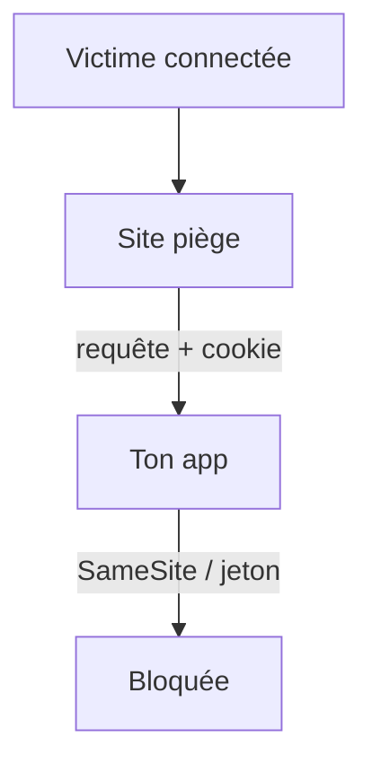

# CSRF

> [!info] En une phrase
> Le CSRF fait exécuter une action à un utilisateur connecté depuis un autre site : son navigateur envoie la requête avec ses cookies, sans qu'il le sache.

```dataviewjs
await dv.view("10 — Templates/Scripts/learning", { view: "concept" })
```

## 1 · Comprendre
### Définition
Tu es connecté à `app.ex` (cookie de session). Tu visites `piege.ex`, qui contient :
```html
<form action="https://app.ex/taches/12/supprimer" method="post" id="f"></form>
<script>document.getElementById("f").submit()</script>
```
Ton navigateur envoie la requête **avec ton cookie** : la tâche est supprimée.
Protections :
- Cookie **`SameSite=Lax`** ou `Strict` (le navigateur ne l'envoie plus depuis un autre site) : la protection de base aujourd'hui.
- **Jeton anti-CSRF** : une valeur aléatoire dans le formulaire, vérifiée par le serveur (Django le fait par défaut).
- Ne jamais modifier de données avec `GET`.
- Les API qui utilisent `Authorization: Bearer` (et pas de cookie) n'y sont pas exposées.

### Pourquoi ça existe
Les cookies sont envoyés automatiquement par le navigateur, quel que soit le site qui déclenche la requête.

### Le problème résolu
Empêcher un site tiers d'agir au nom de l'utilisateur.

## 2 · Explorer
### Comment ça fonctionne


### Exemple concret
```js
// Express : cookie de session protégé
cookie: { httpOnly: true, secure: true, sameSite: "lax" }
```
Dans Django : `` dans chaque formulaire, et l'en-tête `X-CSRFToken` pour les appels `fetch`.

### CSRF ou CORS
| | [[CORS]] | CSRF |
|---|---|---|
| C'est… | une **règle du navigateur** | une **attaque** (et la protection qui va avec) |
| La question | « cette page a-t-elle le droit de **lire** la réponse ? » | « cette requête vient-elle vraiment de mon site ? » |
| Qui décide | le serveur, avec `Access-Control-Allow-*` ; le navigateur applique | le serveur, en vérifiant le jeton et l'origine |
| Exemple | un front sur `localhost:5173` qui appelle une API sur `:8000` | un site piégé qui envoie un formulaire à ta banque avec ta session |

### Cas d'utilisation
- Formulaires d'administration

> [!warning] À ne pas confondre
> **CSRF** (le navigateur de la victime envoie une requête qu'elle n'a pas voulue) et **[[XSS]]** (du code de l'attaquant tourne dans la page). Et [[CORS]] ne protège pas du CSRF : la requête part quand même, seule la lecture de la réponse est bloquée.

## 3 · Pratiquer

### Exercice visuel

Sur Excalidraw, **sans regarder la fiche**. Puis je compare avec la fiche, je corrige en rouge ce qui était faux, et j'explique mon dessin à voix haute ou à Claude dans le chat.

> [!example] 🛣️ Suis le trajet
> Dessine l'attaque : tu es connecté à une appli web, tu ouvres un site piégé, ton navigateur envoie une requête avec tes cookies. Place le jeton CSRF qui l'arrête.

> [!example] 🔄 Change de contexte
> Tu as dessiné le CSRF avec des cookies. Redessine-le pour une API qui utilise un jeton dans l'en-tête Authorization. L'attaque marche-t-elle encore ?

### Mon schéma

> [!tip] Mon dessin Excalidraw
> _Je crée le dessin « Schéma - CSRF » et je l'intègre ici avec `![[Schéma - CSRF.excalidraw]]`, puis je coche `schema`._

### Appliquer dans le fil rouge
- Pas encore d'étape du fil rouge pour cette notion : elle sera pratiquée dans le fil rouge de son niveau (voir [[Niveaux]]).

## 4 · Relier
- **Au travail** : [CSRF au travail](obsidian://open?vault=Travail&file=CSRF%20au%20travail)
- **Prérequis** : [[Session et cookie]] · [[Formulaire HTML]]
- **Complémentaires** : [[XSS]] · [[CORS]]

## 5 · Réviser
> [!question] Me faire interroger
> Je demande à Claude de m'interroger sur cette notion pour vérifier que je l'ai comprise.

### Validation (compris, puis maîtrisé)
Trois cases à cocher dans les propriétés de la fiche :
- `schema` : mon dessin du concept est dans « Mon schéma » ;
- `exercice_visuel` : j'ai fait et corrigé les exercices visuels de la section 3 ;
- `fil_rouge` : je l'ai appliqué dans le fil rouge (coché tout seul quand une étape qui l'utilise est réussie).

Les trois cochées : la notion compte comme **comprise**. **Maîtrisé** : c'est moi qui le mets dans `status`, quand je le sens.

```dataviewjs
await dv.view("10 — Templates/Scripts/learning", { view: "maitrise" })
```
