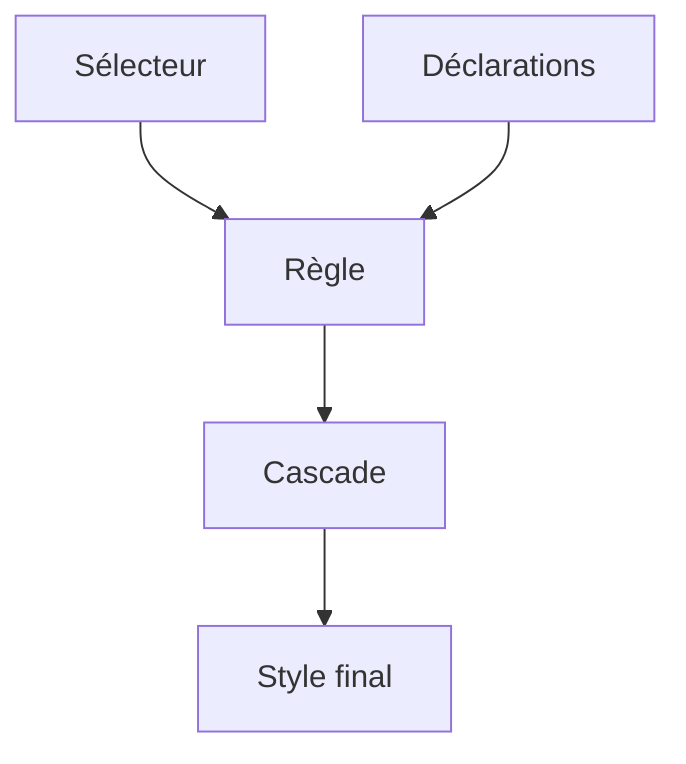

# CSS

> [!info] En une phrase
> Le langage qui décrit l'apparence d'une page : couleurs, polices, tailles, espacements, mise en page.

```dataviewjs
await dv.view("10 — Templates/Scripts/learning", { view: "concept" })
```

## 1 · Comprendre
### Définition
Une feuille **CSS** contient des **règles** : un **sélecteur** (quels éléments) et des **déclarations** `propriété: valeur;`. Les règles s'appliquent **en cascade** : plusieurs peuvent viser le même élément, la plus **spécifique** (puis la dernière) l'emporte, et certaines propriétés (couleur, police) sont **héritées** par les enfants.

### Pourquoi ça existe
Séparer le contenu (HTML) de sa présentation, pour changer le style de tout un site à un seul endroit.

### Le problème résolu
Répéter couleur et taille dans chaque balise, et devoir tout reprendre pour changer de thème.

## 2 · Explorer
### Comment ça fonctionne


### Exemple concret
```css
:root {                      /* variables CSS */
  --couleur-texte: #c8ced9;
  --accent: #ffc66d;
}
body {
  font-family: system-ui, sans-serif;
  color: var(--couleur-texte);
  margin: 0;
}
h1 { font-size: 2rem; }
.badge.ok { color: var(--accent); font-weight: bold; }
```
Trois façons de l'ajouter : un fichier `<link rel="stylesheet" href="style.css">` (à préférer), une balise `<style>`, un attribut `style="…"` (à éviter).

Unités : `px` (fixe), `rem` (relatif à la taille de police de la page, conseillé), `%`, `vw`/`vh` (taille de la fenêtre).

### Cas d'utilisation
- Toute mise en forme de page ; ton snippet Obsidian `dev-learning.css` est du CSS
- Les frameworks (Tailwind, Bootstrap) génèrent du CSS

> [!warning] À ne pas confondre
> Une règle qui « ne s'applique pas » est souvent **écrasée** par une règle plus spécifique : regarde l'onglet *Styles* des outils de développement, la règle perdante y est barrée.

## 3 · Pratiquer
- Crée une feuille de style pour ta page HTML avec des variables de couleur, une police et un style pour les liens.

## 4 · Expliquer
> [!quote] Mon résumé, avec mes mots
> _À écrire sans regarder la fiche. Si je bloque, je ne l'ai pas encore compris._

## 5 · Relier
- **Prérequis** : [[HTML]]
- **Complémentaires** : [[Sélecteur CSS]] · [[Modèle de boîte]]
- **Utilisé par** : [[Flexbox]] · [[Grid CSS]] · [[Responsive design]]

## 6 · Réviser
> [!question] Me faire interroger
> Je demande à Claude de m'interroger sur cette notion pour vérifier que je l'ai comprise.

### Validation de la maîtrise
- [ ] Je l'explique sans notes, en 3 phrases, à quelqu'un qui ne connaît pas
- [ ] J'ai réussi un exercice qui l'utilise
- [ ] Je l'ai utilisé dans un projet
- [ ] Je sais dire quand ne pas l'utiliser (ou ce qu'il ne faut pas confondre)
