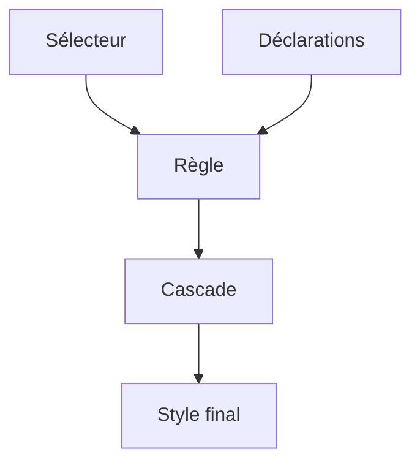

# CSS

> [!info] En une phrase
> Le langage qui décrit l'apparence d'une page : couleurs, polices, tailles, espacements, mise en page.

```dataviewjs
await dv.view("10 — Templates/Scripts/learning", { view: "concept" })
```

## 1 · Comprendre
### Définition
Une feuille **CSS** contient des **règles** : un **sélecteur** (quels éléments) et des **déclarations** `propriété: valeur;`. Les règles s'appliquent **en cascade** : plusieurs peuvent viser le même élément, la plus **spécifique** (puis la dernière) l'emporte, et certaines propriétés (couleur, police) sont **héritées** par les enfants.

### Pourquoi ça existe
Séparer le contenu (HTML) de sa présentation, pour changer le style de tout un site à un seul endroit.

### Le problème résolu
Répéter couleur et taille dans chaque balise, et devoir tout reprendre pour changer de thème.

## 2 · Explorer
### Comment ça fonctionne


### Exemple concret
```css
:root {                      /* variables CSS */
  --couleur-texte: #c8ced9;
  --accent: #ffc66d;
}
body {
  font-family: system-ui, sans-serif;
  color: var(--couleur-texte);
  margin: 0;
}
h1 { font-size: 2rem; }
.badge.ok { color: var(--accent); font-weight: bold; }
```
Trois façons de l'ajouter : un fichier `<link rel="stylesheet" href="style.css">` (à préférer), une balise `<style>`, un attribut `style="…"` (à éviter).

Unités : `px` (fixe), `rem` (relatif à la taille de police de la page, conseillé), `%`, `vw`/`vh` (taille de la fenêtre).

### Cas d'utilisation
- Toute mise en forme de page ; ton snippet Obsidian `dev-learning.css` est du CSS
- Les frameworks (Tailwind, Bootstrap) génèrent du CSS

> [!warning] À ne pas confondre
> Une règle qui « ne s'applique pas » est souvent **écrasée** par une règle plus spécifique : regarde l'onglet *Styles* des outils de développement, la règle perdante y est barrée.

## 3 · Pratiquer

### Exercice visuel

Sur Excalidraw, **sans regarder la fiche**. Puis je compare avec la fiche, je corrige en rouge ce qui était faux, et j'explique mon dessin à voix haute ou à Claude dans le chat.

> [!example] 🧠 Dessine de mémoire
> Dessine une règle CSS en pièces détachées : sélecteur, propriété, valeur. Puis dessine la page de ton application avant et après cette règle.

> [!example] 🔍 Trouve l'erreur
> Ce schéma est faux. Corrige-le en rouge et explique l'erreur.
>
> ```mermaid
> flowchart TD
>   R1[.total rouge] --> P[Même élément]
>   R2[id total bleu] --> P
>   P --> C[Rouge gagne]
> ```

### Mon schéma

> [!tip] Mon dessin Excalidraw
> _Je crée le dessin « Schéma - CSS » et je l'intègre ici avec `![[Schéma - CSS.excalidraw]]`, puis je coche `schema`._

### Appliquer dans le fil rouge
- Pas encore d'étape du fil rouge pour cette notion : elle sera pratiquée dans le fil rouge de son niveau (voir [[Niveaux]]).

## 4 · Relier
- **Prérequis** : [[HTML]]
- **Complémentaires** : [[Sélecteur CSS]] · [[Modèle de boîte]]
- **Utilisé par** : [[Flexbox]] · [[Grid CSS]] · [[Responsive design]]

## 5 · Réviser
> [!question] Me faire interroger
> Je demande à Claude de m'interroger sur cette notion pour vérifier que je l'ai comprise.

### Validation (compris, puis maîtrisé)
Trois cases à cocher dans les propriétés de la fiche :
- `schema` : mon dessin du concept est dans « Mon schéma » ;
- `exercice_visuel` : j'ai fait et corrigé les exercices visuels de la section 3 ;
- `fil_rouge` : je l'ai appliqué dans le fil rouge (coché tout seul quand une étape qui l'utilise est réussie).

Les trois cochées : la notion compte comme **comprise**. **Maîtrisé** : c'est moi qui le mets dans `status`, quand je le sens.

```dataviewjs
await dv.view("10 — Templates/Scripts/learning", { view: "maitrise" })
```
