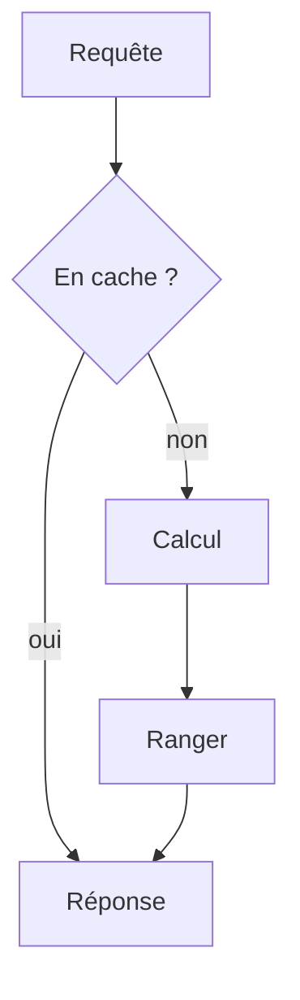

# Cache applicatif

> [!info] En une phrase
> Un cache garde le résultat d'un calcul ou d'une requête coûteuse pour le resservir tout de suite la fois suivante, au lieu de tout refaire.

```dataviewjs
await dv.view("10 — Templates/Scripts/learning", { view: "concept" })
```

## 1 · Comprendre
### Définition
**Succès (hit)** : la valeur est en cache, on la renvoie. **Défaut (miss)** : on calcule, puis on range le résultat.

**Où mettre le cache :**
- en mémoire du programme (`functools.lru_cache`, un dictionnaire)
- dans un service partagé (**Redis**, Memcached) quand il y a plusieurs copies
- côté HTTP (en-têtes `Cache-Control`, navigateur, CDN)

**Invalidation** : quand la donnée d'origine change, il faut retirer ou mettre à jour la copie. Méthodes : durée de vie (TTL), suppression explicite, clé qui inclut une version.

### Pourquoi ça existe
Recalculer la même image PNG ou relire les mêmes annotations à chaque requête : lent, et ça charge CVAT ou la base pour rien.

### Le problème résolu
Répondre plus vite et soulager les services lents ou payants.

## 2 · Explorer
### Comment ça fonctionne


### Exemple concret
```python
from functools import lru_cache

@lru_cache(maxsize=128)            # cache en mémoire, décorateur
def annotations(tache_id: int) -> tuple:
    return tuple(appeler_cvat(tache_id))

# avec Redis et une durée de vie
def png_export(tache_id, version):
    cle = f"export:{tache_id}:{version}"     # la version invalide d'elle-même
    if (png := redis.get(cle)) is not None:
        return png
    png = exporter_png(tache_id)
    redis.set(cle, png, ex=3600)             # expire dans une heure
    return png
```

### Cas d'utilisation
- Résultats d'API externes
- Images ou exports générés
- Pages ou réponses très demandées

> [!warning] À ne pas confondre
> « Il n'y a que deux choses difficiles en informatique : l'invalidation de cache et nommer les choses. » Un cache mal invalidé sert des données périmées : on ne cache que ce qu'on sait rafraîchir, et on mesure avant d'en ajouter.

## 3 · Pratiquer
- Ajoute `lru_cache` à une fonction lente et mesure la différence avec `time`

## 4 · Expliquer
> [!quote] Mon résumé, avec mes mots
> _À écrire sans regarder la fiche. Si je bloque, je ne l'ai pas encore compris._

## 5 · Relier
- **Prérequis** : [[Fonction]]
- **Complémentaires** : [[Patron Proxy]] · [[Patron Décorateur (Decorator)]] · [[En-tête HTTP]]

## 6 · Réviser
> [!question] Me faire interroger
> Je demande à Claude de m'interroger sur cette notion pour vérifier que je l'ai comprise.

### Validation de la maîtrise
La notion est maîtrisée quand j'ai réussi **tous les exercices** qui l'utilisent (statut `reussi` dans l'exercice).

```dataviewjs
await dv.view("10 — Templates/Scripts/learning", { view: "maitrise" })
```
