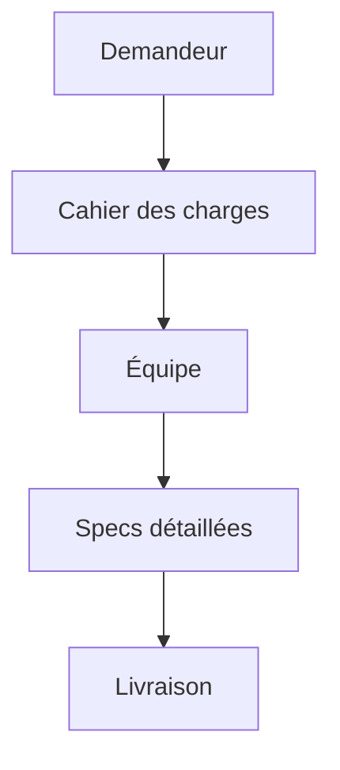

# Cahier des charges

> [!info] En une phrase
> Le cahier des charges est le **document de référence écrit par le demandeur** (client, service métier) pour décrire son besoin, ses contraintes et ses attentes, avant qu'un prestataire ou une équipe ne construise la solution. Très utilisé en France, surtout dans les appels d'offres.

```dataviewjs
await dv.view("10 — Templates/Scripts/learning", { view: "concept" })
```

## 1 · Comprendre
### Définition
**Qui l'écrit ?** Le demandeur (la *maîtrise d'ouvrage*, MOA). L'équipe qui réalise (la *maîtrise d'œuvre*, MOE) y répond, souvent par une spécification plus détaillée.

**Contenu habituel** : contexte, objectifs, utilisateurs, besoins fonctionnels, contraintes (techniques, budget, délais, sécurité), livrables attendus, critères de réception (comment on validera la livraison), planning.

**Deux variantes** :
- *cahier des charges fonctionnel* (CDCF) : seulement le besoin, sans imposer de solution ;
- *cahier des charges technique* : impose aussi des choix (langage, hébergement…).

**Dans les méthodes agiles**, on écrit rarement un gros cahier des charges figé au départ : on préfère un backlog de user stories qui évolue. Mais beaucoup d'entreprises en utilisent encore, surtout pour cadrer un projet ou un budget.

### Pourquoi ça existe
Un client qui fait appel à une équipe (interne ou externe) doit décrire ce qu'il veut de façon assez complète pour qu'on puisse estimer, chiffrer et livrer.

### Le problème résolu
Fixer un cadre commun avant de signer ou de démarrer, et pouvoir vérifier à la fin que ce qui était demandé a été livré.

## 2 · Explorer
### Comment ça fonctionne


### Exemple concret
```markdown
# Cahier des charges - Outil d'export d'annotations
1. Contexte : l'équipe annote des plans dans CVAT.
2. Objectif : obtenir une image des annotations pour les rapports.
3. Utilisateurs : 15 annotateurs, 2 responsables.
4. Besoins fonctionnels : export PNG d'une tâche ; …
5. Contraintes : hébergé sur l'infrastructure interne ; images Docker via le Nexus ;
   pas d'envoi de données hors de l'entreprise.
6. Livrables : code source, documentation d'installation, pipeline GitLab.
7. Réception : démonstration sur 3 tâches réelles.
8. Délai : MVP pour fin décembre.
```

### Cas d'utilisation
- Recevoir une demande d'un service de l'entreprise
- Répondre à un appel d'offres
- Cadrer un projet avant de demander un budget

> [!warning] À ne pas confondre
> Le cahier des charges exprime le **besoin du demandeur** ; la spécification (fonctionnelle et technique) décrit **la solution** qu'on va construire. En pratique les deux mots sont souvent mélangés : demande toujours qui a écrit le document et dans quel but.

## 3 · Pratiquer
- Repère dans l'exemple ce qui est un besoin, une contrainte et un critère de réception

## 4 · Expliquer
> [!quote] Mon résumé, avec mes mots
> _À écrire sans regarder la fiche. Si je bloque, je ne l'ai pas encore compris._

## 5 · Relier
- **Prérequis** : [[Spécification (specs)]]
- **Complémentaires** : [[Exigences fonctionnelles et non fonctionnelles]] · [[Spécification technique]] · [[Méthode agile (Scrum et Kanban)]]

## 6 · Réviser
> [!question] Me faire interroger
> Je demande à Claude de m'interroger sur cette notion pour vérifier que je l'ai comprise.

### Validation de la maîtrise
La notion est maîtrisée quand j'ai réussi **tous les exercices** qui l'utilisent (statut `reussi` dans l'exercice).

```dataviewjs
await dv.view("10 — Templates/Scripts/learning", { view: "maitrise" })
```
