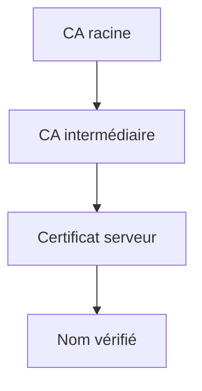

# Certificat

> [!info] En une phrase
> Une carte d'identité numérique d'un serveur, signée par une autorité de certification, qui lie un nom (gitlab.com) à une clé publique.

```dataviewjs
await dv.view("10 — Templates/Scripts/learning", { view: "concept" })
```

## 1 · Comprendre
### Définition
Un **certificat** (format X.509, fichiers `.crt`, `.pem`) contient : le **nom** du serveur, sa **clé publique**, une **date d'expiration**, et la **signature** d'une **autorité de certification** (CA : Let's Encrypt, DigiCert…). Le serveur garde secrète la **clé privée** associée.

Ta machine a une liste de CA de confiance (le **magasin de certificats**). Un certificat est valide s'il remonte, par une **chaîne** de signatures, jusqu'à une de ces CA.

### Pourquoi ça existe
Prouver qu'un serveur est bien celui qu'il prétend être, sans l'avoir jamais rencontré.

### Le problème résolu
N'importe qui pourrait se faire passer pour ta banque ou ton GitLab.

## 2 · Explorer
### Comment ça fonctionne


### Exemple concret
Erreurs fréquentes :
| Message | Cause |
| --- | --- |
| `certificate has expired` | date dépassée |
| `hostname mismatch` | le nom demandé n'est pas dans le certificat |
| `self-signed certificate` / `unable to get local issuer certificate` | la CA n'est pas dans ton magasin de confiance |

**En entreprise**, le proxy inspecte souvent le HTTPS avec **sa propre CA**. Il faut alors l'ajouter au magasin de confiance de chaque outil :
```bash
# Ubuntu / WSL / image Debian
sudo cp ca-entreprise.crt /usr/local/share/ca-certificates/
sudo update-ca-certificates
```
```bash
# Outils qui ont leur propre magasin
export REQUESTS_CA_BUNDLE=/etc/ssl/certs/ca-certificates.crt   # Python requests
pip config set global.cert /etc/ssl/certs/ca-certificates.crt  # pip
git config --global http.sslCAInfo /etc/ssl/certs/ca-certificates.crt
```
```bash
openssl x509 -in cert.pem -noout -subject -issuer -dates     # lire un certificat
```

### Cas d'utilisation
- Résoudre `SSL: CERTIFICATE_VERIFY_FAILED` derrière le proxy de l'entreprise
- Faire confiance au Nexus ou au GitLab interne dans Docker et la CI

> [!warning] À ne pas confondre
> **Ajouter la bonne CA** (solution) et **désactiver la vérification** (`verify=False`, `-k`, `sslVerify false`) : cette dernière supprime toute protection, à ne faire que pour un test ponctuel. Et la **clé publique** (dans le certificat, partagée) et la **clé privée** (secrète, jamais dans Git).

## 3 · Pratiquer
- Récupère le certificat d'un site avec `openssl`, lis son nom, son émetteur et ses dates.
- Demande à ton équipe la CA de l'entreprise et installe-la dans WSL.

## 4 · Expliquer
> [!quote] Mon résumé, avec mes mots
> _À écrire sans regarder la fiche. Si je bloque, je ne l'ai pas encore compris._

## 5 · Relier
- **Prérequis** : [[HTTPS et TLS]]
- **Complémentaires** : [[Proxy]] · [[Clé SSH]]
- **Commandes** : [[openssl]]

## 6 · Réviser
> [!question] Me faire interroger
> Je demande à Claude de m'interroger sur cette notion pour vérifier que je l'ai comprise.

### Validation de la maîtrise
La notion est maîtrisée quand j'ai réussi **tous les exercices** qui l'utilisent (statut `reussi` dans l'exercice).

```dataviewjs
await dv.view("10 — Templates/Scripts/learning", { view: "maitrise" })
```
