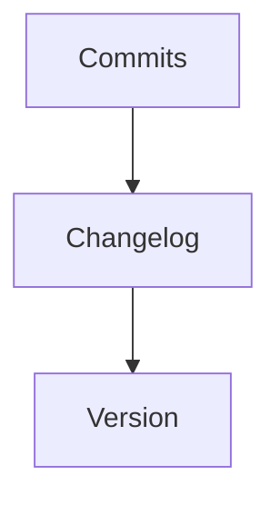

# Changelog

> [!info] En une phrase
> Le journal des changements d'un projet, version par version, écrit pour les humains.

## 1 · Comprendre
### Définition
Un **changelog** (souvent `CHANGELOG.md`) liste, pour chaque version, ce qui a été ajouté, modifié, corrigé ou supprimé. Format courant (*Keep a Changelog*) : une section par version, avec des rubriques `Added`, `Changed`, `Fixed`, `Removed`.

### Pourquoi ça existe
Savoir ce qui change en passant d'une version à une autre sans lire tous les commits.

### Le problème résolu
Mettre à jour un projet « à l'aveugle » et découvrir une rupture en production.

## 2 · Explorer
### Comment ça fonctionne


### Exemple concret
```markdown
## [1.1.0] - 2026-11-20
### Added
- Option `--dry-run` qui affiche les fichiers sans créer l'archive
### Fixed
- Nom d'archive incorrect quand le dossier contient des espaces
```
Certains projets open source demandent d'ajouter un petit fichier de changelog **dans chaque contribution** ; un outil les assemble à la sortie de version.

### Cas d'utilisation
- Documenter les évolutions de ton script

> [!warning] À ne pas confondre
> Le **changelog** (résumé choisi, pour les utilisateurs) et le **git log** (tous les commits, pour les développeurs).

## 3 · Relier
- **Au travail** : [Changelog au travail](obsidian://open?vault=Travail&file=Changelog%20au%20travail)
- **Prérequis** : [[Commit]]
- **Complémentaires** : [[Convention de commit]] · [[Tag Git]]
