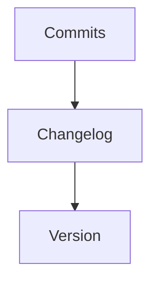

# Changelog

> [!info] En une phrase
> Le journal des changements d'un projet, version par version, écrit pour les humains.

```dataviewjs
await dv.view("10 — Templates/Scripts/learning", { view: "concept" })
```

## 1 · Comprendre
### Définition
Un **changelog** (souvent `CHANGELOG.md`) liste, pour chaque version, ce qui a été ajouté, modifié, corrigé ou supprimé. Format courant (*Keep a Changelog*) : une section par version, avec des rubriques `Added`, `Changed`, `Fixed`, `Removed`.

### Pourquoi ça existe
Savoir ce qui change en passant d'une version à une autre sans lire tous les commits.

### Le problème résolu
Mettre à jour un projet « à l'aveugle » et découvrir une rupture en production.

## 2 · Explorer
### Comment ça fonctionne


### Exemple concret
```markdown
## [1.1.0] - 2026-11-20
### Added
- Option `--dry-run` qui affiche les fichiers sans créer l'archive
### Fixed
- Nom d'archive incorrect quand le dossier contient des espaces
```
Certains projets open source demandent d'ajouter un petit fichier de changelog **dans chaque contribution** ; un outil les assemble à la sortie de version.

### Cas d'utilisation
- Documenter les évolutions de ton script

> [!warning] À ne pas confondre
> Le **changelog** (résumé choisi, pour les utilisateurs) et le **git log** (tous les commits, pour les développeurs).

## 3 · Pratiquer

### Exercice visuel

Sur Excalidraw, **sans regarder la fiche**. Puis je compare avec la fiche, je corrige en rouge ce qui était faux, et j'explique mon dessin à voix haute ou à Claude dans le chat.

> [!example] 🧠 Dessine de mémoire
> Dessine une frise de versions (v1.0, v1.1, v2.0) et range dessous les commits conventionnels qui vont dans chaque section du changelog.

> [!example] 🔄 Change de contexte
> Imagine le changelog de ton application vu par un utilisateur, puis par un développeur. Dessine ce que chacun cherche.

### Mon schéma

> [!tip] Mon dessin Excalidraw
> _Je crée le dessin « Schéma - Changelog » et je l'intègre ici avec `![[Schéma - Changelog.excalidraw]]`, puis je coche `schema`._

### Appliquer dans le fil rouge
- [[MesDépenses 10 - Sortir une version]]

## 4 · Relier
- **Au travail** : [Changelog au travail](obsidian://open?vault=Travail&file=Changelog%20au%20travail)
- **Prérequis** : [[Commit]]
- **Complémentaires** : [[Convention de commit]] · [[Tag Git]]

## 5 · Réviser
> [!question] Me faire interroger
> Je demande à Claude de m'interroger sur cette notion pour vérifier que je l'ai comprise.

### Validation (compris, puis maîtrisé)
Trois cases à cocher dans les propriétés de la fiche :
- `schema` : mon dessin du concept est dans « Mon schéma » ;
- `exercice_visuel` : j'ai fait et corrigé les exercices visuels de la section 3 ;
- `fil_rouge` : je l'ai appliqué dans le fil rouge (coché tout seul quand une étape qui l'utilise est réussie).

Les trois cochées : la notion compte comme **comprise**. **Maîtrisé** : c'est moi qui le mets dans `status`, quand je le sens.

```dataviewjs
await dv.view("10 — Templates/Scripts/learning", { view: "maitrise" })
```
