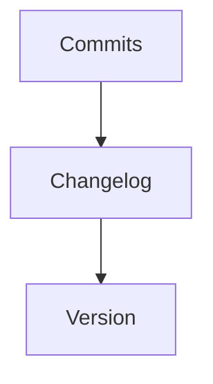

# Changelog

> [!info] En une phrase
> Le journal des changements d'un projet, version par version, écrit pour les humains.

```dataviewjs
await dv.view("10 — Templates/Scripts/learning", { view: "concept" })
```

## 1 · Comprendre
### Définition
Un **changelog** (souvent `CHANGELOG.md`) liste, pour chaque version, ce qui a été ajouté, modifié, corrigé ou supprimé. Format courant (*Keep a Changelog*) : une section par version, avec des rubriques `Added`, `Changed`, `Fixed`, `Removed`.

### Pourquoi ça existe
Savoir ce qui change en passant d'une version à une autre sans lire tous les commits.

### Le problème résolu
Mettre à jour un projet « à l'aveugle » et découvrir une rupture en production.

## 2 · Explorer
### Comment ça fonctionne


### Exemple concret
```markdown
## [1.1.0] - 2026-11-20
### Added
- Option `--dry-run` qui affiche les fichiers sans créer l'archive
### Fixed
- Nom d'archive incorrect quand le dossier contient des espaces
```
Certains projets (CVAT en fait partie) demandent d'ajouter un petit fichier de changelog **dans chaque contribution** ; un outil les assemble à la sortie de version.

### Cas d'utilisation
- Avant de monter de version CVAT : lire le changelog entre ta version et la nouvelle
- Documenter les évolutions de ton script

> [!warning] À ne pas confondre
> Le **changelog** (résumé choisi, pour les utilisateurs) et le **git log** (tous les commits, pour les développeurs).

## 3 · Pratiquer
- Ouvre le `CHANGELOG.md` de CVAT et repère les changements entre deux versions proches.
- Écris le changelog de la première version de ton script.

## 4 · Expliquer
> [!quote] Mon résumé, avec mes mots
> _À écrire sans regarder la fiche. Si je bloque, je ne l'ai pas encore compris._

## 5 · Relier
- **Prérequis** : [[Commit]]
- **Complémentaires** : [[Convention de commit]] · [[Tag Git]]

## 6 · Réviser
> [!question] Me faire interroger
> Je demande à Claude de m'interroger sur cette notion pour vérifier que je l'ai comprise.

### Validation de la maîtrise
La notion est maîtrisée quand j'ai réussi **tous les exercices** qui l'utilisent (statut `reussi` dans l'exercice).

```dataviewjs
await dv.view("10 — Templates/Scripts/learning", { view: "maitrise" })
```
