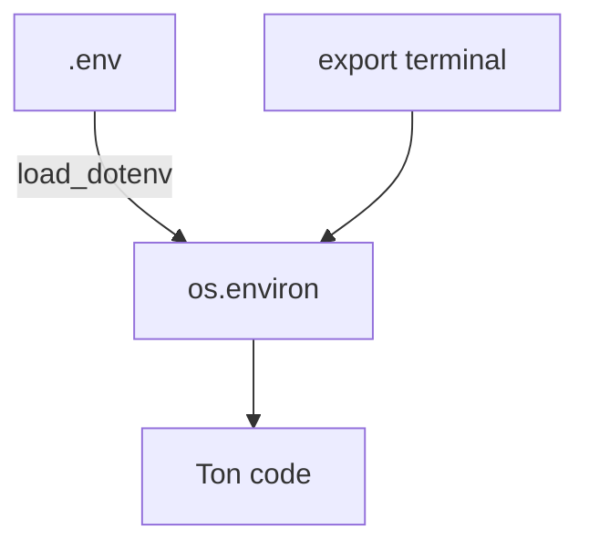

# Charger un fichier .env (python-dotenv)

> [!info] En une phrase
> Python ne lit pas le fichier `.env` tout seul : `load_dotenv()`, de la bibliothèque `python-dotenv`, copie ses lignes dans les variables d'environnement du programme, et le code les lit ensuite avec `os.environ`, comme si elles venaient du terminal.

```dataviewjs
await dv.view("10 — Templates/Scripts/learning", { view: "concept" })
```

## 1 · Comprendre
### Définition
Un `.env` est un simple fichier texte, une variable par ligne :
```bash
# .env
CVAT_URL=http://localhost:8080
CVAT_USERNAME=nuclio-bot
CVAT_PASSWORD="mot de passe avec espaces"
```
```python
import os
from dotenv import load_dotenv   # le paquet s'appelle python-dotenv, le module dotenv

load_dotenv()                     # lit le .env et remplit os.environ
url = os.environ["CVAT_URL"]      # KeyError si elle manque : on le voit tout de suite
```
Les règles à connaître :
- **Où il cherche** : sans argument, `load_dotenv()` cherche `.env` dans le dossier **du script**, puis dans les dossiers parents. Pas dans le dossier où tu lances la commande. Pour un autre fichier : `load_dotenv("chemin/vers/.env")`.
- **Qui gagne** : une variable **déjà définie** dans le terminal (`export CVAT_URL=…`) **n'est pas remplacée** par le `.env`. Pour forcer : `load_dotenv(override=True)`.
- **Pas trouvé = pas d'erreur** : si le fichier n'existe pas, `load_dotenv()` ne dit rien. L'erreur arrive plus loin, sur `os.environ["…"]`.
- **Sans toucher à l'environnement** : `dotenv_values(".env")` renvoie un simple dictionnaire.
- **Installation** : `pip install python-dotenv`, dans le [[Environnement virtuel Python|venv]] du projet (au travail, via le PyPI du Nexus).

### Pourquoi ça existe
Taper `export CVAT_PASSWORD=…` à chaque nouveau terminal est pénible, et l'écrire dans le code le met dans Git. Le `.env` garde les valeurs à côté du projet, hors de Git ([[Secret et fichier .env]]).

### Le problème résolu
Le même code lit `os.environ` partout. En local, les valeurs viennent du `.env` ; dans Docker, de `env_file:` ou `-e` ; dans Nuclio, de `spec.env` ou de `nuctl deploy --env`. Le code ne change pas.

## 2 · Explorer
### Comment ça fonctionne


### Exemple concret
```python
import os
from dotenv import load_dotenv

load_dotenv()
manquantes = [n for n in ("CVAT_URL", "CVAT_USERNAME", "CVAT_PASSWORD") if n not in os.environ]
if manquantes:
    raise SystemExit(f"Variables manquantes : {', '.join(manquantes)}")   # échouer tôt, avec un message clair
```

### Cas d'utilisation
- Ton script local qui parle à CVAT (`~/Projet/CVAT/Integration_function`)
- Tester en local la logique d'une fonction Nuclio avant de la déployer
- Tout projet avec un `.env.example` commité et un `.env` ignoré

> [!warning] À ne pas confondre
> - **`load_dotenv()` et le terminal** : le `.env` n'existe que pour le programme Python qui l'a chargé. `echo $CVAT_URL` dans Bash reste vide.
> - **`.env` et Nuclio** : une fonction déployée n'a pas de `.env` (il n'est pas copié dans l'image, et ne doit pas l'être). Elle reçoit ses variables par `spec.env` ou `nuctl deploy --env`. Ne garde pas `load_dotenv()` dans `main.py` de la fonction, ou garde-le seulement pour les essais en local.
> - **`os.environ["X"]` et `os.environ.get("X")`** : le premier plante si `X` manque (utile pour un secret obligatoire), le second renvoie `None` sans prévenir.

## 3 · Pratiquer
- [[Exercice - Charger les identifiants CVAT depuis un .env]]

## 4 · Expliquer
> [!quote] Mon résumé, avec mes mots
> _À écrire sans regarder la fiche. Si je bloque, je ne l'ai pas encore compris._

## 5 · Relier
- **Prérequis** : [[Variable d'environnement]] · [[Secret et fichier .env]]
- **Complémentaires** : [[Environnement virtuel Python]] · [[Serverless et FaaS]] · [[Docker Compose]]

## 6 · Réviser
> [!question] Me faire interroger
> Je demande à Claude de m'interroger sur cette notion pour vérifier que je l'ai comprise.

### Validation de la maîtrise
La notion est maîtrisée quand j'ai réussi **tous les exercices** qui l'utilisent (statut `reussi` dans l'exercice).

```dataviewjs
await dv.view("10 — Templates/Scripts/learning", { view: "maitrise" })
```
