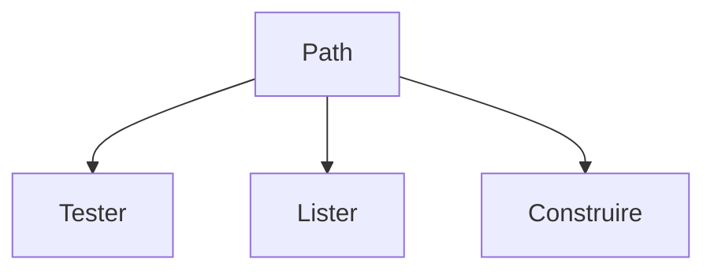

# Chemin de fichier en Python (pathlib)

> [!info] En une phrase
> pathlib représente un chemin comme un objet Path : on le construit avec /, on teste s'il existe, on liste un dossier, sans se soucier de Windows ou Linux.

```dataviewjs
await dv.view("10 — Templates/Scripts/learning", { view: "concept" })
```

## 1 · Comprendre
### Définition
`Path` (module `pathlib`, bibliothèque standard) est un **objet chemin**. Au lieu de coller des bouts de texte avec `"\\"` ou `"/"`, on écrit `dossier / "photo.png"` et Python met le bon séparateur selon le système.

### Pourquoi ça existe
Écrire des chemins qui marchent à la fois sous Windows et dans un conteneur Linux, et avoir sous la main toutes les opérations courantes (existe ? extension ? lister ?).

### Le problème résolu
Les chemins écrits en texte (`"C:\\dossier\\" + nom`) cassent dès qu'on change de système, et les fonctions de l'ancien module `os.path` sont éparpillées.

## 2 · Explorer
### Comment ça fonctionne

| Pour… | On écrit |
| --- | --- |
| créer un chemin | `Path("donnees")`, `Path.cwd()` (dossier courant), `Path.home()` |
| assembler | `dossier / "sous" / "a.png"` |
| tester | `.exists()`, `.is_file()`, `.is_dir()` |
| décomposer | `.name` (`a.png`), `.stem` (`a`), `.suffix` (`.png`), `.parent` |
| lister un dossier | `.iterdir()` (un niveau), `.glob("*.png")`, `.rglob("*.png")` (récursif) |
| créer un dossier | `.mkdir(parents=True, exist_ok=True)` |
| chemin absolu | `.resolve()` |
| chemin relatif | `.relative_to(base)` |
| supprimer un fichier | `.unlink()` |

### Exemple concret
```python
from pathlib import Path

source = Path("donnees")
sortie = Path("sortie")
sortie.mkdir(exist_ok=True)

for fichier in source.rglob("*.png"):
    print(fichier.name, fichier.stat().st_size, "octets")
    print("  relatif :", fichier.relative_to(source))
```

### Cas d'utilisation
- Trouver tous les fichiers à zipper dans un dossier et ses sous-dossiers
- Construire le chemin de l'archive de sortie

> [!warning] À ne pas confondre
> Un chemin **relatif** (`Path("donnees")`) dépend du dossier depuis lequel tu **lances** le script, pas de l'endroit où se trouve le fichier `.py`. Pour partir du script : `Path(__file__).parent / "donnees"`. Dans Docker, c'est le `WORKDIR`.

## 3 · Pratiquer
- Liste tous les fichiers d'un dossier de test avec leur taille et leur extension.
- Compte les `.png` d'un dossier **et de ses sous-dossiers**.
- Lance le même script depuis deux dossiers différents et explique la différence de résultat.

## 4 · Expliquer
> [!quote] Mon résumé, avec mes mots
> _À écrire sans regarder la fiche. Si je bloque, je ne l'ai pas encore compris._

## 5 · Relier
- **Prérequis** : [[Système de fichiers]] · [[Boucle (for, while)]]
- **Complémentaires** : [[Lire et écrire un fichier]] · [[Copier et déplacer des fichiers (shutil)]]
- **Utilisé par** : [[Archive zip (zipfile)]] · [[Volume Docker]]

## 6 · Réviser
> [!question] Me faire interroger
> Je demande à Claude de m'interroger sur cette notion pour vérifier que je l'ai comprise.

### Validation de la maîtrise
La notion est maîtrisée quand j'ai réussi **tous les exercices** qui l'utilisent (statut `reussi` dans l'exercice).

```dataviewjs
await dv.view("10 — Templates/Scripts/learning", { view: "maitrise" })
```
