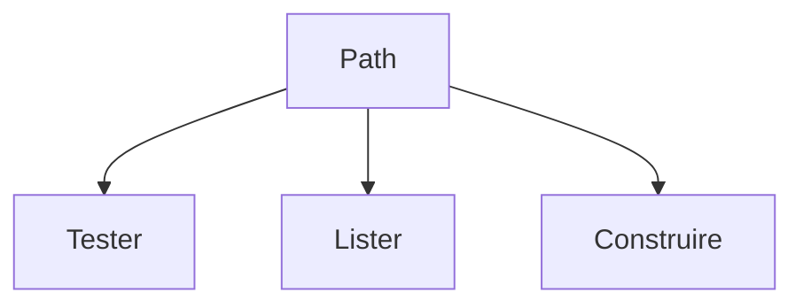

# Chemin de fichier

> [!info] En une phrase
> pathlib représente un chemin comme un objet Path : on le construit avec /, on teste s'il existe, on liste un dossier, sans se soucier de Windows ou Linux.

## 1 · Comprendre
### Définition
`Path` (module `pathlib`, bibliothèque standard) est un **objet chemin**. Au lieu de coller des bouts de texte avec `"\\"` ou `"/"`, on écrit `dossier / "photo.png"` et Python met le bon séparateur selon le système.

### Pourquoi ça existe
Écrire des chemins qui marchent à la fois sous Windows et dans un conteneur Linux, et avoir sous la main toutes les opérations courantes (existe ? extension ? lister ?).

### Le problème résolu
Les chemins écrits en texte (`"C:\\dossier\\" + nom`) cassent dès qu'on change de système, et les fonctions de l'ancien module `os.path` sont éparpillées.

## 2 · Explorer
### Comment ça fonctionne


| Pour… | On écrit |
| --- | --- |
| créer un chemin | `Path("donnees")`, `Path.cwd()` (dossier courant), `Path.home()` |
| assembler | `dossier / "sous" / "a.png"` |
| tester | `.exists()`, `.is_file()`, `.is_dir()` |
| décomposer | `.name` (`a.png`), `.stem` (`a`), `.suffix` (`.png`), `.parent` |
| lister un dossier | `.iterdir()` (un niveau), `.glob("*.png")`, `.rglob("*.png")` (récursif) |
| créer un dossier | `.mkdir(parents=True, exist_ok=True)` |
| chemin absolu | `.resolve()` |
| chemin relatif | `.relative_to(base)` |
| supprimer un fichier | `.unlink()` |

### Exemple concret
```python
from pathlib import Path

source = Path("donnees")
sortie = Path("sortie")
sortie.mkdir(exist_ok=True)

for fichier in source.rglob("*.png"):
    print(fichier.name, fichier.stat().st_size, "octets")
    print("  relatif :", fichier.relative_to(source))
```

> [!abstract]- Comment ça s'écrit (référence à chercher, pas à apprendre par cœur)
> L'idée est la même partout ; seule l'écriture change.
>
> **Python**
> ```python
> from pathlib import Path
> ici = Path(__file__).parent          # dossier du script
> fichier = ici / "data" / "depenses.csv"
> fichier.suffix, fichier.name, fichier.exists()
> ```
>
> **JavaScript (Node)**
> ```js
> import path from "node:path";
> const fichier = path.join("data", "depenses.csv");
> path.extname(fichier);   // ".csv"
> path.basename(fichier);  // "depenses.csv"
> new URL("./data.json", import.meta.url);  // à partir du script
> ```
> Un chemin relatif part du dossier où la commande est lancée (`process.cwd()`), pas du fichier du script.
>
> **Bash**
> ```bash
> ici="$(dirname "$0")"           # dossier du script
> fichier="$ici/data/depenses.csv"
> basename "$fichier"             # depenses.csv
> [ -f "$fichier" ] && echo "existe"
> ```

### Cas d'utilisation
- Trouver tous les fichiers à zipper dans un dossier et ses sous-dossiers
- Construire le chemin de l'archive de sortie

> [!warning] À ne pas confondre
> Un chemin **relatif** (`Path("donnees")`) dépend du dossier depuis lequel tu **lances** le script, pas de l'endroit où se trouve le fichier `.py`. Pour partir du script : `Path(__file__).parent / "donnees"`. Dans Docker, c'est le `WORKDIR`.

## 3 · Relier
- **Prérequis** : [[Système de fichiers]] · [[Boucle (for, while)]]
- **Complémentaires** : [[Lire et écrire un fichier]] · [[Copier et déplacer des fichiers (shutil)]]
- **Utilisé par** : [[Archive zip (zipfile)]] · [[Volume Docker]]
