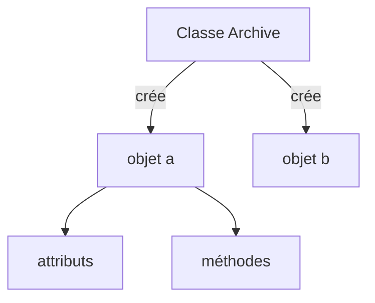

# Classe et objet

> [!info] En une phrase
> Une classe est un plan qui décrit un type de chose (ses données et ce qu'elle sait faire) ; un objet est une chose concrète fabriquée à partir de ce plan.

```dataviewjs
await dv.view("10 — Templates/Scripts/learning", { view: "concept" })
```

## 1 · Comprendre
### Définition
Jusqu'ici tu as rangé des données dans des dictionnaires et écrit des fonctions à côté. Une **classe** réunit les deux : des **attributs** (les données) et des **méthodes** (les fonctions qui travaillent sur ces données).
```python
class Archive:
    def __init__(self, nom: str):        # le constructeur : appelé à la création
        self.nom = nom                   # attribut
        self.fichiers: list[str] = []

    def ajouter(self, chemin: str) -> None:   # méthode
        self.fichiers.append(chemin)

    def taille(self) -> int:
        return len(self.fichiers)

a = Archive("export-12")      # un objet (une instance)
b = Archive("export-13")      # un autre objet, indépendant
a.ajouter("img1.png")
print(a.taille(), b.taille())  # 1 0
```
- `self` : l'objet sur lequel la méthode est appelée.
- **Encapsulation** : l'objet garde ses données et offre des méthodes pour les utiliser ; le reste du code n'a pas à savoir comment c'est rangé à l'intérieur. En Python, un nom qui commence par `_` signale « usage interne ».
- En JavaScript et TypeScript : `class Archive { constructor(nom) { this.nom = nom; } ajouter(c) { … } }`.

### Pourquoi ça existe
Quand des données et les opérations qui les concernent vont toujours ensemble, les garder séparées oblige à passer partout les mêmes dictionnaires et à répéter les mêmes vérifications.

### Le problème résolu
Modéliser les choses du problème (une tâche, une archive, un client d'API) avec leurs règles, en un seul endroit. C'est la base de la **programmation orientée objet** (POO) et de tous les design patterns.

## 2 · Explorer
### Comment ça fonctionne


### Exemple concret
Une classe qui protège ses règles :
```python
class Tache:
    STATUTS = ("a-faire", "en-cours", "fini")

    def __init__(self, nom: str):
        if not nom.strip():
            raise ValueError("nom vide")
        self.nom = nom
        self._statut = "a-faire"

    @property
    def statut(self) -> str:             # lecture comme un attribut
        return self._statut

    def avancer(self) -> None:           # la seule façon de changer le statut
        i = self.STATUTS.index(self._statut)
        if i < len(self.STATUTS) - 1:
            self._statut = self.STATUTS[i + 1]

    def __repr__(self) -> str:           # affichage lisible
        return f"Tache({self.nom!r}, {self._statut})"
```
Pour des données simples sans comportement, une `@dataclass` écrit `__init__` et `__repr__` à ta place :
```python
from dataclasses import dataclass
@dataclass
class Annotation:
    label: str
    x: float
    y: float
```

### Cas d'utilisation
- Le SDK de CVAT (`client.tasks.retrieve(12)` renvoie un objet tâche)
- Les composants Angular et les services
- Tous les design patterns

> [!warning] À ne pas confondre
> La **classe** (le plan, écrit une fois) et l'**objet** (une instance, il peut y en avoir des milliers). Et une classe n'est pas obligatoire : pour un petit script, des fonctions suffisent souvent.

## 3 · Pratiquer
- Écris une classe `Panier` avec `ajouter(produit, prix)`, `retirer(produit)` et `total()`, et crée deux paniers indépendants

## 4 · Expliquer
> [!quote] Mon résumé, avec mes mots
> _À écrire sans regarder la fiche. Si je bloque, je ne l'ai pas encore compris._

## 5 · Relier
- **Prérequis** : [[Fonction]] · [[Liste et dictionnaire]]
- **Complémentaires** : [[Héritage et composition]] · [[Interface et polymorphisme]]
- **Utilisé par** : [[Design pattern]]

## 6 · Réviser
> [!question] Me faire interroger
> Je demande à Claude de m'interroger sur cette notion pour vérifier que je l'ai comprise.

### Validation de la maîtrise
La notion est maîtrisée quand j'ai réussi **tous les exercices** qui l'utilisent (statut `reussi` dans l'exercice).

```dataviewjs
await dv.view("10 — Templates/Scripts/learning", { view: "maitrise" })
```
