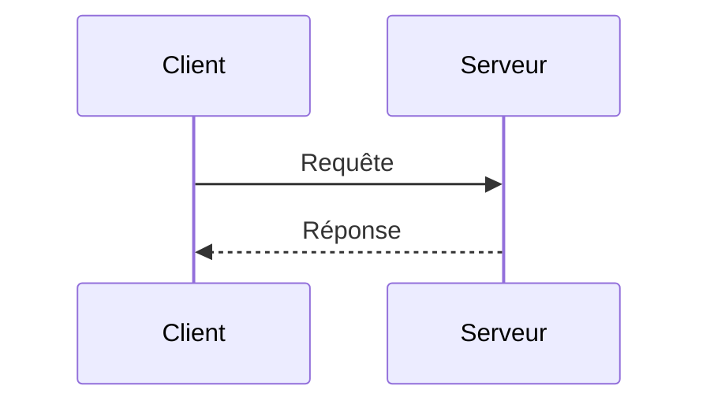

# Client-serveur

> [!info] En une phrase
> Un modèle où un programme (le client) demande quelque chose et un autre (le serveur) répond.

```dataviewjs
await dv.view("10 — Templates/Scripts/learning", { view: "concept" })
```

## 1 · Comprendre
### Définition
Le **client** envoie une requête (navigateur, application mobile, `curl`) ; le **serveur** l'attend en permanence, la traite et renvoie une réponse. Un même programme peut être client d'un service et serveur pour un autre.

### Pourquoi ça existe
Centraliser les données et la logique à un endroit (le serveur) tout en laissant de nombreux clients y accéder.

## 2 · Explorer
### Comment ça fonctionne


> [!warning] À ne pas confondre
> **Client** ≠ « l'utilisateur ». Le client est un *programme*. Et un **serveur** n'est pas forcément une grosse machine : `node server.js` sur ton PC est un serveur.

## 3 · Pratiquer

### Exercice visuel

Sur Excalidraw, **sans regarder la fiche**. Puis je compare avec la fiche, je corrige en rouge ce qui était faux, et j'explique mon dessin avec mes mots (section 4).

> [!example] 🛣️ Suis le trajet
> Dessine le trajet quand tu ouvres CVAT dans ton navigateur : qui est le client, qui est le serveur, ce qui part, ce qui revient.

> [!example] 🔄 Change de contexte
> Redessine le même schéma pour ta fonction Nuclio qui appelle le serveur CVAT. Qui est le client cette fois ? Un programme peut-il être les deux ?

### Mon schéma

> [!tip] Mon dessin Excalidraw
> _Je crée le dessin « Schéma - Client-serveur » et je l'intègre ici avec `![[Schéma - Client-serveur.excalidraw]]`._

### Appliquer dans le fil rouge
- Pas encore d'étape du fil rouge pour cette notion : je l'applique dans mon travail (CVAT, Nuclio) ou je demande une étape à Claude.

## 4 · Expliquer
> [!quote] Mon résumé, avec mes mots
> _J'explique mon schéma avec mes mots, sans regarder la fiche. Si je bloque, je ne l'ai pas encore compris._

## 5 · Relier
- **Prérequis** : [[Internet]]
- **Mène à** : [[HTTP]] (le langage du dialogue), [[API]]
- **En pratique** : [[Express]] sert à écrire le côté serveur

## 6 · Réviser
> [!question] Me faire interroger
> Je demande à Claude de m'interroger sur cette notion pour vérifier que je l'ai comprise.

### Validation de la maîtrise
La notion est maîtrisée quand je sais :
1. **l'expliquer** de façon fluide, à partir de mon schéma (section 4) ;
2. **l'adapter** à un autre contexte (consigne « Change de contexte », ou Claude m'interroge sur un autre cas) ;
3. **l'appliquer** pour de vrai dans le fil rouge (section 3).

Réussir un exercice ne suffit pas. C'est moi qui passe le statut en `maitrise`.

```dataviewjs
await dv.view("10 — Templates/Scripts/learning", { view: "maitrise" })
```
