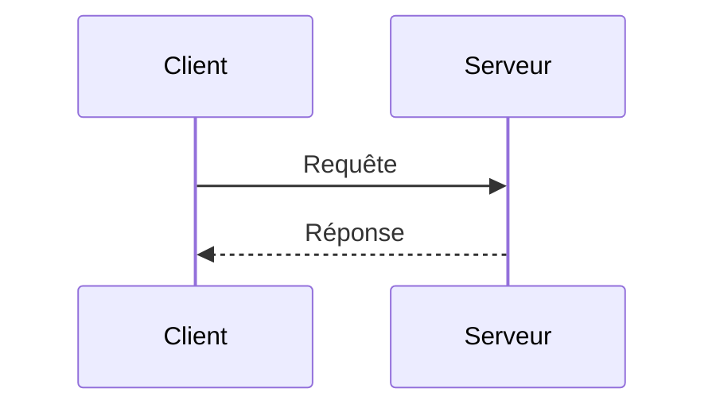

# Client-serveur

> [!info] En une phrase
> Un modèle où un programme (le client) demande quelque chose et un autre (le serveur) répond.

## 1 · Comprendre
### Définition
Le **client** envoie une requête (navigateur, application mobile, `curl`) ; le **serveur** l'attend en permanence, la traite et renvoie une réponse. Un même programme peut être client d'un service et serveur pour un autre.

### Pourquoi ça existe
Centraliser les données et la logique à un endroit (le serveur) tout en laissant de nombreux clients y accéder.

## 2 · Explorer
### Comment ça fonctionne

> [!warning] À ne pas confondre
> **Client** ≠ « l'utilisateur ». Le client est un *programme*. Et un **serveur** n'est pas forcément une grosse machine : `node server.js` sur ton PC est un serveur.

## 3 · Relier
- **Prérequis** : [[Internet]]
- **Mène à** : [[HTTP]] (le langage du dialogue), [[API]]
- **En pratique** : [[Express]] sert à écrire le côté serveur
