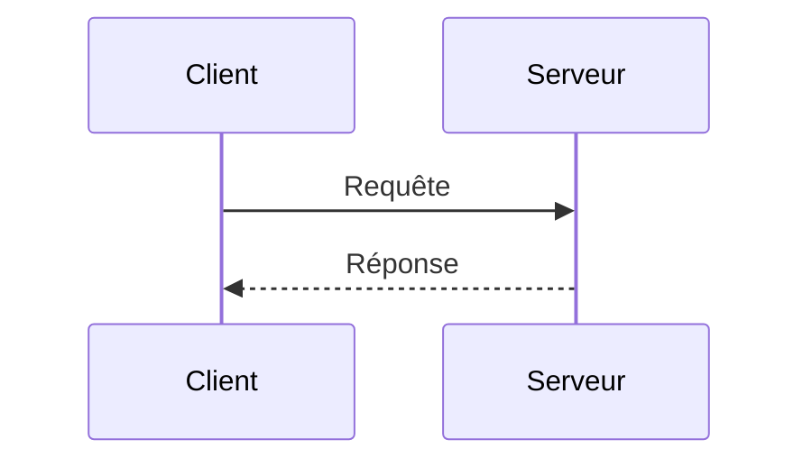

# Client-serveur

> [!info] En une phrase
> Un modèle où un programme (le client) demande quelque chose et un autre (le serveur) répond.

```dataviewjs
await dv.view("10 — Templates/Scripts/learning", { view: "concept" })
```

## 1 · Comprendre
### Définition
Le **client** envoie une requête (navigateur, application mobile, `curl`) ; le **serveur** l'attend en permanence, la traite et renvoie une réponse. Un même programme peut être client d'un service et serveur pour un autre.

### Pourquoi ça existe
Centraliser les données et la logique à un endroit (le serveur) tout en laissant de nombreux clients y accéder.

## 2 · Explorer
### Comment ça fonctionne


> [!warning] À ne pas confondre
> **Client** ≠ « l'utilisateur ». Le client est un *programme*. Et un **serveur** n'est pas forcément une grosse machine : `node server.js` sur ton PC est un serveur.

## 3 · Pratiquer
- Les exercices de cette notion sont listés en haut de la fiche et dans *Validation de la maîtrise*.

## 4 · Expliquer
> [!quote] Mon résumé, avec mes mots
> _À écrire sans regarder la fiche. Si je bloque, je ne l'ai pas encore compris._

## 5 · Relier
- **Prérequis** : [[Internet]]
- **Mène à** : [[HTTP]] (le langage du dialogue), [[API]]
- **En pratique** : [[Express]] sert à écrire le côté serveur

## 6 · Réviser
> [!question] Me faire interroger
> Je demande à Claude de m'interroger sur cette notion pour vérifier que je l'ai comprise.

### Validation de la maîtrise
La notion est maîtrisée quand j'ai réussi **tous les exercices** qui l'utilisent (statut `reussi` dans l'exercice).

```dataviewjs
await dv.view("10 — Templates/Scripts/learning", { view: "maitrise" })
```
