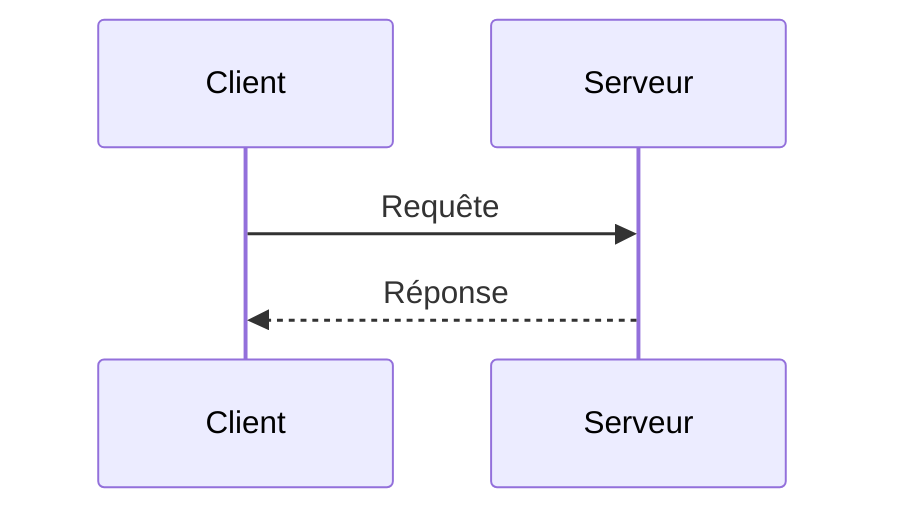

# Client-serveur

> [!info] En une phrase
> Un modèle où un programme (le client) demande quelque chose et un autre (le serveur) répond.

```dataviewjs
await dv.view("10 — Templates/Scripts/learning", { view: "concept" })
```

## 1 · Comprendre
### Définition
Le **client** envoie une requête (navigateur, application mobile, `curl`) ; le **serveur** l'attend en permanence, la traite et renvoie une réponse. Un même programme peut être client d'un service et serveur pour un autre.

### Pourquoi ça existe
Centraliser les données et la logique à un endroit (le serveur) tout en laissant de nombreux clients y accéder.

## 2 · Explorer
### Comment ça fonctionne


> [!warning] À ne pas confondre
> **Client** ≠ « l'utilisateur ». Le client est un *programme*. Et un **serveur** n'est pas forcément une grosse machine : `node server.js` sur ton PC est un serveur.

## 3 · Pratiquer

### Exercice visuel

Sur Excalidraw, **sans regarder la fiche**. Puis je compare avec la fiche, je corrige en rouge ce qui était faux, et j'explique mon dessin à voix haute ou à Claude dans le chat.

> [!example] 🛣️ Suis le trajet
> Dessine le trajet quand tu ouvres un site dans ton navigateur : qui est le client, qui est le serveur, ce qui part, ce qui revient.

> [!example] 🔄 Change de contexte
> Redessine le même schéma pour un script qui appelle une API. Qui est le client cette fois ? Un programme peut-il être client et serveur à la fois ?

### Mon schéma

> [!tip] Mon dessin Excalidraw
> _Je crée le dessin « Schéma - Client-serveur » et je l'intègre ici avec `![[Schéma - Client-serveur.excalidraw]]`, puis je coche `schema`._

### Appliquer dans le fil rouge
- [[MesDépenses 01 - Prendre l'API en main]]

## 4 · Relier
- **Prérequis** : [[Internet]]
- **Mène à** : [[HTTP]] (le langage du dialogue), [[API]]
- **En pratique** : [[Express]] sert à écrire le côté serveur

## 5 · Réviser
> [!question] Me faire interroger
> Je demande à Claude de m'interroger sur cette notion pour vérifier que je l'ai comprise.

### Validation (compris, puis maîtrisé)
Trois cases à cocher dans les propriétés de la fiche :
- `schema` : mon dessin du concept est dans « Mon schéma » ;
- `exercice_visuel` : j'ai fait et corrigé les exercices visuels de la section 3 ;
- `fil_rouge` : je l'ai appliqué dans le fil rouge (coché tout seul quand une étape qui l'utilise est réussie).

Les trois cochées : la notion compte comme **comprise**. **Maîtrisé** : c'est moi qui le mets dans `status`, quand je le sens.

```dataviewjs
await dv.view("10 — Templates/Scripts/learning", { view: "maitrise" })
```
