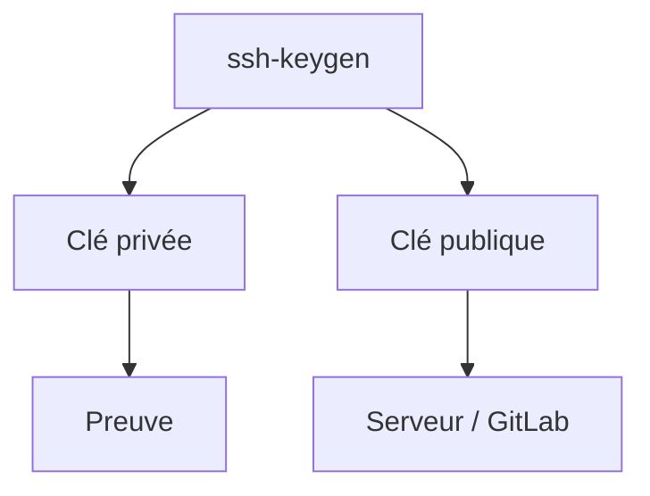

# Clé SSH

> [!info] En une phrase
> Une paire de clés (privée, gardée secrète ; publique, donnée au serveur) qui remplace le mot de passe pour SSH et Git.

```dataviewjs
await dv.view("10 — Templates/Scripts/learning", { view: "concept" })
```

## 1 · Comprendre
### Définition
`ssh-keygen` crée deux fichiers : `~/.ssh/id_ed25519` (**privée**, ne la donne jamais) et `~/.ssh/id_ed25519.pub` (**publique**, à copier sur le serveur ou dans GitLab). Le serveur vérifie que tu possèdes la clé privée sans qu'elle circule.

### Pourquoi ça existe
Plus sûr et plus pratique qu'un mot de passe : rien à retaper, rien à deviner.

### Le problème résolu
Les mots de passe se devinent, se réutilisent et se volent.

## 2 · Explorer
### Comment ça fonctionne


### Exemple concret
```bash
ssh-keygen -t ed25519 -C "oumar@poste"       # crée la paire (une phrase de passe est conseillée)
cat ~/.ssh/id_ed25519.pub                     # à coller dans GitLab > Preferences > SSH Keys
ssh-copy-id oumar@serveur                     # l'installer sur un serveur
ssh -T git@gitlab.com                         # tester l'accès GitLab
chmod 600 ~/.ssh/id_ed25519                   # SSH refuse une clé privée lisible par d'autres
```

### Cas d'utilisation
- Pousser sur GitLab sans mot de passe
- Se connecter aux serveurs ; donner une clé de déploiement à la CI (variable de type File)

> [!warning] À ne pas confondre
> La clé **publique** (`.pub`, se partage) et la clé **privée** (sans extension, **jamais** dans Git, un ticket ou un chat). Une clé créée sous Windows et une sous WSL sont deux clés différentes : chaque côté a son `~/.ssh`.

## 3 · Pratiquer

### Exercice visuel

Sur Excalidraw, **sans regarder la fiche**. Puis je compare avec la fiche, je corrige en rouge ce qui était faux, et j'explique mon dessin avec mes mots (section 4).

> [!example] 🧠 Dessine de mémoire
> Dessine la paire de clés : la privée (où elle reste), la publique (où tu la colles). Montre ce qui voyage pendant la connexion.

> [!example] 🔍 Trouve l'erreur
> Ce schéma est faux. Corrige-le en rouge et explique l'erreur.
>
> ```mermaid
> flowchart TD
>   P[Clé privée] --> G[Collée GitLab]
>   G --> C[Connexion OK]
> ```

### Mon schéma

> [!tip] Mon dessin Excalidraw
> _Je crée le dessin « Schéma - Clé SSH » et je l'intègre ici avec `![[Schéma - Clé SSH.excalidraw]]`._

### Appliquer dans le fil rouge
- Pas encore d'étape du fil rouge pour cette notion : je l'applique dans mon travail (CVAT, Nuclio) ou je demande une étape à Claude.

## 4 · Expliquer
> [!quote] Mon résumé, avec mes mots
> _J'explique mon schéma avec mes mots, sans regarder la fiche. Si je bloque, je ne l'ai pas encore compris._

## 5 · Relier
- **Prérequis** : [[SSH]]
- **Complémentaires** : [[Certificat]] · [[Permissions Linux]]
- **Commandes** : [[ssh-keygen]]

## 6 · Réviser
> [!question] Me faire interroger
> Je demande à Claude de m'interroger sur cette notion pour vérifier que je l'ai comprise.

### Validation de la maîtrise
La notion est maîtrisée quand je sais :
1. **l'expliquer** de façon fluide, à partir de mon schéma (section 4) ;
2. **l'adapter** à un autre contexte (consigne « Change de contexte », ou Claude m'interroge sur un autre cas) ;
3. **l'appliquer** pour de vrai dans le fil rouge (section 3).

Réussir un exercice ne suffit pas. C'est moi qui passe le statut en `maitrise`.

```dataviewjs
await dv.view("10 — Templates/Scripts/learning", { view: "maitrise" })
```
