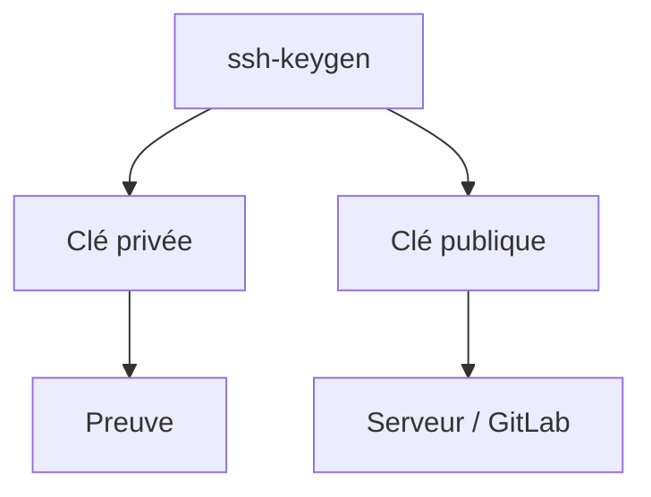

# Clé SSH

> [!info] En une phrase
> Une paire de clés (privée, gardée secrète ; publique, donnée au serveur) qui remplace le mot de passe pour SSH et Git.

```dataviewjs
await dv.view("10 — Templates/Scripts/learning", { view: "concept" })
```

## 1 · Comprendre
### Définition
`ssh-keygen` crée deux fichiers : `~/.ssh/id_ed25519` (**privée**, ne la donne jamais) et `~/.ssh/id_ed25519.pub` (**publique**, à copier sur le serveur ou dans GitLab). Le serveur vérifie que tu possèdes la clé privée sans qu'elle circule.

### Pourquoi ça existe
Plus sûr et plus pratique qu'un mot de passe : rien à retaper, rien à deviner.

### Le problème résolu
Les mots de passe se devinent, se réutilisent et se volent.

## 2 · Explorer
### Comment ça fonctionne


### Exemple concret
```bash
ssh-keygen -t ed25519 -C "oumar@poste"       # crée la paire (une phrase de passe est conseillée)
cat ~/.ssh/id_ed25519.pub                     # à coller dans GitLab > Preferences > SSH Keys
ssh-copy-id oumar@serveur                     # l'installer sur un serveur
ssh -T git@gitlab.com                         # tester l'accès GitLab
chmod 600 ~/.ssh/id_ed25519                   # SSH refuse une clé privée lisible par d'autres
```

### Cas d'utilisation
- Pousser sur GitLab sans mot de passe
- Se connecter aux serveurs ; donner une clé de déploiement à la CI (variable de type File)

> [!warning] À ne pas confondre
> La clé **publique** (`.pub`, se partage) et la clé **privée** (sans extension, **jamais** dans Git, un ticket ou un chat). Une clé créée sous Windows et une sous WSL sont deux clés différentes : chaque côté a son `~/.ssh`.

## 3 · Pratiquer
- Crée une clé dans WSL, ajoute-la à ton compte GitLab, et clone un dépôt en SSH.

## 4 · Expliquer
> [!quote] Mon résumé, avec mes mots
> _À écrire sans regarder la fiche. Si je bloque, je ne l'ai pas encore compris._

## 5 · Relier
- **Prérequis** : [[SSH]]
- **Complémentaires** : [[Certificat]] · [[Permissions Linux]]
- **Commandes** : [[ssh-keygen]]

## 6 · Réviser
> [!question] Me faire interroger
> Je demande à Claude de m'interroger sur cette notion pour vérifier que je l'ai comprise.

### Validation de la maîtrise
- [ ] Je l'explique sans notes, en 3 phrases, à quelqu'un qui ne connaît pas
- [ ] J'ai réussi un exercice qui l'utilise
- [ ] Je l'ai utilisé dans un projet
- [ ] Je sais dire quand ne pas l'utiliser (ou ce qu'il ne faut pas confondre)
