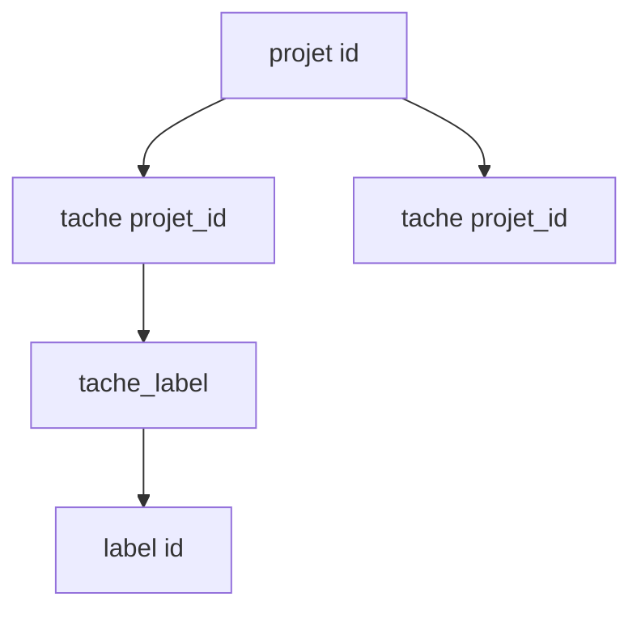

# Clé primaire et clé étrangère

> [!info] En une phrase
> La clé primaire identifie chaque ligne d'une table de façon unique ; la clé étrangère est une colonne qui pointe vers la clé primaire d'une autre table, ce qui relie les tables.

```dataviewjs
await dv.view("10 — Templates/Scripts/learning", { view: "concept" })
```

## 1 · Comprendre
### Définition
```sql
CREATE TABLE projet (
  id   SERIAL PRIMARY KEY,          -- clé primaire : unique, jamais NULL
  nom  TEXT NOT NULL UNIQUE
);
CREATE TABLE tache (
  id         SERIAL PRIMARY KEY,
  projet_id  INTEGER NOT NULL REFERENCES projet(id) ON DELETE CASCADE,  -- clé étrangère
  nom        TEXT NOT NULL
);
```
- **Clé primaire** (*primary key*) : souvent un entier auto-incrémenté (`SERIAL`, `GENERATED ALWAYS AS IDENTITY`) ou un UUID.
- **Clé étrangère** (*foreign key*) : la base **refuse** une tâche dont le `projet_id` n'existe pas (intégrité référentielle).
- `ON DELETE CASCADE` : supprimer un projet supprime ses tâches ; `RESTRICT` : interdit la suppression tant qu'il a des tâches.
Relations : **1-N** (un projet, plusieurs tâches : la clé étrangère est côté N) ; **N-N** (tâches et labels : une **table de liaison** `tache_label(tache_id, label_id)`).

### Pourquoi ça existe
Les données sont rangées dans plusieurs tables pour ne pas les répéter ; il faut un moyen fiable de les relier.

### Le problème résolu
Éviter les doublons et les incohérences (une tâche qui pointe vers un projet supprimé).

## 2 · Explorer
### Comment ça fonctionne


### Exemple concret
```sql
INSERT INTO projet (nom) VALUES ('Chantier');           -- id = 1
INSERT INTO tache (projet_id, nom) VALUES (1, 'Images 01');
INSERT INTO tache (projet_id, nom) VALUES (42, 'X');
-- ERROR: insert or update on table "tache" violates foreign key constraint
```
CVAT stocke ainsi projets, tâches, jobs et annotations dans PostgreSQL.

### Cas d'utilisation
- Toute base relationnelle
- Concevoir le schéma d'une application
- Comprendre les erreurs de contrainte

> [!warning] À ne pas confondre
> Une **clé étrangère** n'est pas un **index** : PostgreSQL ne crée pas d'index automatiquement sur la colonne `projet_id`, il faut souvent l'ajouter.

## 3 · Pratiquer
- Dessine les tables d'une application de notes avec utilisateurs, notes et étiquettes, et place toutes les clés

## 4 · Expliquer
> [!quote] Mon résumé, avec mes mots
> _À écrire sans regarder la fiche. Si je bloque, je ne l'ai pas encore compris._

## 5 · Relier
- **Prérequis** : [[Base de données relationnelle]] · [[SQL]]
- **Complémentaires** : [[Jointure SQL]]
- **Utilisé par** : [[ORM]]

## 6 · Réviser
> [!question] Me faire interroger
> Je demande à Claude de m'interroger sur cette notion pour vérifier que je l'ai comprise.

### Validation de la maîtrise
La notion est maîtrisée quand j'ai réussi **tous les exercices** qui l'utilisent (statut `reussi` dans l'exercice).

```dataviewjs
await dv.view("10 — Templates/Scripts/learning", { view: "maitrise" })
```
