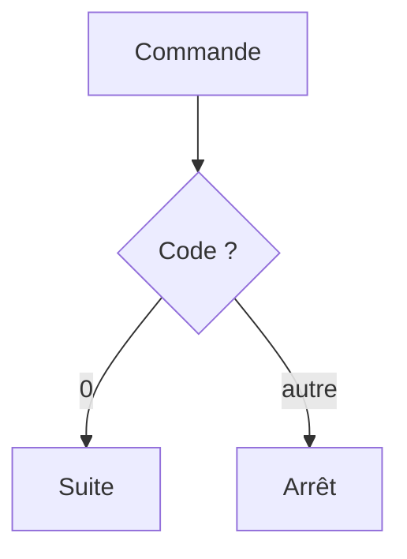

# Code de sortie

> [!info] En une phrase
> Le nombre qu'un programme renvoie en se terminant : 0 veut dire « tout va bien », autre chose veut dire « échec ».

```dataviewjs
await dv.view("10 — Templates/Scripts/learning", { view: "concept" })
```

## 1 · Comprendre
### Définition
Chaque programme qui s'arrête renvoie un **code de sortie** (*exit code*) entre 0 et 255. **0 = succès**, tout le reste = échec. Le texte affiché ne compte pas : seul ce nombre dit officiellement si ça a marché.

### Pourquoi ça existe
Pour que les programmes s'enchaînent sans humain : un script, Docker ou la CI regardent ce code pour décider de continuer ou de s'arrêter.

### Le problème résolu
Sans code de sortie, une machine ne peut pas savoir si une commande a réussi : il faudrait lire et interpréter son texte.

## 2 · Explorer
### Comment ça fonctionne


### Exemple concret
```bash
ls dossier-qui-nexiste-pas
echo $?          # Bash : affiche le code de la dernière commande (ici 2)
```
```powershell
echo $LASTEXITCODE   # PowerShell
```
```python
import sys
if not fichier.exists():
    print("Fichier introuvable", file=sys.stderr)
    sys.exit(1)      # le script se termine en échec
```
Un script Python qui plante sur une exception non attrapée sort avec le code **1**.

### Cas d'utilisation
- **GitLab CI** : un job échoue dès qu'une ligne de `script:` renvoie autre chose que 0.
- **Docker** : `docker ps -a` affiche `Exited (1)` pour un conteneur qui a échoué.
- En Bash, `cmd1 && cmd2` lance `cmd2` seulement si `cmd1` a réussi.

> [!warning] À ne pas confondre
> Un programme qui **affiche** « erreur » mais sort avec 0 est vu comme un succès par la CI. À l'inverse, un avertissement affiché n'est pas un échec tant que le code vaut 0.

## 3 · Pratiquer
- Lance une commande qui réussit et une qui échoue, et affiche leur code à chaque fois.
- Écris un script Python qui fait `sys.exit(3)` et vérifie le code obtenu.

## 4 · Expliquer
> [!quote] Mon résumé, avec mes mots
> _À écrire sans regarder la fiche. Si je bloque, je ne l'ai pas encore compris._

## 5 · Relier
- **Prérequis** : [[Terminal]]
- **Complémentaires** : [[Exception]] · [[Variable d'environnement]]
- **Utilisé par** : [[Pipeline GitLab CI]] · [[Conteneur]] · [[pytest]]

## 6 · Réviser
> [!question] Me faire interroger
> Je demande à Claude de m'interroger sur cette notion pour vérifier que je l'ai comprise.

### Validation de la maîtrise
La notion est maîtrisée quand j'ai réussi **tous les exercices** qui l'utilisent (statut `reussi` dans l'exercice).

```dataviewjs
await dv.view("10 — Templates/Scripts/learning", { view: "maitrise" })
```
