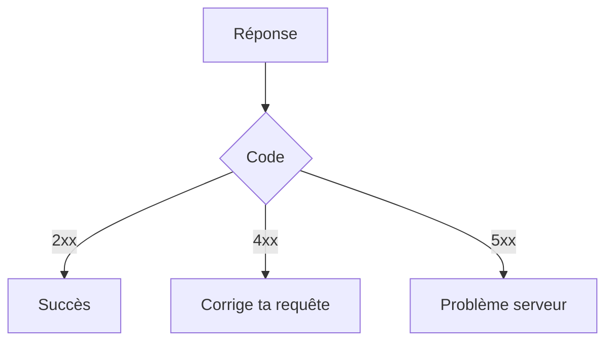

# Code de statut HTTP

> [!info] En une phrase
> Le nombre à trois chiffres en tête d'une réponse HTTP dit comment ça s'est passé : 2xx succès, 3xx redirection, 4xx erreur du client, 5xx erreur du serveur.

```dataviewjs
await dv.view("10 — Templates/Scripts/learning", { view: "concept" })
```

## 1 · Comprendre
### Définition
| Code | Sens | Quand |
| --- | --- | --- |
| **200** OK | succès | GET, PATCH réussis |
| **201** Created | ressource créée | POST réussi |
| **204** No Content | succès, rien à renvoyer | DELETE réussi |
| **301 / 302** | redirection | l'adresse a changé (`Location`) |
| **304** Not Modified | utilise ton cache | |
| **400** Bad Request | requête mal formée ou invalide | JSON cassé, champ manquant |
| **401** Unauthorized | pas (ou mal) authentifié | jeton absent ou expiré |
| **403** Forbidden | authentifié mais pas autorisé | pas le bon rôle |
| **404** Not Found | ressource ou route inconnue | |
| **409** Conflict | conflit avec l'état actuel | doublon |
| **422** Unprocessable | données valides en JSON mais refusées | validation |
| **429** Too Many Requests | trop d'appels | limite de débit |
| **500** Internal Server Error | bug côté serveur | exception non gérée |
| **502 / 503 / 504** | passerelle / indisponible / délai | le [[Reverse proxy]] n'atteint pas l'application |

### Pourquoi ça existe
Le client doit savoir, sans lire le texte, si la requête a marché et qui est en tort.

### Le problème résolu
Réagir automatiquement : réessayer un 503, se reconnecter après un 401, afficher l'erreur d'un 400.

## 2 · Explorer
### Comment ça fonctionne


### Exemple concret
```bash
curl -i https://api.github.com/repos/inexistant/inexistant
# HTTP/2 404
curl -s -o /dev/null -w "%{http_code}\n" https://example.com
# 200
```
En Python : `rep.raise_for_status()` lève une exception pour 4xx et 5xx. En JS : tester `rep.ok`.

### Cas d'utilisation
- Déboguer une API (onglet Réseau, `curl -i`)
- Écrire des réponses correctes dans Express
- Comprendre une 502 derrière Traefik

> [!warning] À ne pas confondre
> **401** (qui es-tu ? connecte-toi) et **403** (je sais qui tu es, mais c'est non). Et **502** (le proxy n'a pas eu de réponse valide de l'application) n'est pas **500** (l'application a planté en répondant).

## 3 · Pratiquer
- Provoque avec curl un 200, un 201, un 404 et un 401 sur des API publiques

## 4 · Expliquer
> [!quote] Mon résumé, avec mes mots
> _À écrire sans regarder la fiche. Si je bloque, je ne l'ai pas encore compris._

## 5 · Relier
- **Prérequis** : [[HTTP]]
- **Complémentaires** : [[Méthode HTTP]] · [[Gestion des erreurs d'une API]]

## 6 · Réviser
> [!question] Me faire interroger
> Je demande à Claude de m'interroger sur cette notion pour vérifier que je l'ai comprise.

### Validation de la maîtrise
La notion est maîtrisée quand j'ai réussi **tous les exercices** qui l'utilisent (statut `reussi` dans l'exercice).

```dataviewjs
await dv.view("10 — Templates/Scripts/learning", { view: "maitrise" })
```
