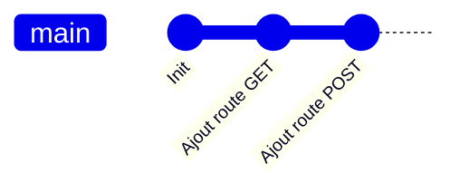

# Commit

> [!info] En une phrase
> Une photo enregistrée de ton projet à un instant donné, avec un message qui explique ce qui a changé.

```dataviewjs
await dv.view("10 — Templates/Scripts/learning", { view: "concept" })
```

## 1 · Comprendre
### Définition
Un **commit** enregistre le contenu de l'index, l'auteur, la date, un message et un lien vers le commit précédent. Il est identifié par un **hash** (`a1b2c3d…`).

### Pourquoi ça existe
Garder une trace de chaque étape du projet, pouvoir revenir en arrière et savoir qui a changé quoi, et pourquoi.

### Le problème résolu
Les copies `projet_v2_final_vraiment.zip` et l'impossibilité de savoir quelle modification a cassé le code.

## 2 · Explorer
### Comment ça fonctionne


### Exemple concret
```bash
git add zipper.py
git commit -m "feat: ajoute l'option --dry-run"
git show --stat HEAD      # le dernier commit : auteur, date, message, fichiers
```
Un bon commit : **une seule** intention, un message qui dit *quoi* (et, dans le corps, *pourquoi*). Voir [[Convention de commit]].

### Cas d'utilisation
- Chaque étape cohérente d'un travail
- Le point de départ d'une pipeline de CI

> [!warning] À ne pas confondre
> **Enregistrer un fichier** (Ctrl+S, sur le disque) et **committer** (l'ajouter à l'historique Git). Un fichier enregistré n'est pas encore dans Git.

## 3 · Pratiquer

### Exercice visuel

Sur Excalidraw, **sans regarder la fiche**. Puis je compare avec la fiche, je corrige en rouge ce qui était faux, et j'explique mon dessin avec mes mots (section 4).

> [!example] 🧠 Dessine de mémoire
> Dessine un commit comme une photo : ce qu'elle contient, son message, son lien vers le commit parent.

> [!example] 🛣️ Suis le trajet
> Suis le trajet d'une modification de `main.py` : fichier modifié, `git add`, `git commit`. Dessine où elle se trouve à chaque étape.

### Mon schéma

> [!tip] Mon dessin Excalidraw
> _Je crée le dessin « Schéma - Commit » et je l'intègre ici avec `![[Schéma - Commit.excalidraw]]`._

### Appliquer dans le fil rouge
- Pas encore d'étape du fil rouge pour cette notion : je l'applique dans mon travail (CVAT, Nuclio) ou je demande une étape à Claude.

## 4 · Expliquer
> [!quote] Mon résumé, avec mes mots
> _J'explique mon schéma avec mes mots, sans regarder la fiche. Si je bloque, je ne l'ai pas encore compris._

## 5 · Relier
- **Prérequis** : [[Dépôt Git]]
- **Mène à** : [[Branche Git]]
- **Commandes** : [[git add]] · [[git commit]]

## 6 · Réviser
> [!question] Me faire interroger
> Je demande à Claude de m'interroger sur cette notion pour vérifier que je l'ai comprise.

### Validation de la maîtrise
La notion est maîtrisée quand je sais :
1. **l'expliquer** de façon fluide, à partir de mon schéma (section 4) ;
2. **l'adapter** à un autre contexte (consigne « Change de contexte », ou Claude m'interroge sur un autre cas) ;
3. **l'appliquer** pour de vrai dans le fil rouge (section 3).

Réussir un exercice ne suffit pas. C'est moi qui passe le statut en `maitrise`.

```dataviewjs
await dv.view("10 — Templates/Scripts/learning", { view: "maitrise" })
```
