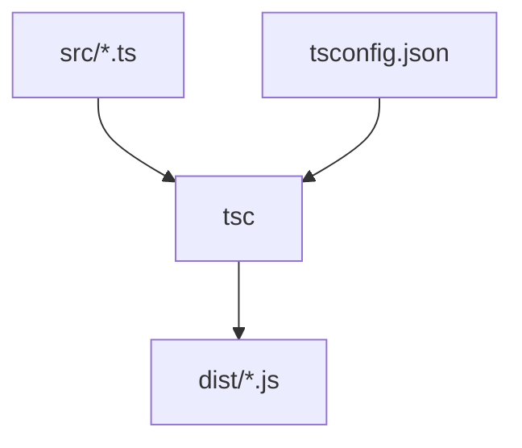

# Compilation TypeScript (tsc et tsconfig)

> [!info] En une phrase
> tsc est le compilateur TypeScript : il lit tsconfig.json, vérifie les types de tout le projet et produit les fichiers JavaScript.

```dataviewjs
await dv.view("10 — Templates/Scripts/learning", { view: "concept" })
```

## 1 · Comprendre
### Définition
- **`tsc`** : vérifie et compile. `tsc --noEmit` vérifie seulement.
- **`tsconfig.json`** : la configuration du projet.
```json
{
  "compilerOptions": {
    "target": "ES2022",        // version de JS produite
    "module": "ESNext",
    "strict": true,            // toutes les vérifications : à garder !
    "outDir": "dist",          // où écrire les .js
    "rootDir": "src",
    "sourceMap": true          // pour déboguer le .ts dans le navigateur
  },
  "include": ["src"]
}
```
Dans les projets React (Vite), Vue ou Angular, la compilation est faite par l'outil du framework ; `tsconfig.json` reste la référence des règles.
Les **fichiers de types** `.d.ts` décrivent une bibliothèque JS (paquets `@types/…`).

### Pourquoi ça existe
Les moteurs JS n'exécutent pas TypeScript : il faut une étape qui vérifie puis traduit.

### Le problème résolu
Avoir les mêmes règles pour toute l'équipe et un échec clair (dans la CI aussi) si le code ne respecte pas les types.

## 2 · Explorer
### Comment ça fonctionne


### Exemple concret
```bash
npm install --save-dev typescript
npx tsc --init          # crée tsconfig.json
npx tsc                 # compile src/ vers dist/
node dist/index.js
npx tsc --noEmit        # vérification seule (utile en CI)
```
Pour exécuter directement un `.ts` en développement : `npx tsx fichier.ts`.

### Cas d'utilisation
- Job de vérification des types dans une pipeline CI
- Compiler une bibliothèque ou un backend Node
- Comprendre les erreurs du build Angular ou Vite

> [!warning] À ne pas confondre
> Vite et `tsx` **retirent** les types sans les vérifier (pour aller vite) : seul `tsc` (ou l'éditeur) vérifie. Un projet peut donc tourner avec des erreurs de type ; d'où `tsc --noEmit` dans la CI.

## 3 · Pratiquer
- Crée un projet TypeScript avec `tsc --init`, compile, puis désactive `strict` et observe ce qui n'est plus signalé

## 4 · Expliquer
> [!quote] Mon résumé, avec mes mots
> _À écrire sans regarder la fiche. Si je bloque, je ne l'ai pas encore compris._

## 5 · Relier
- **Prérequis** : [[TypeScript]] · [[npm]]
- **Complémentaires** : [[Pipeline GitLab CI]]

## 6 · Réviser
> [!question] Me faire interroger
> Je demande à Claude de m'interroger sur cette notion pour vérifier que je l'ai comprise.

### Validation de la maîtrise
La notion est maîtrisée quand j'ai réussi **tous les exercices** qui l'utilisent (statut `reussi` dans l'exercice).

```dataviewjs
await dv.view("10 — Templates/Scripts/learning", { view: "maitrise" })
```
