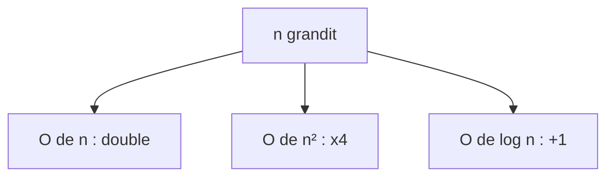

# Complexité (notation grand O)

> [!info] En une phrase
> La complexité décrit comment le temps (ou la mémoire) d'un algorithme grandit quand la taille des données grandit ; la notation grand O en donne l'ordre de grandeur : O(1), O(log n), O(n), O(n log n), O(n²).

```dataviewjs
await dv.view("10 — Templates/Scripts/learning", { view: "concept" })
```

## 1 · Comprendre
### Définition
On ne mesure pas des secondes (elles dépendent de la machine), mais le **nombre d'opérations** en fonction de **n**, la taille de l'entrée, pour de grands n.
| Notation | Nom | n = 1 000 | n = 1 000 000 | Exemple |
| --- | --- | --- | --- | --- |
| O(1) | constant | 1 | 1 | lire `liste[5]`, chercher dans un dictionnaire |
| O(log n) | logarithmique | ~10 | ~20 | [[Recherche linéaire et dichotomique|recherche dichotomique]] |
| O(n) | linéaire | 1 000 | 1 000 000 | parcourir une liste une fois |
| O(n log n) | quasi linéaire | ~10 000 | ~20 000 000 | un bon [[Algorithmes de tri|tri]] |
| O(n²) | quadratique | 1 000 000 | 1 000 000 000 000 | deux boucles imbriquées sur la même liste |
| O(2ⁿ) | exponentiel | impossible | impossible | essayer toutes les combinaisons |
Règles pour estimer :
- une boucle sur n éléments : O(n) ;
- deux boucles **imbriquées** sur n : O(n²) ;
- deux boucles **l'une après l'autre** : O(n) + O(n) = O(n) ;
- couper le problème en deux à chaque étape : O(log n) ;
- on garde le terme qui grandit le plus vite et on oublie les constantes : 3n² + 5n + 2 → O(n²).

### Pourquoi ça existe
Un programme qui marche sur 100 fichiers peut prendre des heures sur 100 000 si l'algorithme est quadratique.

### Le problème résolu
Prévoir si une solution tiendra la charge, et choisir entre deux algorithmes avant même de les écrire.

## 2 · Explorer
### Comment ça fonctionne


### Exemple concret
Trouver les doublons d'une liste :
```python
# O(n²) : chaque élément comparé à tous les autres
def doublons_lent(l):
    res = set()
    for i in range(len(l)):
        for j in range(i + 1, len(l)):
            if l[i] == l[j]:
                res.add(l[i])
    return res
# O(n) : un seul passage avec un ensemble (recherche en O(1))
def doublons_rapide(l):
    vus, res = set(), set()
    for x in l:
        if x in vus:
            res.add(x)
        vus.add(x)
    return res
```
Sur 100 000 éléments : environ 5 milliards de comparaisons contre 100 000.
Pièges cachés : `x in liste` est O(n) (on parcourt la liste) alors que `x in ensemble` ou `cle in dictionnaire` est O(1).

### Cas d'utilisation
- Choisir une structure de données
- Comprendre pourquoi un script devient lent
- Requêtes SQL sans index (parcours complet de la table)

> [!warning] À ne pas confondre
> La complexité n'est pas la vitesse réelle : pour 10 éléments, un O(n²) simple peut être plus rapide qu'un O(n log n) compliqué. Elle compte quand **n devient grand**. Et ne pas optimiser avant d'avoir mesuré qu'il y a un problème.

## 3 · Pratiquer
- Pour cinq petites fonctions données, estime leur complexité, puis vérifie en mesurant le temps pour n = 1 000, 10 000 et 100 000

## 4 · Expliquer
> [!quote] Mon résumé, avec mes mots
> _À écrire sans regarder la fiche. Si je bloque, je ne l'ai pas encore compris._

## 5 · Relier
- **Prérequis** : [[Motifs de boucle]] · [[Liste et dictionnaire]]
- **Complémentaires** : [[Index de base de données]] · [[Table de hachage]]

## 6 · Réviser
> [!question] Me faire interroger
> Je demande à Claude de m'interroger sur cette notion pour vérifier que je l'ai comprise.

### Validation de la maîtrise
La notion est maîtrisée quand j'ai réussi **tous les exercices** qui l'utilisent (statut `reussi` dans l'exercice).

```dataviewjs
await dv.view("10 — Templates/Scripts/learning", { view: "maitrise" })
```
