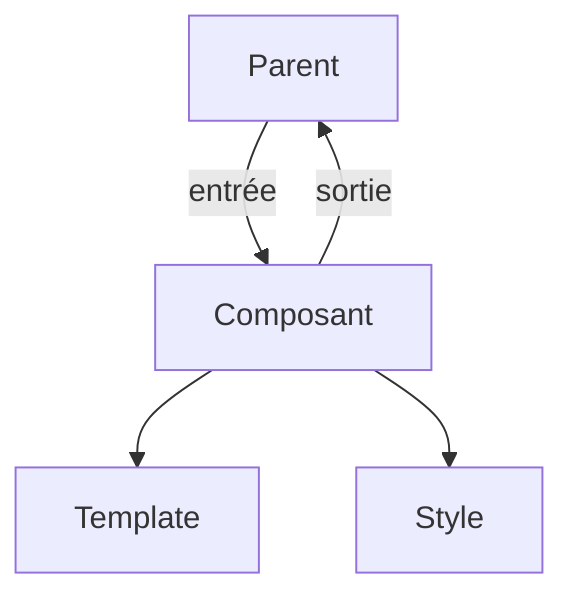

# Composant Angular

> [!info] En une phrase
> Un composant Angular est une classe TypeScript décorée par @Component, associée à un template HTML et à un style ; il reçoit des entrées et émet des sorties.

```dataviewjs
await dv.view("10 — Templates/Scripts/learning", { view: "concept" })
```

## 1 · Comprendre
### Définition
```ts
import { Component, input, output } from "@angular/core";
@Component({
  selector: "app-carte-tache",       // la balise : <app-carte-tache>
  standalone: true,
  templateUrl: "./carte-tache.component.html",
  styleUrl: "./carte-tache.component.css",
})
export class CarteTacheComponent {
  tache = input.required<Tache>();    // entrée (équivalent des props)
  choisir = output<number>();         // sortie (événement vers le parent)
}
```
```html
<!-- carte-tache.component.html -->
<article (click)="choisir.emit(tache().id)">
  <h2>{{ tache().nom }}</h2>
</article>
```
Parent : `<app-carte-tache [tache]="t" (choisir)="ouvrir($event)" />`.
Anciennes écritures très répandues : `@Input() tache!: Tache;` et `@Output() choisir = new EventEmitter<number>();`.
**Cycle de vie** : `ngOnInit` (après la création, pour charger des données), `ngOnDestroy` (nettoyage).

### Pourquoi ça existe
Structurer l'interface en morceaux réutilisables, avec une séparation claire entre logique (classe) et affichage (template).

### Le problème résolu
Des composants typés, testables, générés tous de la même façon par le CLI.

## 2 · Explorer
### Comment ça fonctionne


### Exemple concret
```bash
ng generate component carte-tache     # crée les 4 fichiers (ts, html, css, spec.ts)
```
Le fichier `.spec.ts` contient un test du composant.

### Cas d'utilisation
- Chaque écran et chaque élément d'une application Angular

> [!warning] À ne pas confondre
> Le `selector` (`app-carte-tache`, utilisé dans les templates) n'est pas le nom de la classe (`CarteTacheComponent`). Et un composant autonome doit **importer** les composants qu'il utilise dans `imports: [...]`.

## 3 · Pratiquer

### Exercice visuel

Sur Excalidraw, **sans regarder la fiche**. Puis je compare avec la fiche, je corrige en rouge ce qui était faux, et j'explique mon dessin avec mes mots (section 4).

> [!example] 🧠 Dessine de mémoire
> Dessine un composant Angular : la classe, le décorateur `@Component`, le template, le style. Relie les données de la classe à l'affichage.

> [!example] 🔄 Change de contexte
> Redessine-le pour un composant enfant qui reçoit une dépense avec `@Input()` et prévient le parent avec `@Output()`.

### Mon schéma

> [!tip] Mon dessin Excalidraw
> _Je crée le dessin « Schéma - Composant Angular » et je l'intègre ici avec `![[Schéma - Composant Angular.excalidraw]]`._

### Appliquer dans le fil rouge
- [[MesDépenses 10 - Angular, afficher la liste]]

## 4 · Expliquer
> [!quote] Mon résumé, avec mes mots
> _J'explique mon schéma avec mes mots, sans regarder la fiche. Si je bloque, je ne l'ai pas encore compris._

## 5 · Relier
- **Prérequis** : [[Angular]] · [[Type et interface TypeScript]]
- **Complémentaires** : [[Template et liaison de données Angular]] · [[Composant React]]

## 6 · Réviser
> [!question] Me faire interroger
> Je demande à Claude de m'interroger sur cette notion pour vérifier que je l'ai comprise.

### Validation de la maîtrise
La notion est maîtrisée quand je sais :
1. **l'expliquer** de façon fluide, à partir de mon schéma (section 4) ;
2. **l'adapter** à un autre contexte (consigne « Change de contexte », ou Claude m'interroge sur un autre cas) ;
3. **l'appliquer** pour de vrai dans le fil rouge (section 3).

Réussir un exercice ne suffit pas. C'est moi qui passe le statut en `maitrise`.

```dataviewjs
await dv.view("10 — Templates/Scripts/learning", { view: "maitrise" })
```
