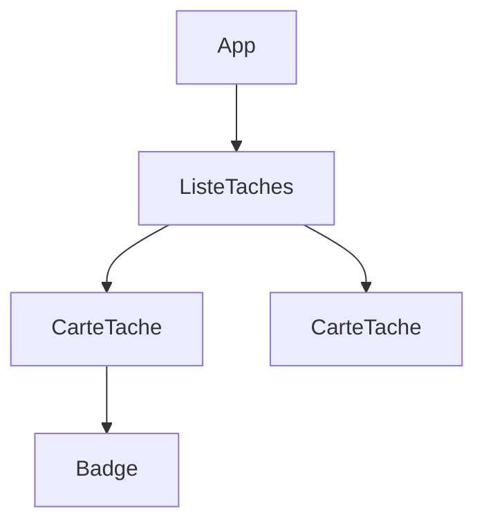

# Composant React

> [!info] En une phrase
> Un composant React est une fonction qui reçoit des données (props) et renvoie du JSX, une syntaxe proche du HTML qui décrit ce qu'il faut afficher.

```dataviewjs
await dv.view("10 — Templates/Scripts/learning", { view: "concept" })
```

## 1 · Comprendre
### Définition
```tsx
function Badge({ statut }: { statut: string }) {
  return <span className={`badge ${statut}`}>{statut}</span>;
}
function CarteTache({ nom, statut }: { nom: string; statut: string }) {
  return (
    <article className="carte">
      <h2>{nom}</h2>
      <Badge statut={statut} />
    </article>
  );
}
```
**JSX** :
- `{ }` insère une expression JavaScript (variable, calcul, appel).
- `className` au lieu de `class`, `htmlFor` au lieu de `for`, événements en camelCase (`onClick`).
- Un composant renvoie **un seul** élément racine (sinon un fragment `<>…</>`).
- Le nom d'un composant commence par une **majuscule** (`<Badge />`), les balises HTML en minuscule.
- Affichage conditionnel : `{erreur && <p>{erreur}</p>}` ou `{ok ? <A /> : <B />}`.

### Pourquoi ça existe
Une interface se répète (cartes, boutons, lignes) : il faut pouvoir écrire un morceau une fois et le réutiliser.

### Le problème résolu
Découper l'interface en pièces simples, testables et réutilisables, chacune dans son fichier.

## 2 · Explorer
### Comment ça fonctionne


### Exemple concret
```tsx
// App.tsx
import CarteTache from "./CarteTache";
export default function App() {
  return (
    <main>
      <h1>Mes tâches</h1>
      <CarteTache nom="Chantier" statut="en-cours" />
      <CarteTache nom="Route" statut="fini" />
    </main>
  );
}
```
JSX est transformé en appels JavaScript (`React.createElement`) par l'outil de build.

### Cas d'utilisation
- Chaque morceau d'une interface React
- Le bouton d'export dans CVAT
- Bibliothèques de composants (boutons, tableaux, fenêtres)

> [!warning] À ne pas confondre
> JSX n'est **pas** du HTML : `class` devient `className`, toute balise doit être fermée (``), et les commentaires s'écrivent `{/* … */}`.

## 3 · Pratiquer
- Découpe une page (en-tête, liste de cartes, pied de page) en quatre composants dans des fichiers séparés

## 4 · Expliquer
> [!quote] Mon résumé, avec mes mots
> _À écrire sans regarder la fiche. Si je bloque, je ne l'ai pas encore compris._

## 5 · Relier
- **Prérequis** : [[React]] · [[HTML]] · [[Fonction fléchée et callback]]
- **Complémentaires** : [[Props React]]

## 6 · Réviser
> [!question] Me faire interroger
> Je demande à Claude de m'interroger sur cette notion pour vérifier que je l'ai comprise.

### Validation de la maîtrise
La notion est maîtrisée quand j'ai réussi **tous les exercices** qui l'utilisent (statut `reussi` dans l'exercice).

```dataviewjs
await dv.view("10 — Templates/Scripts/learning", { view: "maitrise" })
```
