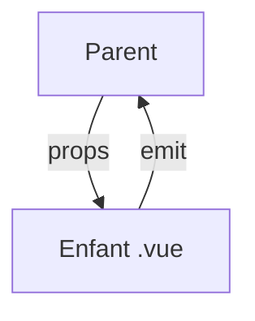

# Composant d'interface

> [!info] En une phrase
> Un composant est un morceau d'interface autonome (sa logique, son HTML, son style) qu'on assemble avec d'autres comme des briques ; Vue, React et Angular reposent tous sur cette idée.

## 1 · Comprendre
### Définition
```vue
<script setup lang="ts">
const props = defineProps<{ nom: string; statut: "a-faire" | "fini" }>();
const emit = defineEmits<{ (e: "choisir", nom: string): void }>();
</script>

<template>
  <article class="carte" @click="emit('choisir', props.nom)">
    <h2>{{ nom }}</h2>
    <span :class="['badge', statut]">{{ statut }}</span>
    <slot />   <!-- contenu passé entre les balises -->
  </article>
</template>

<style scoped>
.carte { padding: 1rem; border-radius: 8px; }
</style>
```
- **Props** (`defineProps`) : données reçues du parent, en lecture seule.
- **Événements** (`defineEmits` puis `emit`) : remonter une information au parent, écouté avec `@choisir="…"`.
- **Slot** : emplacement pour du contenu fourni par le parent.
- `scoped` : le CSS ne s'applique qu'à ce composant.

### Pourquoi ça existe
Garder ensemble tout ce qui concerne un morceau d'interface, tout en séparant clairement HTML, logique et style.

### Le problème résolu
Des composants lisibles et réutilisables, avec un style qui ne fuit pas sur le reste de la page.

## 2 · Explorer
### Comment ça fonctionne


### Exemple concret
```vue
<!-- ListeTaches.vue -->
<script setup lang="ts">
import CarteTache from "./CarteTache.vue";
defineProps<{ taches: { id: number; nom: string; statut: "a-faire" | "fini" }[] }>();
</script>
<template>
  <CarteTache v-for="t in taches" :key="t.id" :nom="t.nom" :statut="t.statut"
              @choisir="(n) => console.log(n)" />
</template>
```

> [!abstract]- Comment ça s'écrit (référence à chercher, pas à apprendre par cœur)
> L'idée est la même partout ; seule l'écriture change.
>
> **Vue (fichier .vue)**
> ```html
> <script setup>
> const props = defineProps({ depense: Object });
> const emit = defineEmits(["supprimer"]);
> </script>
> <template>
>   <li>{{ props.depense.libelle }} <button @click="emit('supprimer')">x</button></li>
> </template>
> ```
>
> **React (fonction + JSX)**
> ```jsx
> function Ligne({ depense, onSupprimer }) {
>   return <li>{depense.libelle} <button onClick={onSupprimer}>x</button></li>;
> }
> ```
> Les données descendent par les props, les événements remontent par une fonction passée en prop.
>
> **Angular (classe + template)**
> ```ts
> @Component({ selector: "app-ligne", template: `<li>{{ depense.libelle }} <button (click)="supprimer.emit()">x</button></li>` })
> export class LigneComponent {
>   @Input() depense!: Depense;
>   @Output() supprimer = new EventEmitter<void>();
> }
> ```

### Cas d'utilisation
- Chaque morceau d'une interface Vue
- Bibliothèques de composants (Vuetify, PrimeVue)

> [!warning] À ne pas confondre
> `:nom="x"` (la valeur de la variable x) et `nom="x"` (la chaîne « x »). Le `:` est le raccourci de `v-bind`, le `@` celui de `v-on`.

## 3 · Relier
- **Prérequis** : [[Vue.js]] · [[CSS]]
- **Complémentaires** : [[Template et liaison de données]] · [[Props React]]
