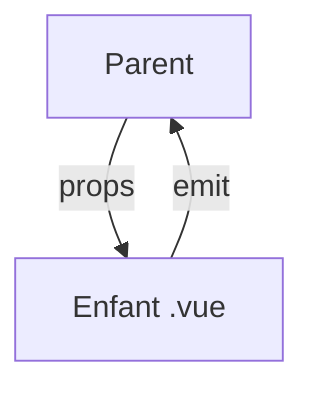

# Composant monofichier Vue (SFC)

> [!info] En une phrase
> Un composant Vue est un fichier .vue avec trois blocs : script (la logique), template (le HTML) et style (le CSS, qu'on peut limiter au composant).

```dataviewjs
await dv.view("10 — Templates/Scripts/learning", { view: "concept" })
```

## 1 · Comprendre
### Définition
```vue
<script setup lang="ts">
const props = defineProps<{ nom: string; statut: "a-faire" | "fini" }>();
const emit = defineEmits<{ (e: "choisir", nom: string): void }>();
</script>

<template>
  <article class="carte" @click="emit('choisir', props.nom)">
    <h2>{{ nom }}</h2>
    <span :class="['badge', statut]">{{ statut }}</span>
    <slot />   <!-- contenu passé entre les balises -->
  </article>
</template>

<style scoped>
.carte { padding: 1rem; border-radius: 8px; }
</style>
```
- **Props** (`defineProps`) : données reçues du parent, en lecture seule.
- **Événements** (`defineEmits` puis `emit`) : remonter une information au parent, écouté avec `@choisir="…"`.
- **Slot** : emplacement pour du contenu fourni par le parent.
- `scoped` : le CSS ne s'applique qu'à ce composant.

### Pourquoi ça existe
Garder ensemble tout ce qui concerne un morceau d'interface, tout en séparant clairement HTML, logique et style.

### Le problème résolu
Des composants lisibles et réutilisables, avec un style qui ne fuit pas sur le reste de la page.

## 2 · Explorer
### Comment ça fonctionne


### Exemple concret
```vue
<!-- ListeTaches.vue -->
<script setup lang="ts">
import CarteTache from "./CarteTache.vue";
defineProps<{ taches: { id: number; nom: string; statut: "a-faire" | "fini" }[] }>();
</script>
<template>
  <CarteTache v-for="t in taches" :key="t.id" :nom="t.nom" :statut="t.statut"
              @choisir="(n) => console.log(n)" />
</template>
```

### Cas d'utilisation
- Chaque morceau d'une interface Vue
- Bibliothèques de composants (Vuetify, PrimeVue)

> [!warning] À ne pas confondre
> `:nom="x"` (la valeur de la variable x) et `nom="x"` (la chaîne « x »). Le `:` est le raccourci de `v-bind`, le `@` celui de `v-on`.

## 3 · Pratiquer
- Découpe une page en trois composants `.vue` avec props, un événement et un slot

## 4 · Expliquer
> [!quote] Mon résumé, avec mes mots
> _À écrire sans regarder la fiche. Si je bloque, je ne l'ai pas encore compris._

## 5 · Relier
- **Prérequis** : [[Vue.js]] · [[CSS]]
- **Complémentaires** : [[Directives Vue]] · [[Props React]]

## 6 · Réviser
> [!question] Me faire interroger
> Je demande à Claude de m'interroger sur cette notion pour vérifier que je l'ai comprise.

### Validation de la maîtrise
La notion est maîtrisée quand j'ai réussi **tous les exercices** qui l'utilisent (statut `reussi` dans l'exercice).

```dataviewjs
await dv.view("10 — Templates/Scripts/learning", { view: "maitrise" })
```
