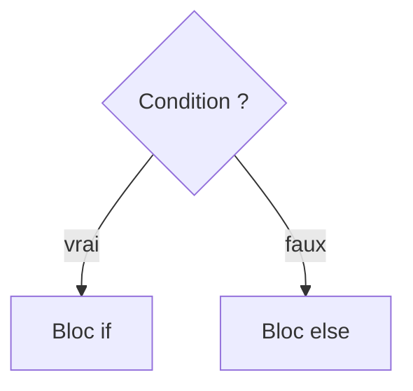

# Condition (if)

> [!info] En une phrase
> Faire une chose seulement si une condition est vraie, et autre chose sinon.

```dataviewjs
await dv.view("10 — Templates/Scripts/learning", { view: "concept" })
```

## 1 · Comprendre
### Définition
`if` teste une expression qui vaut `True` ou `False`. Le bloc indenté dessous ne s'exécute que si elle est vraie. `elif` ajoute un autre cas, `else` le cas par défaut.

### Pourquoi ça existe
Un programme doit réagir à la situation : le fichier existe-t-il ? Est-ce un `.png` ? L'archive est-elle trop grosse ?

### Le problème résolu
Sans condition, un programme ferait toujours exactement la même chose, quel que soit son entrée.

## 2 · Explorer
### Comment ça fonctionne

| Opérateur | Sens |
| --- | --- |
| `==`, `!=` | égal, différent |
| `<`, `>`, `<=`, `>=` | comparaisons |
| `and`, `or`, `not` | combiner |
| `in` | « est dans » : `".png" in nom` |

### Exemple concret
```python
extension = ".png"
taille_mo = 120

if extension == ".png" and taille_mo < 100:
    print("Image à zipper")
elif extension == ".png":
    print("Image trop lourde, ignorée")
else:
    print("Pas une image")
```

### Cas d'utilisation
- Ne traiter que certains types de fichiers
- Vérifier qu'un dossier existe avant de travailler dedans

> [!warning] À ne pas confondre
> L'indentation fait partie du code : une ligne mal indentée sort du bloc `if` ou provoque `IndentationError`. Et `if x = 3` (erreur) au lieu de `if x == 3`.

## 3 · Pratiquer

### Exercice visuel

Sur Excalidraw, **sans regarder la fiche**. Puis je compare avec la fiche, je corrige en rouge ce qui était faux, et j'explique mon dessin avec mes mots (section 4).

> [!example] 🧠 Dessine de mémoire
> Dessine un aiguillage : une dépense arrive, `if montant > 100`, `elif`, `else`. Montre le chemin de trois dépenses différentes.

> [!example] 🔄 Change de contexte
> Redessine le même tri dans un template Vue avec `v-if`. Où se fait le test cette fois ?

### Mon schéma

> [!tip] Mon dessin Excalidraw
> _Je crée le dessin « Schéma - Condition (if) » et je l'intègre ici avec `![[Schéma - Condition (if).excalidraw]]`._

### Appliquer dans le fil rouge
- [[Dépenses 02 - Classer les dépenses]]

## 4 · Expliquer
> [!quote] Mon résumé, avec mes mots
> _J'explique mon schéma avec mes mots, sans regarder la fiche. Si je bloque, je ne l'ai pas encore compris._

## 5 · Relier
- **Prérequis** : [[Variables et types en Python]]
- **Complémentaires** : [[Boucle (for, while)]]
- **Utilisé par** : [[Fonction]] · [[Exception]]

## 6 · Réviser
> [!question] Me faire interroger
> Je demande à Claude de m'interroger sur cette notion pour vérifier que je l'ai comprise.

### Validation de la maîtrise
La notion est maîtrisée quand je sais :
1. **l'expliquer** de façon fluide, à partir de mon schéma (section 4) ;
2. **l'adapter** à un autre contexte (consigne « Change de contexte », ou Claude m'interroge sur un autre cas) ;
3. **l'appliquer** pour de vrai dans le fil rouge (section 3).

Réussir un exercice ne suffit pas. C'est moi qui passe le statut en `maitrise`.

```dataviewjs
await dv.view("10 — Templates/Scripts/learning", { view: "maitrise" })
```
