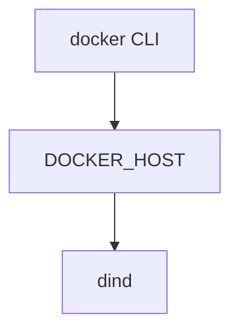

# Construire une image dans la CI

> [!info] En une phrase
> Un job tourne déjà dans un conteneur : pour y construire une image, on lance un démon Docker à côté (Docker-in-Docker) ou on utilise un outil sans démon (Kaniko).

## 1 · Comprendre
### Définition
**Docker-in-Docker** (`dind`) : le job utilise l'image `docker` (le client) et un **service** `docker:dind` (le démon), puis fait `docker login`, `docker build`, `docker push`.

### Pourquoi ça existe
Que la CI construise et publie les images à chaque version, sans passer par le poste d'un développeur.

### Le problème résolu
Les images étaient construites à la main sur un poste et poussées sans trace : impossible de savoir quel code était dedans.

## 2 · Explorer
### Comment ça fonctionne


### Pourquoi il faut un démon à côté
La commande `docker` n'est qu'un **client** : elle envoie des ordres au [[Démon Docker]]. Le job tourne lui-même dans un conteneur, sans démon. Le service `docker:dind` en lance un dans un conteneur voisin, et le client s'y connecte par le réseau via la variable `DOCKER_HOST`.


- `DOCKER_HOST: tcp://docker:2376` : où est le démon (le service s'appelle `docker`).
- `DOCKER_TLS_CERTDIR: "/certs"` : chiffre la connexion client-démon (valeur par défaut des images récentes).
- Le runner doit être en mode **privilégié** pour dind ; sinon, [[Kaniko]].
- Le démon dind est **neuf à chaque job** : pas de cache d'un job à l'autre, sauf `--cache-from` avec une image déjà poussée.

### Exemple concret
```yaml
build-image:
  image: docker:24
  services:
    - docker:24-dind
  script:
    - echo "$CI_REGISTRY_PASSWORD" | docker login -u "$CI_REGISTRY_USER" --password-stdin "$CI_REGISTRY"
    - docker build -t "$CI_REGISTRY_IMAGE:$CI_COMMIT_SHORT_SHA" .
    - docker push "$CI_REGISTRY_IMAGE:$CI_COMMIT_SHORT_SHA"
```
Un projet avec plusieurs Dockerfile demande un `docker build -f` par image, souvent un job par image.

### Cas d'utilisation
- Publier une image à chaque merge sur `main`

> [!warning] À ne pas confondre
> `image:` (le conteneur où tourne le job) et `services:` (des conteneurs annexes à côté du job, ici le démon Docker).

## 3 · Relier
- **Au travail** : [Construire une image dans la CI au travail](obsidian://open?vault=Travail&file=Construire%20une%20image%20dans%20la%20CI%20au%20travail)
- **Prérequis** : [[Pipeline GitLab CI]] · [[Dockerfile]] · [[Registre Docker]]
- **Notion parente** : [[Pipeline GitLab CI]]
- **Complémentaires** : [[Kaniko]] · [[Variables CI-CD GitLab]]
- **Commandes** : [[docker build]] · [[docker login]] · [[docker push]]
