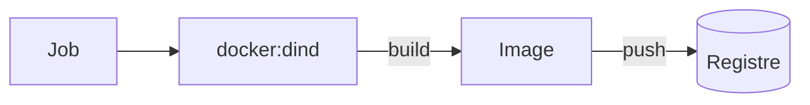

# Construire une image dans la CI

> [!info] En une phrase
> Un job tourne déjà dans un conteneur : pour y construire une image, on lance un démon Docker à côté (Docker-in-Docker) ou on utilise un outil sans démon (Kaniko).

```dataviewjs
await dv.view("10 — Templates/Scripts/learning", { view: "concept" })
```

## 1 · Comprendre
### Définition
**Docker-in-Docker** (`dind`) : le job utilise l'image `docker` (le client) et un **service** `docker:dind` (le démon), puis fait `docker login`, `docker build`, `docker push`.

### Pourquoi ça existe
Que la CI construise et publie les images à chaque version, sans passer par le poste d'un développeur.

### Le problème résolu
Les images étaient construites à la main sur un poste et poussées sans trace : impossible de savoir quel code était dedans.

## 2 · Explorer
### Comment ça fonctionne


### Exemple concret
```yaml
build-image:
  image: docker:24
  services:
    - docker:24-dind
  script:
    - echo "$CI_REGISTRY_PASSWORD" | docker login -u "$CI_REGISTRY_USER" --password-stdin "$CI_REGISTRY"
    - docker build -t "$CI_REGISTRY_IMAGE:$CI_COMMIT_SHORT_SHA" .
    - docker push "$CI_REGISTRY_IMAGE:$CI_COMMIT_SHORT_SHA"
```
Un projet avec plusieurs Dockerfile demande un `docker build -f` par image, souvent un job par image.

### Cas d'utilisation
- Publier une image à chaque merge sur `main`
- Projet CVAT : partie 1 (reprendre CVAT sur GitLab, construire ses images en CI via le Nexus)

> [!warning] À ne pas confondre
> `image:` (le conteneur où tourne le job) et `services:` (des conteneurs annexes à côté du job, ici le démon Docker).

## 3 · Pratiquer
- Demande à ton équipe si les runners autorisent le mode privilégié. Si oui, essaie le job ci-dessus sur un petit projet ; sinon, passe à [[Kaniko]].

## 4 · Expliquer
> [!quote] Mon résumé, avec mes mots
> _À écrire sans regarder la fiche. Si je bloque, je ne l'ai pas encore compris._

## 5 · Relier
- **Prérequis** : [[Pipeline GitLab CI]] · [[Dockerfile]] · [[Registre Docker]]
- **Notion parente** : [[Pipeline GitLab CI]]
- **Complémentaires** : [[Kaniko]] · [[Nexus]] · [[Variables CI-CD GitLab]]
- **Commandes** : [[docker build]] · [[docker login]] · [[docker push]]

## 6 · Réviser
> [!question] Me faire interroger
> Je demande à Claude de m'interroger sur cette notion pour vérifier que je l'ai comprise.

### Validation de la maîtrise
- [ ] Je l'explique sans notes, en 3 phrases, à quelqu'un qui ne connaît pas
- [ ] J'ai réussi un exercice qui l'utilise
- [ ] Je l'ai utilisé dans un projet
- [ ] Je sais dire quand ne pas l'utiliser (ou ce qu'il ne faut pas confondre)
