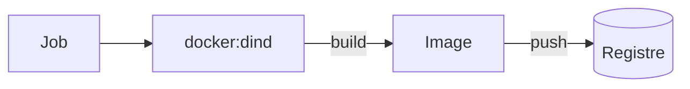
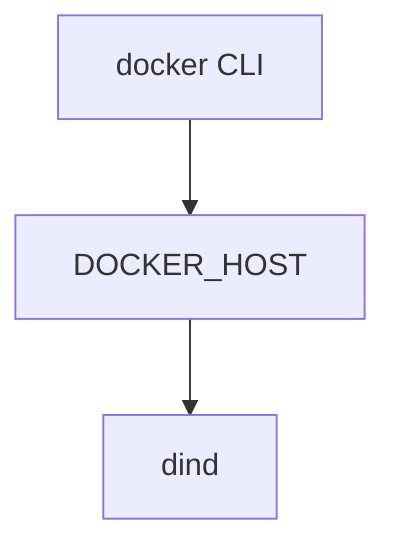

# Construire une image dans la CI

> [!info] En une phrase
> Un job tourne déjà dans un conteneur : pour y construire une image, on lance un démon Docker à côté (Docker-in-Docker) ou on utilise un outil sans démon (Kaniko).

```dataviewjs
await dv.view("10 — Templates/Scripts/learning", { view: "concept" })
```

## 1 · Comprendre
### Définition
**Docker-in-Docker** (`dind`) : le job utilise l'image `docker` (le client) et un **service** `docker:dind` (le démon), puis fait `docker login`, `docker build`, `docker push`.

### Pourquoi ça existe
Que la CI construise et publie les images à chaque version, sans passer par le poste d'un développeur.

### Le problème résolu
Les images étaient construites à la main sur un poste et poussées sans trace : impossible de savoir quel code était dedans.

## 2 · Explorer
### Comment ça fonctionne


### Pourquoi il faut un démon à côté
La commande `docker` n'est qu'un **client** : elle envoie des ordres au [[Démon Docker]]. Le job tourne lui-même dans un conteneur, sans démon. Le service `docker:dind` en lance un dans un conteneur voisin, et le client s'y connecte par le réseau via la variable `DOCKER_HOST`.


- `DOCKER_HOST: tcp://docker:2376` : où est le démon (le service s'appelle `docker`).
- `DOCKER_TLS_CERTDIR: "/certs"` : chiffre la connexion client-démon (valeur par défaut des images récentes).
- Le runner doit être en mode **privilégié** pour dind ; sinon, [[Kaniko]].
- Le démon dind est **neuf à chaque job** : pas de cache d'un job à l'autre, sauf `--cache-from` avec une image déjà poussée.
- Les images des services (`docker:dind`) viennent aussi d'un registre : derrière un Nexus, il faut les préfixer aussi.

### Exemple concret
```yaml
build-image:
  image: docker:24
  services:
    - docker:24-dind
  script:
    - echo "$CI_REGISTRY_PASSWORD" | docker login -u "$CI_REGISTRY_USER" --password-stdin "$CI_REGISTRY"
    - docker build -t "$CI_REGISTRY_IMAGE:$CI_COMMIT_SHORT_SHA" .
    - docker push "$CI_REGISTRY_IMAGE:$CI_COMMIT_SHORT_SHA"
```
Un projet avec plusieurs Dockerfile demande un `docker build -f` par image, souvent un job par image.

### Cas d'utilisation
- Publier une image à chaque merge sur `main`
- Projet CVAT : partie 1 (reprendre CVAT sur GitLab, construire ses images en CI via le Nexus)

> [!warning] À ne pas confondre
> `image:` (le conteneur où tourne le job) et `services:` (des conteneurs annexes à côté du job, ici le démon Docker).

## 3 · Pratiquer

### Exercice visuel

Sur Excalidraw, **sans regarder la fiche**. Puis je compare avec la fiche, je corrige en rouge ce qui était faux, et j'explique mon dessin avec mes mots (section 4).

> [!example] 🛣️ Suis le trajet
> Dessine un job `build-image` : le conteneur du job, le service Docker-in-Docker à côté, le push vers le registre.

> [!example] 🔄 Change de contexte
> Redessine le même job avec Kaniko. Qu'est-ce qui disparaît du dessin ?

### Mon schéma

> [!tip] Mon dessin Excalidraw
> _Je crée le dessin « Schéma - Construire une image dans la CI » et je l'intègre ici avec `![[Schéma - Construire une image dans la CI.excalidraw]]`._

### Appliquer dans le fil rouge
- [[MesDépenses 08 - La CI de l'API]]
- [[Fil rouge 06 - Construire l'image dans la CI]]

## 4 · Expliquer
> [!quote] Mon résumé, avec mes mots
> _J'explique mon schéma avec mes mots, sans regarder la fiche. Si je bloque, je ne l'ai pas encore compris._

## 5 · Relier
- **Prérequis** : [[Pipeline GitLab CI]] · [[Dockerfile]] · [[Registre Docker]]
- **Notion parente** : [[Pipeline GitLab CI]]
- **Complémentaires** : [[Kaniko]] · [[Nexus]] · [[Variables CI-CD GitLab]]
- **Commandes** : [[docker build]] · [[docker login]] · [[docker push]]

## 6 · Réviser
> [!question] Me faire interroger
> Je demande à Claude de m'interroger sur cette notion pour vérifier que je l'ai comprise.

### Validation de la maîtrise
La notion est maîtrisée quand je sais :
1. **l'expliquer** de façon fluide, à partir de mon schéma (section 4) ;
2. **l'adapter** à un autre contexte (consigne « Change de contexte », ou Claude m'interroge sur un autre cas) ;
3. **l'appliquer** pour de vrai dans le fil rouge (section 3).

Réussir un exercice ne suffit pas. C'est moi qui passe le statut en `maitrise`.

```dataviewjs
await dv.view("10 — Templates/Scripts/learning", { view: "maitrise" })
```
