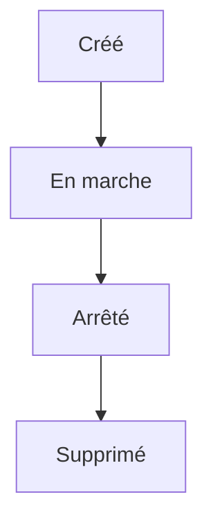

# Conteneur

> [!info] En une phrase
> Une instance isolée et jetable d'une image Docker, en cours d'exécution : un processus dans sa bulle.

```dataviewjs
await dv.view("10 — Templates/Scripts/learning", { view: "concept" })
```

## 1 · Comprendre
### Définition
Un **conteneur** a son propre système de fichiers, ses processus et son réseau, mais partage le noyau de la machine hôte. On peut en lancer plusieurs à partir de la même image.

Concrètement, c'est **un processus** (ton script, un serveur) lancé dans une bulle isolée, avec une couche **modifiable** posée sur l'image en lecture seule.

### Pourquoi ça existe
Lancer une application dans un environnement propre et identique à chaque fois, sans rien installer sur la machine.

### Le problème résolu
Les applications installées directement sur une machine se marchent dessus (versions, ports, fichiers) et laissent des traces quand on les retire.

## 2 · Explorer
### Comment ça fonctionne

- Un conteneur **vit tant que son processus principal** (le `CMD`) tourne. Un script Python qui se termine arrête le conteneur : c'est normal.
- Son **code de sortie** est celui du processus (`Exited (0)` = succès), voir [[Code de sortie]].
- Ce qu'il écrit dans sa couche disparaît avec lui : les données à garder vont dans un [[Volume Docker]].
- Il ne voit **pas** les fichiers de ta machine, sauf ceux que tu montes avec `-v`.

### Exemple concret
```bash
docker run --rm python:3.12-slim python -c "print('bonjour')"   # lance, affiche, se supprime
docker run -it --rm python:3.12-slim bash                        # un shell dedans pour explorer
docker run -d --name web -p 8080:80 nginx                        # en arrière-plan
docker ps -a                       # tous les conteneurs, même arrêtés, avec leur état
docker logs web                    # ce qu'il a affiché
docker exec -it web sh             # ouvrir un shell dans un conteneur qui tourne
docker stop web && docker rm web   # arrêter puis supprimer
```

| Option de `docker run` | Rôle |
| --- | --- |
| `--rm` | supprime le conteneur quand il s'arrête |
| `-it` | interactif avec un terminal (pour un shell) |
| `-d` | en arrière-plan |
| `-e NOM=valeur` | une [[Variable d'environnement]] |
| `-v hôte:conteneur` | monter un dossier, voir [[Volume Docker]] |
| `-p hôte:conteneur` | publier un [[Port]] |

### Cas d'utilisation
- Lancer un script une fois sur des fichiers (`--rm`)
- Faire tourner un service (base de données, serveur web) en arrière-plan

> [!warning] À ne pas confondre
> `docker run` (crée un **nouveau** conteneur) et `docker exec` (entre dans un conteneur **qui tourne déjà**). Et un conteneur arrêté n'est pas supprimé : `docker ps -a` le montre encore.

## 3 · Pratiquer
- Lance un conteneur `python:3.12-slim` avec un shell, crée un fichier dedans, sors, relance : le fichier est-il là ?
- Lance un conteneur qui échoue (`python -c "import sys; sys.exit(3)"`) et retrouve son code dans `docker ps -a`.

## 4 · Expliquer
> [!quote] Mon résumé, avec mes mots
> _À écrire sans regarder la fiche. Si je bloque, je ne l'ai pas encore compris._

## 5 · Relier
- **Prérequis** : [[Image Docker]]
- **Complémentaires** : [[Volume Docker]] · [[Port]] · [[Variable d'environnement]]
- **Utilisé par** : [[Python dans Docker]] · [[Docker Compose]]
- **Commandes** : [[docker run]] · [[docker ps]]

## 6 · Réviser
> [!question] Me faire interroger
> Je demande à Claude de m'interroger sur cette notion pour vérifier que je l'ai comprise.

### Validation de la maîtrise
La notion est maîtrisée quand j'ai réussi **tous les exercices** qui l'utilisent (statut `reussi` dans l'exercice).

```dataviewjs
await dv.view("10 — Templates/Scripts/learning", { view: "maitrise" })
```
