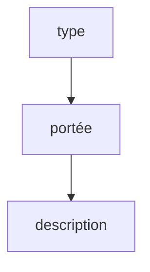

# Convention de commit

> [!info] En une phrase
> Une règle d'écriture des messages de commit (type: description) qui rend l'historique lisible et permet de générer un changelog.

```dataviewjs
await dv.view("10 — Templates/Scripts/learning", { view: "concept" })
```

## 1 · Comprendre
### Définition
Les **Conventional Commits** imposent la forme `type(portée facultative): description courte`. Le **type** dit la nature du changement :

| Type | Pour |
| --- | --- |
| `feat` | une nouvelle fonctionnalité |
| `fix` | une correction de bug |
| `ci` | la configuration de la CI (`.gitlab-ci.yml`) |
| `build` | le build, les Dockerfile, les dépendances |
| `docs` | la documentation |
| `test` | les tests |
| `refactor` | réorganiser le code sans changer son comportement |
| `chore` | l'entretien divers |

### Pourquoi ça existe
Comprendre d'un coup d'œil ce que fait chaque commit, et automatiser (changelog, numéro de version).

### Le problème résolu
Des historiques remplis de « modif », « ça marche », « wip » : impossible de retrouver quand et pourquoi un changement a été fait.

## 2 · Explorer
### Comment ça fonctionne


### Exemple concret
```text
ci: récupère les images de base depuis le Nexus
fix(export): corrige le nom de l'archive quand le dossier contient des espaces
build: rend entrypoint.sh exécutable
feat(ui): ajoute le bouton « Générer le plan »
```
Règles pratiques : l'impératif ou le présent, pas de point final, une ligne courte (≈ 70 caractères). Le détail du **pourquoi** va dans le corps, après une ligne vide.

### Cas d'utilisation
- Projet CVAT : les commits de la CI GitLab (`ci:`) et des corrections (`fix:`)
- Générer le [[Changelog]]

> [!warning] À ne pas confondre
> `fix` (corrige un bug du produit) et `ci` (change la pipeline). Un commit qui mélange les deux devrait être **deux** commits : un changement = un commit.

## 3 · Pratiquer
- Relis tes 10 derniers commits et réécris leur message (sur papier) au format conventionnel.
- Regarde l'historique de CVAT (`git log --oneline`) : quels types y trouves-tu ?

## 4 · Expliquer
> [!quote] Mon résumé, avec mes mots
> _À écrire sans regarder la fiche. Si je bloque, je ne l'ai pas encore compris._

## 5 · Relier
- **Prérequis** : [[Commit]]
- **Complémentaires** : [[Changelog]] · [[Tag Git]]
- **Commandes** : [[git commit]] · [[git diff]]

## 6 · Réviser
> [!question] Me faire interroger
> Je demande à Claude de m'interroger sur cette notion pour vérifier que je l'ai comprise.

### Validation de la maîtrise
- [ ] Je l'explique sans notes, en 3 phrases, à quelqu'un qui ne connaît pas
- [ ] J'ai réussi un exercice qui l'utilise
- [ ] Je l'ai utilisé dans un projet
- [ ] Je sais dire quand ne pas l'utiliser (ou ce qu'il ne faut pas confondre)
