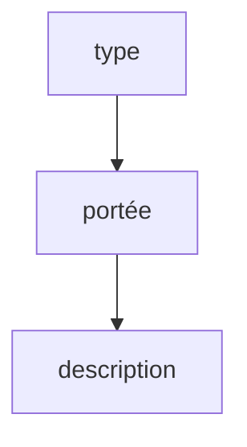

# Convention de commit

> [!info] En une phrase
> Une règle d'écriture des messages de commit (type: description) qui rend l'historique lisible et permet de générer un changelog.

```dataviewjs
await dv.view("10 — Templates/Scripts/learning", { view: "concept" })
```

## 1 · Comprendre
### Définition
Les **Conventional Commits** imposent la forme `type(portée facultative): description courte`. Le **type** dit la nature du changement :

| Type | Pour |
| --- | --- |
| `feat` | une nouvelle fonctionnalité |
| `fix` | une correction de bug |
| `ci` | la configuration de la CI (`.gitlab-ci.yml`) |
| `build` | le build, les Dockerfile, les dépendances |
| `docs` | la documentation |
| `test` | les tests |
| `refactor` | réorganiser le code sans changer son comportement |
| `style` | la mise en forme du code (espaces, formatage), sans changer le comportement |
| `perf` | rendre plus rapide ou plus léger |
| `chore` | l'entretien divers (`.gitignore`, nettoyage) |
| `revert` | annuler un commit précédent |

Un `!` après le type (`feat!:`) ou un pied de page `BREAKING CHANGE:` signale un changement **cassant**.

> [!example] Plein d'exemples
> Tous les types, des messages complets et des « mauvais → bons » : [[Exemples de commits conventionnels]].

### Pourquoi ça existe
Comprendre d'un coup d'œil ce que fait chaque commit, et automatiser (changelog, numéro de version).

### Le problème résolu
Des historiques remplis de « modif », « ça marche », « wip » : impossible de retrouver quand et pourquoi un changement a été fait.

## 2 · Explorer
### Comment ça fonctionne


### Exemple concret
```text
ci: récupère les images de base depuis le registre interne
fix(export): corrige le nom de l'archive quand le dossier contient des espaces
build: rend entrypoint.sh exécutable
feat(ui): ajoute le bouton « Générer le plan »
```
Règles pratiques : l'impératif ou le présent, pas de point final, une ligne courte (≈ 70 caractères). Le détail du **pourquoi** va dans le corps, après une ligne vide.

### Cas d'utilisation
- Générer le [[Changelog]]

> [!warning] À ne pas confondre
> `fix` (corrige un bug du produit) et `ci` (change la pipeline). Un commit qui mélange les deux devrait être **deux** commits : un changement = un commit.

## 3 · Pratiquer

### Exercice visuel

Sur Excalidraw, **sans regarder la fiche**. Puis je compare avec la fiche, je corrige en rouge ce qui était faux, et j'explique mon dessin à voix haute ou à Claude dans le chat.

> [!example] 🧠 Dessine de mémoire
> Dessine trois commits de ton application (une fonctionnalité, une correction, de la doc). Écris leur message au bon format et entoure le type.

> [!example] 🔄 Change de contexte
> Redessine-les comme les verrait un outil qui génère le changelog. Quel type fait monter quelle partie de la version ?

### Mon schéma

> [!tip] Mon dessin Excalidraw
> _Je crée le dessin « Schéma - Convention de commit » et je l'intègre ici avec `![[Schéma - Convention de commit.excalidraw]]`, puis je coche `schema`._

### Appliquer dans le fil rouge
- [[MesDépenses 07 - Travailler en branche]]
- [[Fil rouge 04 - Ranger le projet dans Git]]

## 4 · Relier
- **Au travail** : [Convention de commit au travail](obsidian://open?vault=Travail&file=Convention%20de%20commit%20au%20travail)
- **Prérequis** : [[Commit]]
- **Complémentaires** : [[Changelog]] · [[Tag Git]]
- **Commandes** : [[git commit]] · [[git diff]]
- **Ressource** : [[Exemples de commits conventionnels]]

## 5 · Réviser
> [!question] Me faire interroger
> Je demande à Claude de m'interroger sur cette notion pour vérifier que je l'ai comprise.

### Validation (compris, puis maîtrisé)
Trois cases à cocher dans les propriétés de la fiche :
- `schema` : mon dessin du concept est dans « Mon schéma » ;
- `exercice_visuel` : j'ai fait et corrigé les exercices visuels de la section 3 ;
- `fil_rouge` : je l'ai appliqué dans le fil rouge (coché tout seul quand une étape qui l'utilise est réussie).

Les trois cochées : la notion compte comme **comprise**. **Maîtrisé** : c'est moi qui le mets dans `status`, quand je le sens.

```dataviewjs
await dv.view("10 — Templates/Scripts/learning", { view: "maitrise" })
```
