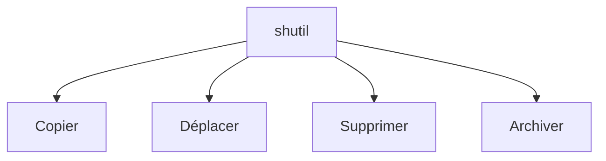

# Copier et déplacer des fichiers (shutil)

> [!info] En une phrase
> shutil fait en Python ce que tu fais dans l'explorateur : copier, déplacer, supprimer des dossiers entiers, créer une archive en une ligne.

```dataviewjs
await dv.view("10 — Templates/Scripts/learning", { view: "concept" })
```

## 1 · Comprendre
### Définition
`shutil` (*shell utilities*, bibliothèque standard) regroupe les opérations « haut niveau » sur les fichiers et les dossiers, celles qui en touchent plusieurs à la fois.

### Pourquoi ça existe
`pathlib` gère surtout **un** chemin ; `shutil` gère les opérations complètes (copier un dossier et tout son contenu, déplacer, supprimer un arbre).

### Le problème résolu
Recoder à la main la copie récursive d'un dossier, fichier par fichier, avec les erreurs que ça implique.

## 2 · Explorer
### Comment ça fonctionne

| Fonction | Fait |
| --- | --- |
| `shutil.copy2(src, dst)` | copie un fichier (avec sa date) |
| `shutil.copytree(src, dst)` | copie un dossier entier |
| `shutil.move(src, dst)` | déplace ou renomme |
| `shutil.rmtree(dossier)` | **supprime** un dossier et tout son contenu |
| `shutil.make_archive(nom, "zip", dossier)` | crée `nom.zip` à partir d'un dossier |
| `shutil.disk_usage(".")` | espace disque libre |

### Exemple concret
```python
import shutil
from pathlib import Path

travail = Path("travail")
shutil.copytree("donnees", travail, dirs_exist_ok=True)   # copie de sécurité

for f in travail.glob("*.tmp"):
    f.unlink()                                             # supprimer un fichier : pathlib

shutil.make_archive("export", "zip", root_dir=travail)     # crée export.zip
shutil.rmtree(travail)                                     # nettoyage
```

### Cas d'utilisation
- Préparer un dossier temporaire avant de zipper
- Déplacer les fichiers traités dans un dossier `archives/`
- Archive simple d'un dossier entier (pour un contrôle fin, voir [[Archive zip (zipfile)]])

> [!warning] À ne pas confondre
> `rmtree` ne passe pas par la corbeille : c'est **définitif**. Teste toujours sur un dossier de test, et affiche le chemin avant de supprimer. Et `copy` (fichier) ≠ `copytree` (dossier).

## 3 · Pratiquer

### Exercice visuel

Sur Excalidraw, **sans regarder la fiche**. Puis je compare avec la fiche, je corrige en rouge ce qui était faux, et j'explique mon dessin à voix haute ou à Claude dans le chat.

> [!example] ⚖️ Avant / après
> Avant / après : un dossier `entrée` avec trois fichiers, puis après `copy`, `move` et `rmtree`. Dessine ce qui reste et où.

> [!example] 🛣️ Suis le trajet
> Dessine le trajet d'un fichier déplacé par `shutil.move` vers un autre disque : est-ce un renommage ou une copie puis une suppression ?

### Mon schéma

> [!tip] Mon dessin Excalidraw
> _Je crée le dessin « Schéma - Copier et déplacer des fichiers (shutil) » et je l'intègre ici avec `![[Schéma - Copier et déplacer des fichiers (shutil).excalidraw]]`, puis je coche `schema`._

### Appliquer dans le fil rouge
- [[MesDépenses 13 - Sauvegarder la base avec un script]]

## 4 · Relier
- **Prérequis** : [[Chemin de fichier]]
- **Complémentaires** : [[Archive zip (zipfile)]]
- **Utilisé par** : [[Cours - Manipuler des fichiers et des archives]]

## 5 · Réviser
> [!question] Me faire interroger
> Je demande à Claude de m'interroger sur cette notion pour vérifier que je l'ai comprise.

### Validation (compris, puis maîtrisé)
Trois cases à cocher dans les propriétés de la fiche :
- `schema` : mon dessin du concept est dans « Mon schéma » ;
- `exercice_visuel` : j'ai fait et corrigé les exercices visuels de la section 3 ;
- `fil_rouge` : je l'ai appliqué dans le fil rouge (coché tout seul quand une étape qui l'utilise est réussie).

Les trois cochées : la notion compte comme **comprise**. **Maîtrisé** : c'est moi qui le mets dans `status`, quand je le sens.

```dataviewjs
await dv.view("10 — Templates/Scripts/learning", { view: "maitrise" })
```
